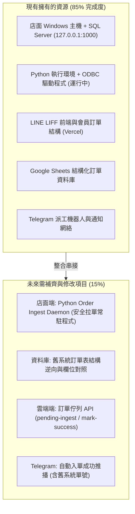
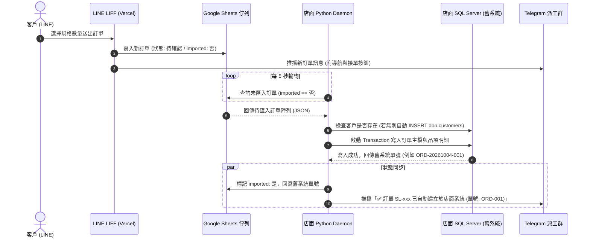
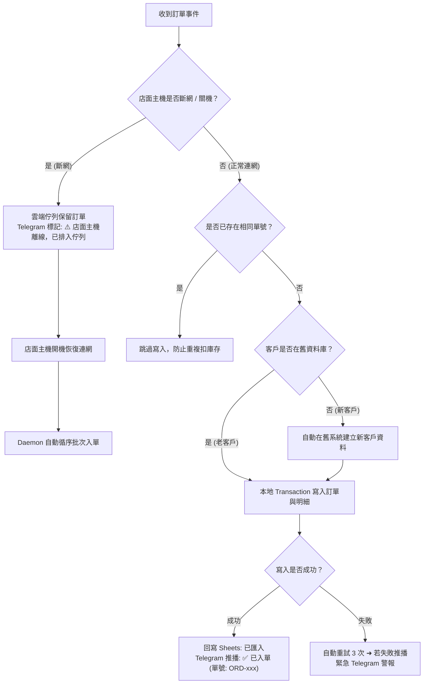

# 盛隆瓦斯：LINE 叫瓦斯自動匯入舊進銷存系統專案計畫報告書

> **專案代號**：`SL-AUTO-INGEST-2026`  
> **編撰日期**：2026 年 10 月  
> **系統範圍**：LINE LIFF 叫瓦斯系統 ⇄ 雲端 API ⇄ 店面 Windows 主機（SQL Server 127.0.0.1:1000）  
> **版本**：v1.0 正式版  

---

## 1. 專案摘要（Executive Summary）

### 1.1 核心目標
本專案旨在打通「線上叫瓦斯」到「店面進銷存系統」的最後一哩路，實現**客戶在 LINE 送出訂單後，3～10 秒內全自動於店面舊進銷存系統建立叫貨/出貨單並完成庫存扣減**，徹底取代現行「人工看 Telegram 訊息、手動在電腦打單」的作業模式。

### 1.2 預期效益
- **人工鍵單時間降為 0**：節省每日早/晚叫氣尖峰 1.5 ~ 2.5 小時的人工作業。
- **抄單錯誤率降為 0**：杜絕人工打錯電話、地址、單價、折抵金額與鋼瓶規格的客訴。
- **即時庫存與帳目同步**：出貨紀錄秒級入帳，鋼瓶動態與每日營收帳目零延遲。

---

## 2. 現有資源 vs 未來需求全盤比對



### 2.1 【目前我們有的】（既有資產與技術基底）

| 類別 | 項目名稱 | 現有狀態與技術規格 | 專案可用價值 |
|---|---|---|---|
| **硬體主機** | 店面主力電腦 | Windows PC，日常營業開機運作，配置固定內網 IP | 具備充足運算效能，無需額外採購主機 |
| **資料庫** | Microsoft SQL Server | `127.0.0.1:1000`，資料庫名稱與 `sa` 連線權限已具備 | 核心業務資料庫，具備交易（Transaction）支援 |
| **執行環境** | 本地 Python 環境 | 已配置 Python 3.10+、ODBC Driver 18 for SQL Server | 現行備份腳本已正常運行，可直接擴充 Daemon |
| **前端應用** | LINE LIFF 叫瓦斯系統 | 網址正常運行中，支援歷史價格、地址防呆、取消訂單 | 已產生完整結構化訂單（規格、數量、單價、地址） |
| **中樞儲存** | Google Sheets 雲端表 | `訂單`、`訂單明細`、`會員資料` 三張主表正常讀寫 | 可直接作為訂單佇列緩衝（Queue Buffer） |
| **派工告警** | Telegram Bot 體系 | `@shenglong_gas_bot` 訂單群、警報群、匯報中心完整運作 | 可即時推播入單成功通知與異常告警 |

### 2.2 【未來需要的】（硬體、網路、權限與修改清單）

| 類別 | 項目名稱 | 規格需求 / 採購成本 | 說明與具體行動 |
|---|---|---|---|
| **硬體設備** | 主機與網路 | **$0 元（沿用現有設備）** | 現有電腦即可，**無需固定 IP，免開防火牆 Port** |
| **輔助硬體** | 小型不斷電系統（UPS） | 約 NT$ 1,500 ~ 2,500（建議選配） | 預防店面突發跳電造成寫入中断與硬碟損傷 |
| **軟體開發** | 本地 Ingest Daemon | 自行開發（Python 腳本） | 常駐背景，每 5 秒向雲端拉取未入庫訂單並寫入 SQL |
| **API 擴充** | 雲端佇列端點 | 自行開發（Vercel Serverless） | 新增 `pending-ingest-orders` 與 `mark-ingest-success` |
| **資料庫對齊** | 舊系統訂單欄位逆向 | 需店面主機執行一次檢測腳本 | 取得舊進銷存訂單主檔與明細檔之欄位名稱與規格編碼 |

---

## 3. 系統整體架構與運作流程

本計畫採用安全規格最高的**「主動輪詢拉取模式（Pull-Agent Architecture）」**：由店面主機單向連線雲端查詢，外網完全無法連入店面電腦，兼顧極速入單與金融級資安。



---

## 4. 核心模組技術規格

### 4.1 模組 A：店面本地「自動入單守護程式」（Ingest Daemon）
- **程式檔案**：`shenglong_order_ingest_daemon.py`
- **運行模式**：Windows 背景 Service 或排程器常駐（開機自動啟動）。
- **關鍵運作邏輯**：
  1. **取單循環**：透過 HTTPS 每 5 秒呼叫雲端端點取得未入庫之訂單清單。
  2. **防重檢驗（Idempotency）**：寫入前先行查詢資料庫，檢查 `line_request_id` 或備註內之 `orderId`，已存在則跳過，確保不會重複下單。
  3. **新客自動補建（Auto Customer Sync）**：
     - 比對 `dbo.customers` 的 `customer_tel` 與 `customer_remarks`。
     - 若為新客人，先配發新客號並執行 `INSERT INTO dbo.customers` 建立客戶檔案。
  4. **交易寫入（Database Transaction）**：
     ```python
     with connection.cursor() as cursor:
         cursor.execute("BEGIN TRANSACTION")
         # 1. 寫入訂單主檔 (訂單號, 客戶ID, 配送地址, 應收總額, 備註)
         cursor.execute(INSERT_ORDER_SQL, (...))
         # 2. 寫入明細檔 (瓦斯規格品號, 數量, 單價, 折扣)
         cursor.executemany(INSERT_ORDER_ITEMS_SQL, items)
         # 3. 提交
         cursor.execute("COMMIT")
     ```
  5. **成功回執**：呼叫雲端 API 回填 `imported = true` 與舊系統生成之流水單號。

### 4.2 模組 B：雲端中樞佇列端點（Cloud Ingest API）
- **修改檔案**：[`shenglong-line-sync/web/api/index.js`](file:///c:/Gass/shenglong-line-sync/shenglong-line-sync-main/web/api/index.js)
- **新增端點 1：`GET /api?action=pending-ingest-orders`**
  - 驗證：內網安全金鑰標頭 `X-Store-Agent-Key`。
  - 回傳：所有 `imported === false` 且未取消的訂單清單。
- **新增端點 2：`POST /api?action=mark-ingest-success`**
  - 傳入參數：`{ orderId, legacyOrderId, importedAt }`。
  - 動作：更新 Google Sheets 的 O 欄（舊系統狀態）與 P 欄（舊系統單號）。

### 4.3 模組 C：舊系統資料庫欄位對齊與逆向工程
在店面電腦執行逆向腳本，確認以下 4 項數據結構：
1. **訂單主檔表名**：確認為 `dbo.orders`、`dbo.sales_head` 或 `dbo.delivery_order`。
2. **品項代碼對照表**：
   - `50kg` 瓦斯 ➜ 舊系統商品代號（例：`G50`）
   - `20kg` 瓦斯 ➜ 舊系統商品代號（例：`G20`）
   - `16kg` 瓦斯 ➜ 舊系統商品代號（例：`G16`）
   - `4kg` 瓦斯 ➜ 舊系統商品代號（例：`G04`）
3. **優惠折抵處理方式**：
   - 方式 A：舊系統有折讓欄位，直接填入 `discount`。
   - 方式 B：舊系統無折讓欄位，新增一筆負數品項（例：`PROMO_DISCOUNT`，金額 `-$50`）。

---

## 5. 例外情況與安全防呆機制



1. **斷網與關機容錯**：
   - 訂單先持久化於 Google Sheets。店面主機斷網或深夜關機期間，訂單絕不丟失；開機連網後，Daemon 自動以 FIFO（先進先出）順序批次補建訂單。
2. **防重複扣庫存（Idempotency）**：
   - 每筆訂單綁定唯一 UUID。即使網路瞬斷重試，只要該 UUID 已存在資料庫，程式直接略過，絕不重複扣庫存。
3. **客戶線上取消連動**：
   - 若客戶在下單後立即按「取消訂單」，雲端佇列會直接標記為 `已取消`。
   - Daemon 若尚未入單則直接放棄；若已入單，則自動在舊系統打上「作廢/取消」標籤，並推播 Telegram 提醒調度人員。

---

## 6. 實施期程與執行階段（Roadmap）

```
【第 1 階段：資料庫逆向與欄位對照】──耗時：1 個工作天
  ├── 在店面主機執行 SQL 結構分析腳本
  ├── 確認訂單主檔、明細檔之欄位名稱與自動流水號規則
  └── 建立商品規格代號對照表 (20kg / 16kg / 50kg 等)

【第 2 階段：程式開發與雲端端點擴充】──耗時：2 個工作天
  ├── 雲端 API 擴充 pending-ingest-orders 與 mark-ingest-success 端點
  ├── 開發店面常駐 Python Ingest Daemon 程式
  └── 整合 Telegram 自動入單成功通知推播

【第 3 階段：沙盒測試與雙軌驗收】──耗時：2 個工作天
  ├── 模擬 LINE 測試下單，確認舊進銷存畫面能否看見正式單據
  ├── 48 小時雙軌運行（店面人員人工核對自動產生的訂單數據與庫存）
  └── 設定 Windows 開機自動常駐，正式全面上線
```

---

## 7. 決策與確認事項

為了立即啟動本專案之實作，需要確認以下步驟：
1. **是否同意採用「店面 Pull-Agent（免固定 IP、免開 Port）」的架構方案？**
2. **是否排定在店面主機執行一次 SQL Server 結構檢查，以確認舊進銷存的訂單資料表名稱？**
