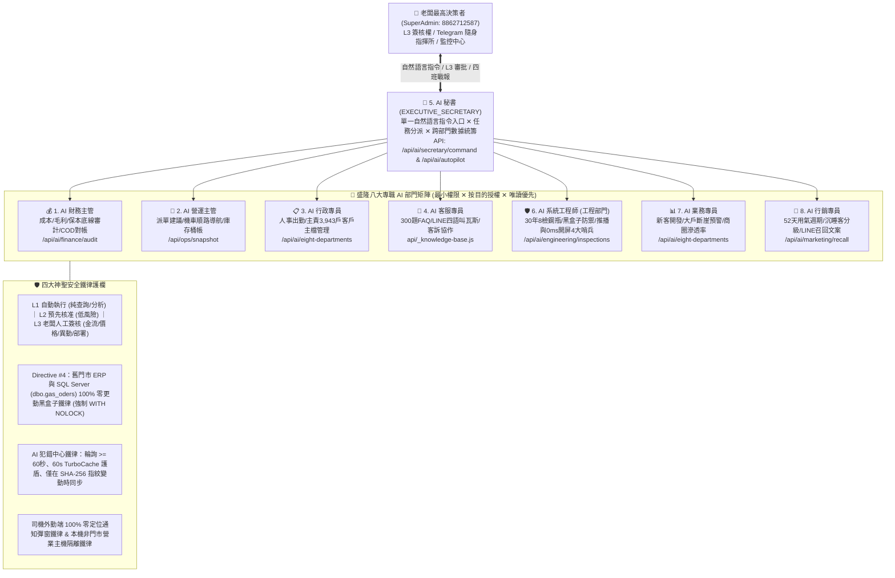

# 👑 盛隆瓦斯 八大 AI 部門 GitHub 權威架構與一鍵召喚操作手冊 (Eight AI Departments Master Playbook)

> **最高決策者**：老闆（Telegram ID: `8862712587`，唯一 SuperAdmin）  
> **核准定案基準**：[`docs/ai-eight-departments-v1-approved.md`](ai-eight-departments-v1-approved.md)（2026-11-06 官方審批 V1.0，2026-11-21 GitHub 全量專冊化 V1.2）  
> **官方 GitHub 倉庫**：[`shenglong-next`](https://github.com/qazwsx32100/shenglong-next) ＆ [`gass`](https://github.com/qazwsx32100/gass)  
> **專屬召喚 Skill**：`shenglong-ai-departments`（[`.agents/skills/shenglong-ai-departments/SKILL.md`](../.agents/skills/shenglong-ai-departments/SKILL.md)）  
> **桌面鏡像路徑**：`C:\Users\懶\Desktop\盛隆瓦斯_八大AI部門架構與召喚操作手冊.md`  
> **適用範圍**：盛隆瓦斯專屬；不含 179 人才媒合平台。

---

## 壹、 專屬召喚指令與自然語言關鍵字 (How to Summon)

老闆或管理員在任何對話視窗中，只需輸入以下任一自然語言關鍵字，AI 助手即會自動載入本權威手冊與對應部門 API 進行巡檢、分析或呈報：

- **全局召喚關鍵字**：
  - `召喚AI部門`、`八大AI部門`、`AI部門架構`、`AI部門巡檢`、`查AI部門`、`AI部門GitHub`
- **單一部門精準召喚關鍵字**：
  1. 💰 **財務部**：`召喚AI財務主管`、`AI財務稽核`、`查毛利底線`
  2. 🛵 **營運部**：`召喚AI營運主管`、`AI派單調度`、`查空滿瓶週轉`
  3. 📋 **行政部**：`召喚AI行政專員`、`AI客戶主檔檢查`、`查地址標準化`
  4. 💬 **客服部**：`召喚AI客服專員`、`AI客服題庫`、`查300題知識庫`
  5. 🤖 **秘書處**：`召喚AI秘書`、`AI跨部門戰報`、`下達AI指令`
  6. 🛡️ **工程部**：`召喚AI工程部門`、`召喚AI系統工程師`、`查推播與開屏哨兵`、`系統健康巡檢`
  7. 📊 **業務部**：`召喚AI業務專員`、`查生意大戶流失預警`、`商圈滲透率`
  8. 📢 **行銷部**：`召喚AI行銷專員`、`查52天沉睡客召回`、`生成LINE關懷文案`

---

## 貳、 八大 AI 部門協同架構拓撲圖 (Architecture Topology)

---

## 參、 八大 AI 部門職責、代碼路徑、API 端點與權限紅線總表

| 編號 | 部門名稱（代碼 ID） | 主責領域與主責資料 | 核心程式碼路徑 (`shenglong-next` / `gass`) | 線上 API 端點 / 控制台 | 權限紅線（絕對禁止事項） |
| :---: | :--- | :--- | :--- | :--- | :--- |
| **1** | **💰 AI 財務主管** `FINANCE_SUPERVISOR` | 營收、成本、毛利、淨利、現金流、應收帳款、外勤 COD 對帳 | `lib/ai-finance-audit-service.ts` `lib/gas-cost-master-data.ts` `c:\Gass\src\utils\gasCost.js` | `GET /api/ai/finance/audit` 監控中心 ➔ AI 部門 ➔ 財務主管 | 依授權唯讀訂單與交易；**不得任意更動客戶主檔或私自改價** |
| **2** | **🛵 AI 營運主管** `OPERATIONS_SUPERVISOR` | 訂單、配送、派單建議、兩輪導航、庫存、桶帳、營運效率 | `lib/ai-eight-departments.ts` `lib/gas-stock-health.ts` `lib/dispatch-queue.ts` | `GET /api/ops/snapshot` `GET /api/today-orders` `GET /api/gas-stock` | 正式派單或交易異動須遵守現行核准流程；**不得越權刪除歷史訂單** |
| **3** | **📋 AI 行政專員** `ADMIN_SPECIALIST` | 人事、出勤、文件；**主責 3,943 戶客戶主檔管理**（建檔、地址標準化、同電話多戶檢查） | `lib/cloud-customer-gateway.ts` `lib/ai-eight-departments.ts` `app/components/CustomerSearchHub.tsx` | `GET /api/ai/eight-departments` `GET /api/customers/directory` | **歷史交易不可任意修改；同電話多戶僅供人工檢視，嚴禁自動合併刪除** |
| **4** | **💬 AI 客服專員** `CUSTOMER_SERVICE_SPECIALIST` | 客戶查詢、訂單諮詢、客訴、LINE 會員服務、300 題瓦斯 FAQ | `c:\Gass\api\_knowledge-base.js` `docs/GAS_CONSUMER_FAQ_300.md` `lib/ai-eight-departments.ts` | LINE Webhook / LIFF 四語語音叫瓦斯 `GET /api/line-orders/pending` | **客戶主檔異動須向行政專員提出申請，不得直接覆寫主檔** |
| **5** | **🤖 AI 秘書** `EXECUTIVE_SECRETARY` | **單一指令入口**、任務分派、**主責跨部門數據分析統籌**、四班戰報、任務導航 | `lib/ai-eight-departments.ts` `lib/seven-ai-autopilot-scheduler.ts` `advisor-bot.cjs` | `GET/POST /api/ai/secretary/command` `GET/POST /api/ai/autopilot` `GET/POST /api/ai/approvals` | **不直接修改原始交易資料**；L3 高風險指令一律攔截轉呈老闆簽核 |
| **6** | **🛡️ AI 系統工程師** `SYSTEM_ENGINEER` | **主責系統監控**：ERP、API、資料庫連線池、同步延遲、30年8檢鋼瓶、**推播與 0ms 開屏 4 大哨兵** | `lib/ai-engineering-monitor.ts` `lib/ai-engineering-service.ts` `lib/sql-connection-pool.ts` | `GET /api/ai/engineering/inspections` `GET /api/system-diagnostics` `GET /api/cron/check-heartbeat` | **正式部署與資料修復需核准；嚴禁對舊門市 SQL 執行任何 DDL 修改** |
| **7** | **📊 AI 業務專員** `SALES_SPECIALIST` | 新客開發、業績分析、生意大戶叫氣斷崖流失預警、商圈滲透率分析 | `lib/ai-eight-departments.ts` `lib/seven-ai-matrix.ts` | `GET /api/ai/eight-departments` 監控中心 ➔ AI 部門 ➔ 業務專員 | 僅提供策略與拓客分析，**不得直接操作後端異動或私自折價** |
| **8** | **📢 AI 行銷專員** `MARKETING_SPECIALIST` | LINE 活動、住家 52 天用氣週期追蹤、45/60/90 天沉睡客分級、個人化召回文案 | `lib/ai-marketing-service.ts` `app/api/ai/marketing/recall/route.ts` | `GET /api/ai/marketing/recall` 監控中心 ➔ AI 部門 ➔ 行銷專員 | 恪守官方定價標準，**不可自行破盤促銷；全體廣播須 L3 老闆審批** |

---

## 肆、 三項跨部門整合功能權責矩陣 (Cross-Department Governance)

1. **📋 客戶資料管理（Customer Master Data）**
   - **主責部門**：**AI 行政專員 (`ADMIN_SPECIALIST`)**
   - **協作部門**：
     - AI 客服專員：僅讀取客戶基本資訊與提交地址更新申請單。
     - AI 營運主管：僅讀取配送地址、大門 GPS 座標與現場備註。
     - AI 財務主管：僅讀取月結統編與帳務結算條件。
   - **安全鐵律**：單一寫入責任制，嚴禁跨部門無紀錄覆寫客戶主檔。

2. **📊 跨部門數據分析（Cross-Department Analytics）**
   - **統籌部門**：**AI 秘書 (`EXECUTIVE_SECRETARY`)**
   - **協作部門**：財務主管（毛利損益）、營運主管（配送週轉）、業務專員（大戶流失率）、行銷專員（召回轉換率）。
   - **安全鐵律**：所有產出強制標註資料來源、時間戳與同步狀態；同步異常時絕不以舊資料冒充即時資料。

3. **🛡️ 全系統健康與推播監控（System & Notification Monitoring）**
   - **主責部門**：**AI 系統工程師 (`SYSTEM_ENGINEER`)**
   - **協作部門**：AI 營運主管（接收派單通道告警）、AI 秘書（彙整異常推播至老闆 Telegram `8862712587`）。
   - **四大專屬哨兵**（定義於 [`lib/ai-engineering-monitor.ts`](../lib/ai-engineering-monitor.ts)）：
     1. **`orderSyncChannel`（收單與推播中繼通道）**：監控 `today_orders` `200 OK` 狀態、反應毫秒與雙 KV 容災回退。
     2. **`driverFcmSentinel`（司機端 App 推播憑證）**：監控外勤司機（如小龍 三星 Galaxy S23）FCM Token 在線狀態。
     3. **`operationsWebPushSentinel`（監控中心背景推播綁定）**：監控調度台螢幕綁定數與 `AES-256-GCM` 加密 KV 雙備援狀態。
     4. **`fastBootLatencySentinel`（雙端 0ms 開屏與 API 速度）**：監控雙端 `0ms` 本機快取秒顯與後端 6 路 `Promise.all` 並行引擎耗時（`< 1200ms`）。

---

## 伍、 L1 / L2 / L3 三級權限護欄與官方成本核算基準

### 1. 三級權限分級（Three-Tier Security Guardrails）
- **🟢 L1 自動化執行（唯讀查詢／診斷分析）**：
  - 查訂單、查庫存、查客戶歷史、毛利審計報表、52 天沉睡客名單、30 年鋼瓶定檢試算、4 大推播哨兵巡檢。
- **🟡 L2 預先核准作業（低風險標準流程）**：
  - 排程晨夕戰報推播、單一沉睡客關懷文案生成、已知地址 GPS 座標微調建議。
- **🔴 L3 老闆人工簽核（高風險／金流／架構異動）**：
  - 修改價格或低於底線出貨、月結大戶發票開立、全體 LINE 會員廣播、刪除或修改正式資料、雲端正式環境部署。

### 2. AI 財務主管官方標準成本與雙階底線（Supreme Directive #3）
- **瓦斯批發進價**：固定 **$22.63 元 / kg**（含公共意外責任險）。
- **外送運費標準**：4kg / 10kg / 16kg / 20kg 為 **$70 元 / 桶**；50kg 為 **$140 元 / 桶**。
- **鋼瓶年均持有與檢驗分攤**（30 年壽命、8 次定檢每次 $360）：住家 20kg 為 **$33 元 / 桶**（年均 6 桶）、生意攤 20kg 為 **$6 元 / 桶**（年均 50 桶）。
- **第一階：純成本保本底線（低於此價嚴重倒賠 🔴 紅燈攔截）**：
  - 20kg 住家純成本底線：**$556 元 / 桶**（進氣 $453 + 運費 $70 + 鋼瓶 $33）
  - 20kg 生意攤純成本底線：**$529 元 / 桶**（進氣 $453 + 運費 $70 + 鋼瓶 $6）
- **第二階：官方最低售價底線（含合理利潤，低於此價 🟡 黃燈警示）**：
  - **住家最低售價**：4kg **$350** ｜ 10kg **$500** ｜ 16kg **$700** ｜ 20kg **$800**
  - **商家最低售價**：4kg **$300** ｜ 10kg **$420** ｜ 16kg **$540** ｜ 20kg **$590** ｜ 50kg **$1,625**

---

## 陸、 八大 AI 部門五大進階優化與深度模組 (Advanced Optimizations V2.0)

依據老闆 2026-11-22 指示「都來」，全面完成五大方向落地：

### 1. 方向 A：老闆 Telegram 雙向深度互動 ✕ L3 審批一鍵核准按鈕
- **Telegram Inline Keyboard 一鍵審批**：
  - 當 AI 發起 L3 敏感動作（如改價、大戶專案、發票開立）時，推播訊息直接掛載 `[ ✅ 核准執行 (Approve) ]` 與 `[ ❌ 駁回申請 (Reject) ]` 雙按鈕。
  - 老闆於手機 Telegram 點擊按鈕，由 `/api/telegram/advisor` 或 `advisor-bot.cjs` 接收 `apr_approve:${id}` 或 `apr_reject:${id}`，0 秒即時更新 `boss_approvals_state_v1` 並回覆確認卡片。
- **AI 秘書自然語言智慧直答**：
  - 老闆在 Telegram 私聊輸入任何營運問句（如「查今天各司機跑單數」、「巡檢推播與連線」、「查倒賠單」），自動經由 `parseAndDispatchSecretaryCommand()` 分派專責 AI，直接查詢線上最新數據並以 Markdown 卡片秒回！

### 2. 方向 B：三大跨部門主動閉環管線 (`lib/ai-cross-department-pipeline.ts` ✕ `/api/ai/pipelines`)
1. **90 天呆瓶壓瓶召回閉環 (`DORMANT_CYLINDER_RECOVERY`)**：
   - 行銷 AI 篩選 90 天以上未叫客群 ➔ 行政 AI 核實大門地址與電話 ➔ 財務 AI 依官方購入成本 $1,550/支 與年折舊 $147.67 精算沉澱資金 ➔ 秘書 AI 生成個人化關懷文案並推播外勤順路收瓶工單。
2. **門市訂單倒賠保本底線主動防禦閉環 (`BELOW_COST_MARGIN_DEFENSE`)**：
   - 財務 AI 依據 Directive #3 保本底線（住家 $556 / 商家 $529）即時審計今日每一筆訂單 ➔ 發現低於底線時標記 `CRITICAL_BELOW_COST` ➔ 業務 AI 覆核合約量 ➔ 秘書 AI 彙整於每日戰報，0 破壞性干擾打單。
3. **即時庫存告急與夜間斷氣主動預警閉環 (`STOCK_DEPLETION_EMERGENCY`)**：
   - 營運 AI 監控實瓶水位（20kg < 30 桶黃燈預警、< 15 桶紅燈告急）➔ 系統工程 AI 驗證連線心跳 ➔ 秘書 AI 自動算出建議進氣補桶量並推播老闆 Telegram。

### 3. 方向 C：八大部門專屬模組深度落地 (`lib/ai-specialist-deep-modules.ts`)
1. **AI 業務主管 (`/api/ai/sales/anomalies`)**：
   - 監控餐飲與商業大戶叫氣週期，未叫天數達常態 2.2 倍以上時自動觸發「用量斷崖預警」，識別 `POSSIBLE_COMPETITOR_POACHING`（疑似競業搶單）並產出實地拜訪對策。
2. **AI 行政主管 (`/api/ai/admin/geocode-audit`)**：
   - 全量審計客戶主檔中「大門 GPS 座標完整率」與「門牌標準化清洗率」，自動列出活躍但缺經緯度之客戶名單供外勤送達時一鍵補點打卡。
3. **AI 客服主管 (`/api/ai/customer-service/audit`)**：
   - 審計近 7 天 LINE 官方帳號對話，瓦斯味、漏氣、熱水器點不著關鍵字 100% 觸發 P0 安全阻斷（0 漏報），並提煉對話盲區產出候選問答。

### 4. 方向 D：戰情調度台 AI 順路併單建議與殘氣折抵防呆
1. **調度台順路併單標籤 (`Route Coalescing`)**：
   - 營運 AI 自動比對未派單與現役司機（小龍）配送中單據的路名與座標，同路段或 500 公尺內自動於卡片上方亮起綠色膠囊：`💡 順路併單建議：與【小龍】車上 #XXXX 同在「路名」(相距 ~380m)，併單估計可省 12 分鐘外送趟次！`
2. **空瓶退殘氣折抵防呆計算器 (`calculateResidualGasRefund`)**：
   - 嚴格恪守 Directive #3 官方瓦斯批發進價 **$22.63 / kg**，輸入殘氣公斤數自動精算折抵金額，杜絕人工心算誤差。

### 5. 方向 E：LINE 客服自學習題庫反哺機制 (`/api/ai/customer-service/candidate-faqs`)
- 自動從低信心對話中提煉新進問題草稿（如鋼瓶陽台防雨防鏽、廢棄爐具回收規範），由客服主管整理並提供老闆一鍵審批，依 SOP 同步匯入官方消費者常見問題 300 題知識庫！
