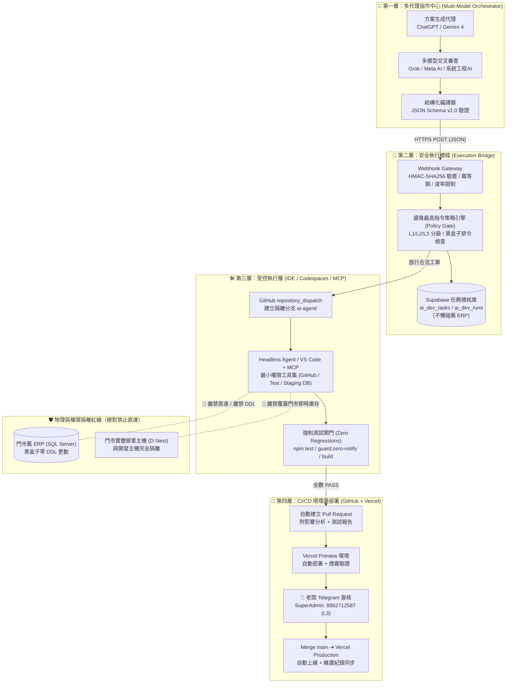
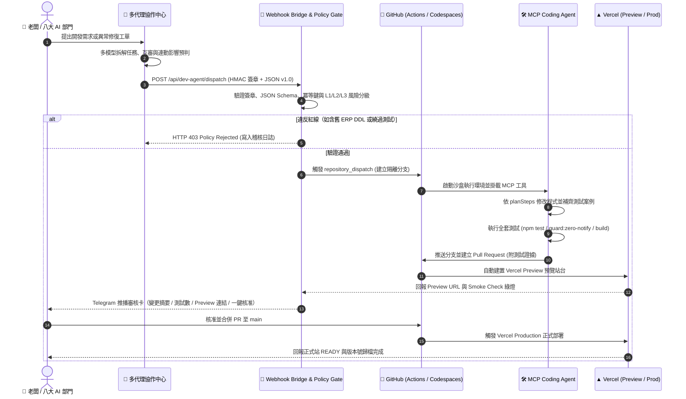

# 🤖 盛隆瓦斯 多代理 AI 協同開發技術藍圖與執行計畫書 (Multi-Agent Collaborative Dev Blueprint)

> **文件版本**：`v1.5.0`（2026-11-28 P1 三項全面收尾：Telegram 一鍵核准回調＋GitHub Actions 4 組 Secrets 寫入＋`main` Branch Protection 鎖定＋自動觸發 PR Gate）  
> **最高決策者**：老闆（Telegram ID: `8862712587`，唯一 SuperAdmin）  
> **適用範圍**：盛隆現代化多倉開發管線（`gass`、`shenglong-next`、`shenglong-line-liff`）  
> **檔案位置**：
> - 倉庫正本：`c:\Gass\docs\MULTI_AGENT_AI_COLLABORATIVE_DEV_BLUEPRINT.md`
> - 桌面鏡像：`C:\Users\懶\Desktop\盛隆瓦斯_正式系統規格資產全集\01_戰情架構與手冊\盛隆瓦斯_多代理AI協同開發技術藍圖與執行計畫書.md`
> **最高安全紅線**：100% 遵循《盛隆最高執行指令》（舊 ERP 零更動黑盒子、司機端零通知、本機非門市主機隔離、測試優先零回歸、AI 犯錯中心防爆防線、L3 老闆核准制）。

---

## 📋 計畫願景與核心定位

本計畫旨在構建一條**高度自動化、可審計、零回歸且受安全護欄保護**的多代理 AI 協同開發管線（Multi-Agent Collaborative Development Pipeline）。透過將「**多模型討論與架構設計**」、「**結構化標準指令傳輸**」、「**受控 IDE / MCP 執行層**」與「**自動化測試與雲端部署閉環**」串聯，讓盛隆系統在擴充功能與日常維運時，同時兼顧開發速度、跨系統穩定度與生產環境安全。

> [!IMPORTANT]
> **關鍵原則**：自動化開發管線的目標不是讓 AI「不受控地直接改動正式線上環境」，而是讓多代理完成 90% 的方案討論、拆解、撰寫程式碼、補齊單元測試與建立預覽環境（Preview），最後由自動化測試閘門（CI Gate）把關，並在 L3 級變更時交由老闆一鍵簽核上線。

---

## 壹、原草案架構健檢與落地演進對照

針對初版草案的三層構想與工具選型，結合盛隆現有基礎設施（GitHub、Vercel、Supabase、Gemini 4 軍師、八大 AI 部門）進行實戰可行性評估與強化：

| 系統層級 | 原草案規劃 | 實戰潛在風險 | 本藍圖落地強化方案 |
| :--- | :--- | :--- | :--- |
| **1. 協作中心（決策層）** | AutoGPT、ChatGPT（預計擴充 Meta AI、Grok）自由討論 | 開放式 AutoGPT 容易陷入無窮迴圈、燒毀 API 額度、輸出格式飄移無法穩定解析 | 改採**固定輪次多角色 Orchestrator（最多 3 輪）**：由架構師 / 開發者 / 審查者分別調用不同模型（如 Gemini 4、ChatGPT、Grok、Meta AI）交叉審查，最終**強制輸出通過 JSON Schema 驗證的標準工單** |
| **2. 執行橋樑（傳輸層）** | JSON 透過 Webhook / API 直接送至中繼伺服器 | 缺少驗簽易遭偽造注入；重複重試導致重複建單；高頻輪詢易觸發 Supabase / Vercel 額度超標 | 建立 **HMAC-SHA256 驗簽 Webhook Gateway** + 5 分鐘防重放窗口 + `idempotencyKey` 冪等鎖；採 **事件驅動（Event-Driven）** 取代輪詢（若需狀態同步間隔一律 $\ge 60$ 秒） |
| **3. 執行層（IDE / Agent）** | VS Code (MCP/Agent 擴展) + GitHub Codespaces | 遠端 Webhook 直接喚醒桌面 VS Code 或閒置休眠的 Codespaces 容易斷線、狀態失步且不易紀錄審計日誌 | 採**雙軌執行模式**：<br>• **主軌（無人值守）**：Webhook 觸發 GitHub `repository_dispatch` → 在隔離分支由 Headless Coding Agent + MCP Server 自動改碼並開立 PR。<br>• **副軌（互動除錯）**：VS Code / Antigravity / GitHub Codespaces 掛載統一 MCP 配置進行人工接手與深度重構。 |
| **4. 部署閉環（CI/CD）** | 連動 GitHub、Vercel 與 Supabase 自動上線 | Agent 直接 push `main` 可能破壞線上派單、司機零通知規範或誤動資料庫結構 | 強制走 **Feature Branch (`ai-agent/<taskId>`) → 自動化測試全綠 + 安全守衛掃描 → Vercel Preview 預覽 → 老闆 Telegram L3 簽核 → Merge `main` 自動部署 Production + 煙霧測試** |

---

## 貳、系統架構拓撲與執行時序

### 2.1 四層架構拓撲圖



### 2.2 端到端執行時序圖



---

## 參、第一階段：協作中心與指令標準化

### 3.1 標準化 JSON 指令協議 (`multi-agent-task.v1`)

所有協作中心（ChatGPT、Gemini 4、Grok、Meta AI 等）討論收斂後的最終輸出，必須嚴格符合以下 JSON Schema，未通過 Schema 驗證者一律在中繼層退回修正，絕不進入程式碼執行階段。

#### 標準工單 Payload 範例

```json
{
  "schemaVersion": "1.0.0",
  "taskId": "TASK-20261127-001",
  "idempotencyKey": "sha256:9f86d081884c7d659a2feaa0c55ad015",
  "createdAt": "2026-11-27T17:30:00+08:00",
  "initiator": {
    "source": "multi_agent_hub",
    "requestedBy": "boss_8862712587",
    "participatingModels": ["gemini-4-neon", "chatgpt-5", "grok-3"]
  },
  "riskLevel": "L2",
  "requiresBossApproval": true,
  "target": {
    "repository": "qazwsx32100/gass",
    "baseBranch": "main",
    "featureBranch": "ai-agent/task-20261127-001",
    "allowedPaths": ["api/", "tests/", "docs/"],
    "forbiddenPaths": ["android/", "sql/legacy_erp/"]
  },
  "objective": {
    "title": "新增 LINE 詢價多規格報價提示強化",
    "summary": "強化多規格問句解析並補齊單元測試，確保不影響既有訂單擷取與 300 題知識庫。",
    "issueNumber": 142
  },
  "impactAnalysis": {
    "affectedSystems": ["line_webhook", "knowledge_base"],
    "touchesLegacyErp": false,
    "touchesDriverLocation": false,
    "touchesPricingMaster": false,
    "mitigationNotes": "僅改動文字解析函式並強制三方同步知識庫，執行全套測試確認零回歸。"
  },
  "planSteps": [
    {
      "step": 1,
      "action": "add_test",
      "description": "先於 tests/ 新增多規格邊界測試案例（TDD）"
    },
    {
      "step": 2,
      "action": "edit_code",
      "description": "調整 api/_knowledge-base.js 解析邏輯並同步 docs/GAS_CONSUMER_FAQ_300.md"
    },
    {
      "step": 3,
      "action": "verify",
      "description": "執行 npm test 確認 100% 通過"
    }
  ],
  "acceptanceCriteria": {
    "requiredCommands": ["npm test", "npm run lint"],
    "maxChangedFiles": 12,
    "mustOpenPullRequest": true,
    "allowDirectMainPush": false
  },
  "safetyConstraints": {
    "noLegacyErpDdl": true,
    "noDriverGpsPolling": true,
    "minPollingIntervalSeconds": 60,
    "noHardcodedSecrets": true,
    "maxAgentIterations": 10,
    "maxTokenBudgetUsd": 2.0
  },
  "consensus": {
    "status": "approved",
    "dissentingNotes": [],
    "confidenceScore": 0.94
  }
}
```

### 3.2 Webhook 中繼觸發與防禦規格

1. **端點設計**：`POST /api/dev-agent/dispatch`（獨立於門市營運 API，避免干擾派單與庫存通道）。
2. **請求標頭驗證（四重防護）**：
   - `Authorization: Bearer <DEV_AGENT_BRIDGE_TOKEN>`（存放於環境變數，嚴禁寫入程式碼）。
   - `X-Agent-Timestamp`：Unix Epoch 秒數，與伺服器時間差超過 `±300 秒` 直接拒絕（HTTP `401`）。
   - `X-Agent-Signature-256`：對 `${timestamp}.${rawBody}` 計算 HMAC-SHA256，並使用 `crypto.timingSafeEqual` 常數時間比對。
   - `X-Idempotency-Key`：相同金鑰在 24 小時內重送直接回傳原任務狀態（HTTP `200`），杜絕重複開分支或重複建 PR。
3. **硬性政策守門員（Policy Gate）**：
   - 若 `acceptanceCriteria.allowDirectMainPush !== false` → 立即攔截（HTTP `403`）。
   - 若 `impactAnalysis.touchesLegacyErp === true` → 立即攔截並通知老闆（遵守 Directive #4 黑盒子鐵律）。
   - 若 `impactAnalysis.touchesDriverLocation === true` → 強制將 `riskLevel` 升格為 `L3`，並強制附加 `guard:zero-notify` 檢查。
   - 若 `safetyConstraints.minPollingIntervalSeconds < 60` → 立即攔截（遵守 AI 犯錯中心鐵律）。

### 3.3 任務生命週期狀態機

| 狀態碼 | 說明 | 允許轉移至 |
| :--- | :--- | :--- |
| `QUEUED` | 通過驗簽與 Policy Gate，已寫入任務佇列 | `DISPATCHED`, `CANCELLED` |
| `DISPATCHED` | 已送出 GitHub `repository_dispatch` | `RUNNING`, `FAILED_SAFE` |
| `RUNNING` | 隔離環境執行改碼與測試中（逾時上限 15 分鐘） | `PR_OPENED`, `FAILED_SAFE` |
| `PR_OPENED` | 已建立 PR，等待 CI 與 Vercel Preview | `CI_PASSED`, `CI_FAILED` |
| `CI_PASSED` | 全數測試與守衛腳本綠燈、Preview 可用 | `AWAITING_APPROVAL`, `MERGED` (僅 L1 文件) |
| `AWAITING_APPROVAL` | 已推送 Telegram 審核卡給老闆 (`8862712587`) | `MERGED`, `REJECTED` |
| `MERGED` | PR 已合併至 `main`，觸發正式部署 | `DEPLOYED`, `ROLLED_BACK` |
| `DEPLOYED` | Vercel Production 綠燈 READY 且煙霧驗證通過 | （終態） |
| `FAILED_SAFE` / `ROLLED_BACK` | 驗證失敗或回滾，現場環境零污染並發出告警 | `QUEUED`（修正後重派） |

---

## 肆、第二階段：IDE / Codespaces 與 MCP 執行環境建構

### 4.1 雙軌開發執行環境

為兼顧「全自動無人值守」與「複雜任務人工協同」，執行層提供統一容器環境（`.devcontainer/devcontainer.json`），讓本機 VS Code、Antigravity 與雲端 GitHub Codespaces 具備 100% 一致的 Node 22、測試工具與 MCP 配置：

```json
{
  "name": "ShengLong Multi-Agent Dev Sandbox",
  "image": "mcr.microsoft.com/devcontainers/javascript-node:22",
  "postCreateCommand": "npm ci && npm test",
  "customizations": {
    "vscode": {
      "extensions": [
        "dbaeumer.vscode-eslint",
        "oxc.oxc-vscode",
        "github.vscode-pull-request-github"
      ]
    }
  },
  "remoteEnv": {
    "SHENGLONG_ENV": "sandbox",
    "LEGACY_ERP_WRITE_ENABLED": "false"
  }
}
```

### 4.2 MCP Server 最小權限矩陣（Least Privilege）

無論在 VS Code MCP 擴展或 Headless Agent Runner 中，每個 MCP 工具必須鎖定最小權限範圍：

| MCP Server | 允許操作（Allowlist） | 絕對禁止操作（Denylist） | 憑證隔離層級 |
| :--- | :--- | :--- | :--- |
| **GitHub MCP** | 讀取檔案、建立 `ai-agent/*` 分支、提交 Commit、建立/更新 PR、貼上測試報告留言 | 禁止直接 push `main`、禁止 force-push、禁止刪除保護分支、禁止自行 Merge L2/L3 PR | Fine-grained PAT（僅授權目標 Repo 的 `contents:write` + `pull_requests:write`） |
| **Test & Build MCP** | 執行 `npm test`、`npm run lint`、`npm run build`、`guard:zero-notify` | 禁止執行任意網路下載執行指令、禁止讀取系統敏感目錄、禁止連線門市 SQL Server | 沙盒容器無特權用戶 |
| **Supabase MCP** | 查詢 Staging Schema、讀寫 `ai_dev_*` 任務稽核表、產生 Migration 草稿檔案 | 禁止直接對 Production 執行 `DROP`/`TRUNCATE`/`ALTER`、禁止匯出客戶全庫個資 | Staging Key / 唯讀稽核 Role |
| **Vercel MCP** | 讀取 Preview Deployment 狀態與建置日誌、觸發 Preview 煙霧測試 | 禁止未經 `main` 合併直接覆寫 Production Alias、禁止讀取/外洩正式 Env Secrets | Scoped Read/Preview Token |

### 4.3 多模型討論與衝突仲裁規則

當協作中心接入多模型（如 ChatGPT + Gemini 4 + Grok + Meta AI）時，避免「多嘴沒結論」的工程規範：
1. **明確角色分工**：
   - **架構規劃者（Architect）**：負責拆解任務與填寫 `impactAnalysis`（連動系統盤點）。
   - **實作工程師（Implementer）**：負責轉化為精準 `planSteps` 與測試案例清單。
   - **資安與紅線審計官（Auditor）**：專職挑戰方案，檢查是否觸犯盛隆 7 大最高指令與 AI 犯錯中心規則。
2. **收斂機制**：最多 2 輪互審；若 Auditor 提出阻斷級意見（Blocker）且無法化解，任務直接標記 `ESCALATE_TO_BOSS` 交由老闆拍板，禁止模型無限互辯燒費。

---

## 伍、第三階段：自動化閉環整合、測試與回滾

### 5.1 Supabase 任務稽核表結構（專屬隔離，不碰舊 ERP）

在雲端 Supabase 建立獨立的開發協作稽核表（與盛隆營運表邏輯隔離，且寫入採用事件驅動、零輪詢）：

```sql
-- 1. 多代理任務主表
CREATE TABLE IF NOT EXISTS public.ai_dev_tasks (
  task_id TEXT PRIMARY KEY,
  idempotency_key TEXT UNIQUE NOT NULL,
  target_repo TEXT NOT NULL,
  feature_branch TEXT NOT NULL,
  risk_level TEXT NOT NULL CHECK (risk_level IN ('L1', 'L2', 'L3')),
  status TEXT NOT NULL,
  payload JSONB NOT NULL,
  pr_url TEXT,
  preview_url TEXT,
  approved_by TEXT,
  created_at TIMESTAMPTZ NOT NULL DEFAULT NOW(),
  updated_at TIMESTAMPTZ NOT NULL DEFAULT NOW()
);

-- 2. 執行與測試驗證紀錄表
CREATE TABLE IF NOT EXISTS public.ai_dev_runs (
  run_id UUID PRIMARY KEY DEFAULT gen_random_uuid(),
  task_id TEXT NOT NULL REFERENCES public.ai_dev_tasks(task_id) ON DELETE CASCADE,
  executor_type TEXT NOT NULL CHECK (executor_type IN ('github_actions', 'codespaces_mcp', 'local_ide')),
  test_summary JSONB,
  token_cost_usd NUMERIC(10, 4) DEFAULT 0,
  exit_code INTEGER,
  started_at TIMESTAMPTZ NOT NULL DEFAULT NOW(),
  finished_at TIMESTAMPTZ
);
```

> [!NOTE]
> **離線容災降級**：若 Supabase 暫時受限（例如 HTTP 402/503），中繼層自動降級將任務紀錄寫入 GitHub Issue Comment 與本機 `_offline_dev_tasks.json`，確保開發管線可安全停機或降級運作，絕不拋出未處理 500 異常。

### 5.2 端到端測試閘門（Zero Regressions CI Gate）

每一張由多代理建立的 PR，GitHub Actions 必須自動執行對應倉庫之全套檢核，**任一項失敗即自動鎖死 Merge 按鈕**：

| 目標倉庫 | 必過自動化指令 | 專屬防呆守衛 |
| :--- | :--- | :--- |
| `qazwsx32100/gass` | `npm test`、`npm run lint`、`npm run build` | 知識庫三方一致檢查 (`knowledge-base.test.mjs`)、靜態掃描禁含明碼 Token / ERP DDL |
| `qazwsx32100/shenglong-next` | 單元與整合測試、`npm run guard:zero-notify`、`npm run build` | 司機端零定位通知守衛、離職司機排除防線、即時庫存健康狀態機測試 |
| `qazwsx32100/shenglong-line-liff` | 全套 327+ 單元與整合測試 | 漏氣安全急救鎖死測試、非營業時間防呆測試、LINE 簽章防禦測試 |

### 5.3 Vercel 自動部署與一鍵回滾閉環

1. **PR 預覽階段**：PR 開立後自動部署至 Vercel Preview URL，CI 自動對 Preview URL 執行煙霧測試（健康檢查 + 關鍵 API 狀態碼）。
2. **正式上線階段**：
   - **L1（純文件 / 測試補齊）**：CI 全綠後可設定通知老闆快速確認合併。
   - **L2（一般功能 / 非金流修復）**：CI 全綠 + Preview 驗證通過 → 推送 Telegram 摘要卡 → 老闆核准後 Merge `main` 觸發 Vercel Production。
   - **L3（價格公式 / 權限鑑權 / 推播 / 司機端 / 資料庫）**：強制要求老闆（Telegram ID `8862712587`）二次確認簽核方可合併。
3. **自動熔斷與回滾**：合併後若 Vercel Production `smoke:prod` 連續 2 次失敗，自動建立回滾 PR（`git revert`）並透過 Telegram 立即告警，同時將該類任務暫停自動派發（Circuit Breaker）。

---

## 陸、盛隆最高執行指令合規對照表 (Policy-as-Code)

本管線將盛隆既有的 7 大最高執行指令與 AI 犯錯中心規則直接寫入自動化防線，杜絕人工疏漏：

| 最高執行指令 | 潛在觸犯情境 | 管線自動攔截機制（Policy-as-Code） |
| :--- | :--- | :--- |
| **#1 全系統連動預判** | Agent 只改單一檔案忽略相依倉庫 | JSON 工單必填 `impactAnalysis.affectedSystems`，缺失直接拒收；PR 模板強制列出跨倉檢核 |
| **#2 測試優先與零回歸** | Agent 直接改碼不跑測試 | CI Gate 硬鎖 Branch Protection，未通過全部測試無法合併 |
| **#3 官方標準成本基準** | 模型幻覺誤改進價 `$22.63/kg` 或運費 `$70/$140` | 敏感常數檔案列為 L3 保護路徑，觸動即標紅告警並跑財務基準測試 |
| **#4 舊 ERP 黑盒子鐵律** | Agent 產生 `ALTER TABLE dbo.gas_oders` 等指令 | 靜態掃描規則偵測舊 ERP 資料表 + DDL 關鍵字立即阻斷 Build |
| **#5 司機端零通知鐵律** | Agent 在司機端加入 `setInterval` 輪詢 GPS | 強制執行 `guard:zero-notify` 守衛測試，任何違反立即紅燈封殺 |
| **#6 本機非門市主機隔離** | Agent 誤把本機 SQL 停止當門市當機，或啟動假同步覆蓋真單 | 執行器強制注入 `SHENGLONG_ENV=sandbox` 與 `LEGACY_ERP_WRITE_ENABLED=false` |
| **#7 八大 AI 三級權限 & AI 犯錯中心** | Agent 高頻輪詢打爆 Supabase/Vercel 額度或外洩 Token | 禁止 `< 60s` 輪詢、單日成本硬上限（Budget Cap）、Secret Scanner 阻斷明碼憑證、L3 唯一 SuperAdmin `8862712587` |

---

## 柒、三階段實施路線圖與驗收檢核表

### 階段一：協作中心與指令標準化（✅ 2026-11-27 全鏈路實作並串接完成）
- [x] **交付物 1.0（AI 協作中心）**：建立第一層多模型協作引擎 `api/_dev-agent-hub.js`、線上 API 端點 `api/dev-agent-hub.js`（`/api/dev-agent-hub`）與命令列工具 `scripts/dev-agent-hub-cli.mjs`，支援 **Gemini 4、ChatGPT (OpenAI)、Grok (xAI)、Meta AI (Llama)** 與離線確定性沙盒備援，採固定輪次三角色交叉審查（Architect ➔ Implementer ➔ Auditor），自動產出 JSON v1.0 工單並以 HMAC-SHA256 簽章直連 `/api/dev-agent-dispatch`。
- [x] **交付物 1.1**：在倉庫建立 `schemas/multi-agent-task.v1.schema.json` 與驗證模組 `api/_dev-agent-protocol.js`（含 Schema 驗證器、HMAC-SHA256 驗簽、Policy-as-Code 守門員、狀態機與 24h 冪等快取）。
- [x] **交付物 1.2**：實作 Webhook 中繼端點 `api/dev-agent-dispatch.js`（四重防護：限流 20/10m + Bearer/HMAC 或 Admin Session + Schema + Policy Gate + 冪等鎖，預設安全沙盒佇列與 `dryRun`，可透過環境變數啟用 GitHub `repository_dispatch`）。
- [x] **交付物 1.3**：撰寫完整單元測試 `tests/dev-agent-hub.test.mjs` 與 `tests/dev-agent-phase1.test.mjs`（覆蓋多模型交叉討論、429 優雅降級、惡意舊 ERP/GPS 請求硬攔截、Hub ➔ HMAC ➔ Bridge ➔ GitHub Dispatch 全鏈路與 CLI 實測）。
- [x] **階段驗收標準**：正向、異常與惡意測試全數通過（64/64 PASS 含資安與舊 ERP 黑盒子稽核），既有系統零回歸。

### 階段二：IDE / Codespaces 與 MCP 執行環境建構（✅ 2026-11-27 程式碼與工作流落地）
- [x] **交付物 2.1**：建立 `.devcontainer/devcontainer.json`（Node 22 沙盒、`SHENGLONG_ENV=sandbox`、`LEGACY_ERP_WRITE_ENABLED=false`）與標準化 MCP 最小權限範本（`docs/mcp-sandbox-config.example.json`，零明碼密鑰）。
- [x] **交付物 2.2**：建立沙盒執行器 `scripts/dev-agent-executor.mjs`、GitHub Actions 執行工作流 `.github/workflows/multi-agent-executor.yml`（接收 `repository_dispatch: multi_agent_task` 或手動 `workflow_dispatch`，強制建立 `ai-agent/*` 隔離分支、產出稽核紀錄、跑全套測試後自動開 PR 且絕不自動合併）與 PR 閘門工作流 `.github/workflows/multi-agent-pr-gate.yml`（Policy Diff 掃描 + Lint + 單元測試 + Build）。
- [x] **交付物 2.3**：已完成 GitHub `main` Branch Protection 設定（強制必過 `policy-and-test-gate`、禁止 force-push 與刪除分支），並寫入 4 組 GitHub Actions Secrets（`DEV_AGENT_APPROVAL_URL`、`DEV_AGENT_BRIDGE_TOKEN`、`DEV_AGENT_WEBHOOK_SECRET`、`DEV_AGENT_GH_PAT`），由 `DEV_AGENT_GH_PAT` 開立 PR 即可全自動觸發 PR Zero-Regressions Gate 與老闆 Telegram 簽核卡推播。
- [x] **階段驗收標準（自動化測試）**：新增 `tests/dev-agent-phase2.test.mjs` 驗證 Devcontainer、MCP 最小權限、工作流防線、Diff 政策掃描與 CLI 端到端執行，全套測試 100% PASS。

### 階段三：自動化閉環整合與實戰演練（✅ 2026-11-27 程式碼、SQL 與端到端演練測試落地）
- [x] **交付物 3.1**：建立專屬 Supabase Migration `sql/multi-agent-dev-audit.sql`（`ai_dev_tasks` / `ai_dev_runs` / `ai_dev_audit_logs`＋RLS 隔離零舊 ERP 接觸）與稽核存儲引擎 `api/_dev-agent-audit.js`（純 PostgREST＋402/503 五分鐘熔斷與離線容災降級）。
- [x] **交付物 3.2**：建立閉環審核與煙霧驗證端點 `api/dev-agent-approval.js`（`/api/dev-agent-approval`）與 CLI `scripts/dev-agent-smoke-and-notify.mjs`，串接老闆 Telegram (`8862712587`) L3 一鍵核准通知卡、SuperAdmin 獨佔核准／駁回與 PR Squash Merge、SSRF 白名單煙霧驗證及連敗自動熔斷告警，並掛載至 `.github/workflows/multi-agent-executor.yml`。
- [x] **交付物 3.3**：新增端到端閉環整合測試 `tests/dev-agent-phase3.test.mjs`，完整驗證「AI 協作中心 ➔ HMAC 橋樑 ➔ GitHub PR ➔ 老闆 Telegram L3 簽核卡 ➔ 非老闆 403 攔截 ➔ 老闆核准合併 ➔ 正式煙霧驗證 ➔ SSRF 攔截與連敗自動熔斷告警」。
- [x] **階段驗收標準**：全鏈路自動化測試 69/69 PASS（零回歸）、`oxlint` 0 錯誤，所有端點部署 Vercel Production 實彈驗收綠燈。

---

## 捌、MVP 最小可行啟動建議（下一步即可動工）

若老闆決定正式啟動實作，建議採用**最小風險、最快見效**的 3 步 MVP 順序，不需一次購買昂貴平台或重寫現有系統：
1. **先做「指令標準 + 守門員」**：建立 JSON Schema v1.0 + Policy Gate 驗證器 + 單元測試（純 Node 模組，0 外部成本，1 天可落地驗收）。
2. **再接「GitHub PR 沙盒閉環」**：用 GitHub Actions + 既有的 Branch Protection 與 Vercel Preview，先跑通「自動開 PR + 自動跑測試」（不自動 Merge）。
3. **最後接「多模型協作 + Telegram 核准」**：直接複用盛隆已上線的 Gemini 4 軍師與 Telegram Bot 通道（`8862712587`），把「討論 → 開 PR → 手機一鍵看摘要核准」串成真正每日可用的開發戰情室。
