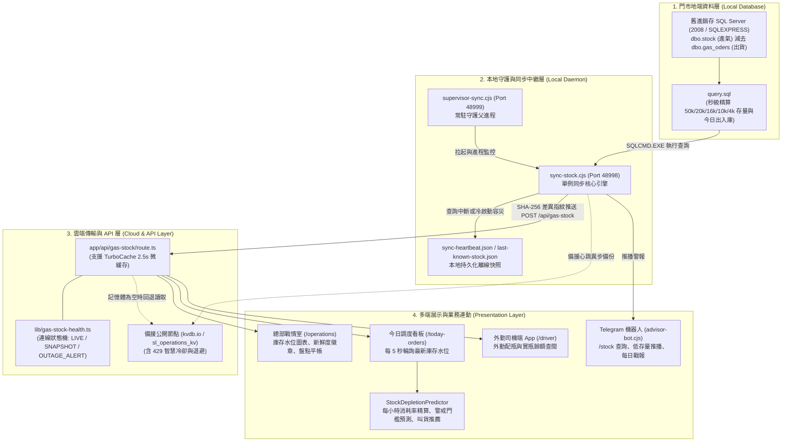

# 📦 盛隆瓦斯 即時庫存全鏈路架構與連線診斷權威手冊
> **文件版本**：v1.0.0 (2026-11-14)  
> **權威制定者**：老闆 (Telegram ID: `8862712587`，唯一 SuperAdmin)  
> **適用儲存庫**：`qazwsx32100/gass` 與 `qazwsx32100/shenglong-next`  
> **安全等級**：門市內部核心營運機密 ｜ 全 AI 代理必讀技術指引

---

## 🔮 一、 如何召喚本說明（How to Summon This Guide）

在未來任何與 AI（Antigravity、Gemini、Claude、Codex）的對話中，只要透過以下任一方式，即可立即召喚並載入本完整架構說明：

### 1. 💬 關鍵字自然語言召喚（隨時直接輸入）
直接在對話中提及以下任一詞彙，AI 即會自動檢索並套用本規範：
* **「即時庫存架構」**
* **「庫存連線問題」**
* **「召喚即時庫存說明」**
* **「庫存架構診斷」**
* **「查即時庫存」**

### 2. ⚡ 專屬 Workspace Skill 召喚
本系統已配置 Antigravity 專屬工作區技能：
* 直接提及技能名稱：`shenglong-realtime-stock`
* 或使用斜線指令推薦時指定庫存模組。

### 3. 📂 檔案路徑直接引證召喚
* 程式庫內部路徑：
  - `docs/REALTIME_STOCK_ARCHITECTURE_AND_TROUBLESHOOTING.md`
* 桌面鏡像備份路徑：
  - `C:\Users\懶\Desktop\盛隆瓦斯_即時庫存架構與連線診斷說明書.md`

---

## 🌐 二、 即時庫存全鏈路架構圖 (End-to-End Architecture)

盛隆瓦斯的即時庫存系統橫跨「門市地端舊進銷存」、「本機常駐同步守護進程」、「雲端 Vercel Edge API」與「多端即時展現（戰情室/調度台/外勤司機/Telegram）」，整體架構如下：



---

## ⚙️ 三、 核心模組與工作原理

### 1. 資料精算層（`query.sql`）
* **計算原理**：
  - **當前實瓶總庫存**：由 `dbo.stock` 累計進氣量扣除歷史基準量與 `dbo.gas_oders` 累計有效出貨量（`disable = 'N'`）。
  - **今日已出貨**：即時統計 `dbo.gas_oders` 當日（`CONVERT(char(10), GETDATE(), 111)`）出貨總數。
  - **今日已進氣 / 退殘氣**：即時統計 `dbo.stock` 當日進氣與殘氣回收量。
  - **進氣明細批次**：抽取最新 100 筆進氣單詳細資訊（供戰情室顯示進氣流水號、氣廠、單價與殘氣公斤數）。
* **安全機制**：所有 SQL 查詢皆強制使用 `WITH (NOLOCK)` 與 `READ UNCOMMITTED`，絕對零鎖定門市小姐打單。

### 2. 本地守護中繼進程（`supervisor-sync.cjs` + `sync-stock.cjs`）
* **`supervisor-sync.cjs`（父進程）**：
  - 常駐監聽 `127.0.0.1:48999` 單例端口。
  - 負責看守子進程 `sync-stock.cjs` 與 `advisor-bot.cjs`，當子進程異常崩潰或超時假死時，自動重啟並清理孤兒進程。
* **`sync-stock.cjs`（核心同步子進程）**：
  - 綁定 `127.0.0.1:48998` 單例端口。
  - 定時（秒級）調用 `SQLCMD.EXE` 執行 `query.sql`。
  - **SQL Guard 熔斷保護**：當偵測到 SQL 連線失敗或逾時（15 秒），立即觸發熔斷防護，將重試頻率退避至 15~120 秒，杜絕高頻查詢產生大量孤兒 SQLCMD 進程導致記憶體耗盡（OOM）。
  - **離線快照鎖定**：查詢失敗時，自動使用前一秒的記憶體快照 `lastKnownStock`，並覆寫本地 `sync-heartbeat.json`，保證前端顯示不中斷。
  - **跨日自動歸零**：過 24:00（台北時間），進出貨累計強制歸零，但鋼瓶存量完整滾動結轉。

### 3. 指紋差異推送引擎（`lib/daemons/stock-sync-daemon.cjs`）
* 嚴格落實《AI 犯錯中心》最高準則：
  - **無變動不全量發送**：每次計算後產生 SHA-256 業務指紋，若指紋未改變且未超過保活心跳上限（30 分鐘），一律不消耗外部網路流量。
  - **狀態碼退避**：遭遇 HTTP 429 或 5xx 時啟動指數退避冷卻。

### 4. 狀態機連線健康度評估（`lib/gas-stock-health.ts`）
雲端 API 與前端頁面統一採用同源狀態機評估連線新鮮度（以最後同步時間戳 `updatedAtEpoch` 判定）：
1. 🟢 **即時連線（`LIVE`）**：最後同步延遲 `< 180 秒`（正常狀態）。
2. ⚠️ **離線快照（`SNAPSHOT`）**：最後同步延遲 `180 秒 ～ 599 秒`（暫時中斷，鎖定最後已知數字）。
3. 🚨 **斷線告警（`OUTAGE_ALERT`）**：最後同步延遲 `>= 600 秒（10 分鐘）`（觸發 Telegram 自動推播通知老闆與管理群）。

### 5. 雲端 API 端點（`app/api/gas-stock/route.ts`）
* **GET**：提供帶有 `TurboCache`（2.5 秒微緩存）的極速查詢端點，內建多層級降級機制（本地檔案 ➜ 記憶體快取 ➜ 備援 KV）。
* **POST**：
  - 接收來自 `sync-stock.cjs` 的最新庫存指紋數據（需驗證 `x-gas-stock-sync-secret`）。
  - 接收戰情室管理員的盤點平帳 (`adjust_stock`)、現場進氣登記 (`add_stock`)、進氣修改與作廢，並透過 `remote-command` 即時反寫回門市 SQL Server。

### 6. 消耗預測引擎（`StockDepletionPredictor.tsx`）
* 以每日 08:00 為基準，計算每小時出貨速率（支/小時）。
* 精算當前存量距離安全存量門檻之剩餘安全時間，預估何時觸及警報線。
* 依據營業補氣模型（50kg 補至 5 支、20kg 補至 70 支、16kg 補至 20 支）自動推薦叫貨支數（以 5 支為單位整數化）。

---

## 🔍 四、 常見連線問題與故障排查手冊 (Troubleshooting Runbook)

### 問題 1：SQL 連線中斷 / 錯誤代碼 xFFFFFFFF
* **症狀**：
  - 日誌出現：`Microsoft ODBC Driver 17 for SQL Server : 定位指定的伺服器/執行個體時發生錯誤 [xFFFFFFFF]`
  - 日誌出現：`登入逾時已過。建立 SQL Server 的連接時發生網路相關或特定執行個體的錯誤。找不到伺服器或是無法連接。`
  - 戰情室徽章顯示：`⚠️ 離線快照` 或 `🚨 斷線逾 10 分鐘`。
* **原因分析**：
  1. **本機 SQL 服務未啟動**：Windows 服務 `MSSQL$SQLEXPRESS`（或 `MSSQLSERVER`）被手動停止或開機未正常拉起。
  2. **端點設定不符**：`.env` 中的 `SQL_SERVER`（如 `.\SQLEXPRESS`）與實際門市執行個體（如 `127.0.0.1,1000`）不一致。
* **修復操作**：
  1. 以系統管理員身分開啟 PowerShell，檢查並啟動 SQL 服務：
     ```powershell
     Get-Service | Where-Object { $_.Name -match 'MSSQL' }
     Start-Service 'MSSQL$SQLEXPRESS'
     ```
  2. 手動驗證 SQL 連線：
     ```powershell
     sqlcmd.exe -S ".\SQLEXPRESS" -E -d "ShengLong_Inspection" -Q "SELECT DB_NAME();"
     ```
  3. 服務啟動後，`sync-stock.cjs` 的探針會在下一個檢測週期自動恢復並解除熔斷。

---

### 問題 2：備援節點 HTTP 429 請求過多 (Rate Limited)
* **症狀**：
  - 日誌出現：`[StockSync] 公開 KVdb 節點 HTTP 429，進入靜默冷卻期。`
* **原因分析**：
  - 外部公開備援服務（`kvdb.io`）每小時有免費請求配額上限，當頻率過高時會被阻斷。
* **處理機制**：
  - 系統已內建自動退避熔斷（冷卻 60 秒至 300 秒），此備援中斷不會影響主站 Vercel 與本地端運作，冷卻後會自動恢復。

---

### 問題 3：遠端修復（一鍵自癒）指令
若管理人員在戰情室（`/operations`）或 Telegram 收到斷線通報，可點擊：
* **「一鍵遠端修復」**（`repair_sql_connection` 或 `heal_all`）：
  - 系統會透過 `/api/remote-command` 下發指令至本機 `sync-stock.cjs`。
  - 本地 Daemon 會自動執行：重設連線池 ➜ 清理解鎖未跳轉來電（ROWLOCK） ➜ 校驗備份檔案 ➜ 重送即時心跳 ➜ 自動銷單回報。

---

## 🛠️ 五、 常用維護指令快速速查 (Cheat Sheet)

```powershell
# 1. 檢視同步進程狀態
Get-Process node | Select-Object Id, ProcessName, StartTime

# 2. 檢視最新 30 行同步日誌
Get-Content C:\shenglong-next\logs\sync-stock.log -Tail 30

# 3. 測試雲端即時庫存端點
Invoke-RestMethod -Uri "https://shenglong.vercel.app/api/gas-stock" -Method Get

# 4. 檢視本地持久化心跳檔案
Get-Content C:\shenglong-next\sync-heartbeat.json | ConvertFrom-Json
```

---

## 🖥️ 六、 ERP 主機（門市實體主機）部署與執行指引 (ERP Server Runbook)

> [!IMPORTANT]
> **環境隔離原則**：
> 1. **開發筆電（本機）**：僅供代碼撰寫、測試與打包，**嚴禁常駐運行同步 Daemon**，避免因筆電無門市資料庫而向雲端發送 `SQL: [FAIL]` 假警報。
> 2. **門市 ERP 實體主機**：才是真正存放 20 年 SQL Server 資料庫（`gas_station_ShengLong` / `127.0.0.1,1000`）的主機，**所有守護與同步進程必須在 ERP 主機常駐執行**！

### 步驟 1：在 ERP 主機同步最新程式碼
在 ERP 主機（通常位於 `D:\test\` 或 `C:\`）開啟終端機：
```cmd
cd D:\test\shenglong-next
git pull origin main

cd D:\test\gass
git pull origin main
```
*(若 ERP 主機無法直連外網 Git，可直接用隨身碟將 `shenglong-next` 與 `gass` 複製過去)*

---

### 步驟 2：確認 ERP 主機環境變數 (`.env`)
確認 ERP 主機 `D:\test\shenglong-next\.env` 中的資料庫端點設定正確：
```env
# 門市主機通常配置
SQL_SERVER=127.0.0.1,1000
SQL_DB=gas_station_ShengLong

# 若門市主機是使用本機 SQLEXPRESS 執行個體：
# SQL_SERVER=.\SQLEXPRESS
# SQL_DB=ShengLong_Inspection
```

---

### 步驟 3：在 ERP 主機啟動四大核心守護進程

#### 🟢 任務 A：即時庫存與派工同步守護進程（最重要，核心心跳）
* **【推薦：開機自動常駐（免人工管）】**：
  在 ERP 主機上，以 **滑鼠右鍵點擊 ➜ 以系統管理員身分執行**：
  `D:\test\shenglong-next\register-autostart.bat`
  *(系統會建立 Windows 工作排程任務 `ShengLongAutoStart`，每次開機登入自動於背景啟動 `supervisor-sync.cjs`，零彈窗干擾門市打單)*
* **【手動單次前台測試】**：
  在命令提示字元（cmd）中執行：
  ```cmd
  cd D:\test\shenglong-next
  node supervisor-sync.cjs
  ```

#### 🟢 任務 B：LINE 訂單自動匯入門市進銷存 Daemon
* **【開機自動常駐】**：
  在 ERP 主機上，以管理員身分開啟 PowerShell 執行：
  ```powershell
  cd D:\test\gass
  powershell -ExecutionPolicy Bypass -File scripts\install_windows_startup_task.ps1
  ```
* **【手動單次啟動】**：
  雙擊執行 `D:\test\gass\scripts\start_ingest_daemon.bat`。

#### 🟢 任務 C：門市主檔與歷史訂單雲端鏡像同步（Tools）
* **【每日 21:05 自動備份】**：
  在 `tools\erp-cloud-sync` 資料夾中，右鍵以管理員身分執行：
  `安裝每日21點自動同步排程.bat`。
* **【隨時手動一鍵全量同步】**：
  直接雙擊 `tools\erp-cloud-sync\一鍵同步門市資料至雲端.bat`。

---

### 步驟 4：在 ERP 主機驗證是否成功連線

1. **查看本機同步日誌**：
   在 ERP 主機開啟 `D:\test\shenglong-next\logs\sync-stock.log`，確認看到：
   ```text
   [Sync 15:30:00] 庫存:[50k:X 20k:X 16k:X 10k:X 4k:X] | 今日已出:[...] -> OK
   [Heartbeat] 主機: SHENGLONG-SRV, SQL: [OK]
   ```
2. **查看線上正式戰情室**：
   使用手機或瀏覽器開啟 [盛隆戰情室](https://shenglong.vercel.app/operations) 或 [今日調度台](https://shenglong.vercel.app/today-orders)，確認即時庫存徽章顯示為：
   🟢 **`即時連線（最後同步: XX:XX:XX）`**。

