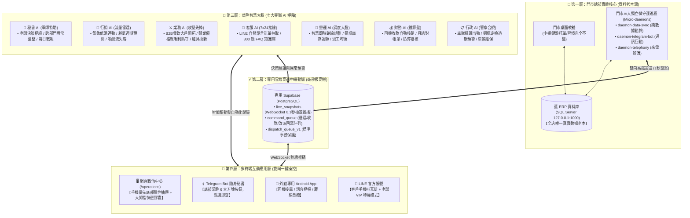
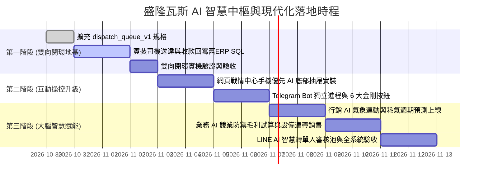

# 👑 盛隆瓦斯 AI 智慧中樞與現代化系統架構總整理全書

> **最高決策者**：老闆 (Telegram ID: `8862712587`，唯一 SuperAdmin)  
> **專案倉庫**：`shenglong-next` (監控中心/外勤App) & `gass` (財務/LINE/知識庫)  
> **制定日期**：2026 年 10 月 31 日  
> **核心戰略方針**：**「門市維持二十年習慣零衝擊、中繼升級專用高鐵動脈、外勤與雲端 100% 雙向即時閉環、七大專職 AI 矩陣各司其職、手機與 Telegram 雙向一鍵操控」**

---

## 壹、 系統總體架構：四大層次與雙向閉環拓撲

盛隆瓦斯的現代化系統劃分為四個層次，徹底杜絕單點故障與資料斷環，實現「讀寫皆通」的完整閉環：



---

## 貳、 盛隆七大專職 AI 矩陣深度職能分工全表

盛隆瓦斯的營運不再依賴單一龐雜的 AI，而是由 **七大專職 AI 緊密協同**：

| AI 角色名稱 | 核心戰略定位 | 目標客群與場景 | 核心功能武器 | 實體連動產出 |
| :--- | :--- | :--- | :--- | :--- |
| **🤖 秘書 AI**<br>(Executive Secretary) | **軍師特助<br>指揮樞紐** | 老闆專屬 (Telegram ID `8862712587`) | • 每日 08:30 晨會綜合戰報<br>• 跨部門異常警報篩選與即時通報<br>• 老闆自然語言指令轉化為各 AI 任務 | Telegram 戰報推送、調度決策確認卡片 |
| **🎯 行銷 AI**<br>(Marketing & Retention) | **空軍轟炸<br>流量雷達** | 一對多海量家庭散戶、社區住宅群 | • **中央氣象局低溫驟降 API 連動早鳥推播**<br>• 耗氣週期預測模型 (`gas-cycle`)<br>• **第 60 天沈睡客戶自動發放專屬喚醒券**<br>• 社區「好鄰居省氣券」推薦裂變 | LINE 分群自動推播、早鳥預購單轉入待審池 |
| **⚔️ 業務 AI**<br>(Sales & B2B Expansion) | **地面特種部隊<br>攻堅掠奪** | 一對一高客單商用戶（快炒、火鍋、小吃、央廚、學校） | • **商圈新開幕餐飲潛力戶掃描**<br>• **競業搶客削價防禦（精算保本毛利底線）**<br>• 爐具/數位熱水器連帶銷售 (`stove-orders`)<br>• 大商戶階梯長約與鋼瓶押金監管 | B2B 專屬合約書、防守談判建議、爐具報價單 |
| **💬 客服 AI**<br>(Customer Service) | **7x24 接線生<br>前線服務** | 全體 LINE 叫瓦斯客戶 | • LINE 自然語言智慧訂單抽取<br>• 300 題瓦斯常見問題 FAQ 即時問答<br>• 配送進度查詢與急件客訴安撫 | 自動建立待審叫貨草稿單、FAQ 滿意度記錄 |
| **🚚 營運 AI**<br>(Operations Dispatch) | **前線動脈<br>調度大腦** | 門市調度員、外送車隊（小龍、柏林） | • 智慧配送路線規劃 (TSP / VRP)<br>• **出車載量與已派單自動扣減試算**<br>• 鋼瓶進銷存週轉與安全庫存預警<br>• 司機負載均衡動態派工 | 車載剩餘現貨即時更新、派工指令寫入佇列 |
| **💰 財務 AI**<br>(Finance & Audit) | **鐵算盤<br>風控審計** | 門市會計、老闆查帳 | • 外送員現場繳回現金與欠款自動核銷<br>• 餐飲大戶月結對帳單與稅額自動試算<br>• 作廢單、改價單、異常單防弊稽核 | 每日收現對帳清單、月結發票明細表 |
| **📋 行政 AI**<br>(Admin & Safety) | **法規管家<br>後勤合規** | 人資排班、車輛設備安全 | • 司機出勤排班與工時合規監控<br>• **鋼瓶檢驗過期前 60 天法規預警**<br>• 配送機車/貨車定檢、保險到期追蹤 | 鋼瓶報廢/送檢清冊、車輛維保提醒通知 |

---

## 參、 雙向操控互動通道設計：免打字、手機優先

老闆在外出或辦公時，可透過以下兩大主力通道與 AI 即時互動，**徹底消滅繁瑣打字**：

### 1. ✈️ Telegram Bot：隨身秘書「底部常駐 6 大金剛按鈕」
老闆打開 Telegram，輸入框下方**永久常駐 6 個大拇指方塊大按鈕**，點一下答案直接跳出：

```text
┌───────────────────────────┐
│     盛隆智慧軍師 (常駐選單)     │
├─────────────┬─────────────┤
│ 📊 今日戰報  │ 🚛 司機現貨  │
├─────────────┼─────────────┤
│ 🚨 異常預警  │ 🔍 快速查客  │
├─────────────┼─────────────┤
│ ❄️ 寒流推播  │ ⚔️ 業務防禦  │
└─────────────┴─────────────┘
```
* **點擊 `[📊 今日戰報]`** ➔ 0.2 秒回傳今日總單數、已送達數、總營收、收現與欠款統計。
* **點擊 `[🚛 司機現貨]`** ➔ 立即顯示小龍與柏林當前車上剩幾桶、未送完單據明細，並附帶 `[🛵 快速改派]` 內嵌按鈕。
* **安全機制**：唯一白名單鎖定老闆 Telegram ID `8862712587`，其餘帳號私訊一律靜默忽略。

### 2. 🖥️ 網頁戰情中心：手機優先「底部彈性抽屜 (Mobile Bottom Sheet)」
針對老闆大部分用手機看盤的習慣，戰情中心右下角常駐呼吸燈號，向上滑動即可展開**三段式彈性抽屜**：

```text
┌─────────────────────────────────┐
│ 盛隆調度戰情中心   [🔔3] [≡]    │ <- 頂部狀態列
├─────────────────────────────────┤
│ [全部82] [待派工2] [配送中6]... │ <- 流動膠囊快篩
│                                 │
│ 🚛 小龍 (剩2桶) | 🚛 柏林 (剩1桶)│ <- 車載現貨動態扣減
│                                 │
│ ┌─────────────────────────────┐ │
│ │ 訂單 #352100 | 中正路 100 號 │ │ <- 背景訂單卡片
│ │ 20kg×1 | 柏林配送中         │ │
│ └─────────────────────────────┘ │
├─────────────────────────────────┤
│ ╭─────────────────────────────╮ │
│ │  ═══ (拖曳拉桿：收合/半開/全開) │ │
│ │ 🤖 盛隆 AI 特助              │ │ <- 底部彈性抽屜
│ │ [📊 今日戰報] [🚛 查車載] [❄️寒流]│ │ <- 大拇指快選膠囊列
│ │ ─────────────────────────── │ │
│ │ 💬 AI：老闆好！今日進度達 92%│ │
│ │ 建議提醒小龍補載 20kg 5 桶。 │ │
│ │ [一鍵通知小龍] [忽略]        │ │
│ ╰─────────────────────────────╯ │
│ [ 🎤 語音輸入 ]  [ 請輸入指令... ]│
└─────────────────────────────────┘
```
* **收合狀態 (Peek / 60px)**：僅底部露出一句話摘要，不遮擋看訂單。
* **半開狀態 (Half / 50% 螢幕)**：上半部看單、下半部看 AI 數據分析與卡片。
* **全開狀態 (Full / 90% 螢幕)**：深度閱讀財務折線圖與客戶 360 度歷史。
* **一鍵快選膠囊列**：大拇指單手點擊 `[📊 今日戰報]`、`[🚛 查車載]`，免叫出虛擬鍵盤擋螢幕！
* **麥克風語音輸入**：按住即可用講的下達調度指令。

---

## 肆、 全系統連動影響預判與閉環機制 (Ripple Analysis)

依據最高執行指令，系統所有擴充必須通過連動影響審查：

1. **會員系統 ↔ 業務/行銷 AI**：
   * 標籤化與生命週期模型僅在獨立分析表（`customer_insights`）運行，**絕不竄改舊 ERP 會員原始欄位**，保障歷史資料純淨。
2. **訂單系統 ↔ 客服/營運 AI**：
   * 所有 AI 產生的訂單均嚴格經過「中繼暫存池 ➔ 老闆/門市審核確認」兩道防線，寫入舊 ERP 必須透過 `dispatch_queue_v1` 具備事務保護之 SQL 語法執行，徹底杜絕重複下單或漏單。
3. **財務系統 ↔ 業務/財務 AI**：
   * 業務談判之折價與優惠券，均綁定專用行銷會計科目編號，自動與瓦斯本業收入拆分核銷，確保每月損益表平衡。
4. **守護進程與權限保護**：
   * 門市資料動脈、Telegram 通訊、來電顯示拆分為微進程獨立運行，互不卡死；最高指揮權嚴格限定老闆 Telegram ID `8862712587`。

---

## 伍、 分階段實施落地路線圖 (Implementation Roadmap)



### 👑 總結：
本規劃書將**「穩固門市老本」、「升級即時中繼動脈」、「七大專職 AI 矩陣」**與**「手機 / Telegram 免打字一鍵操作」**融為一體，構建出兼具高穩定性與前瞻競爭力的現代智慧瓦斯營運體系！
