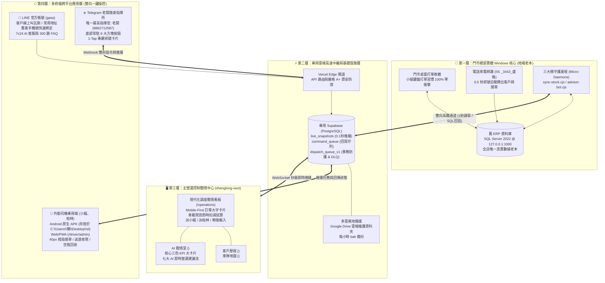
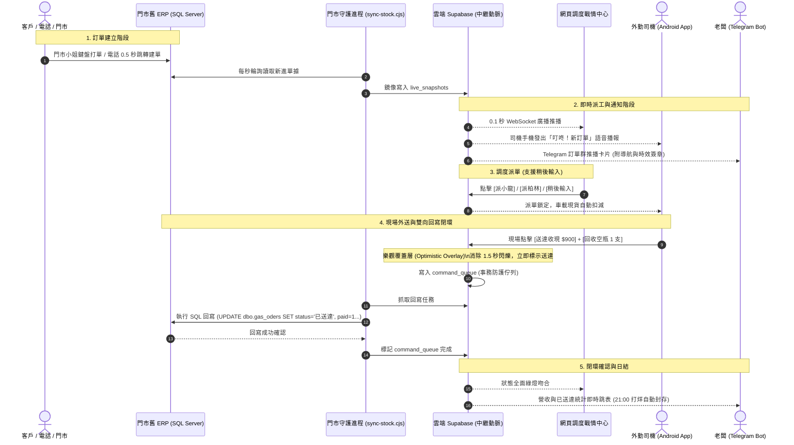
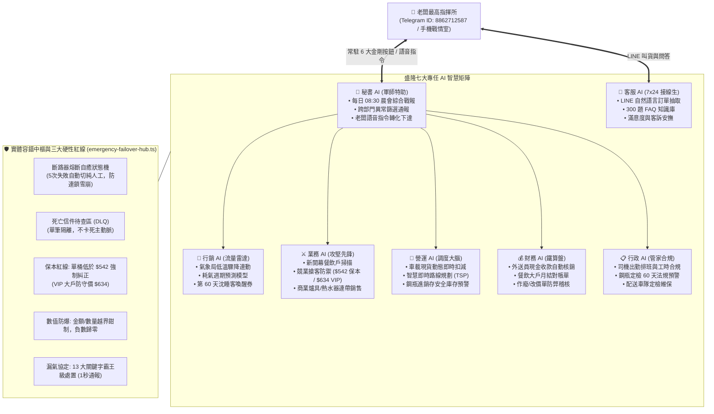
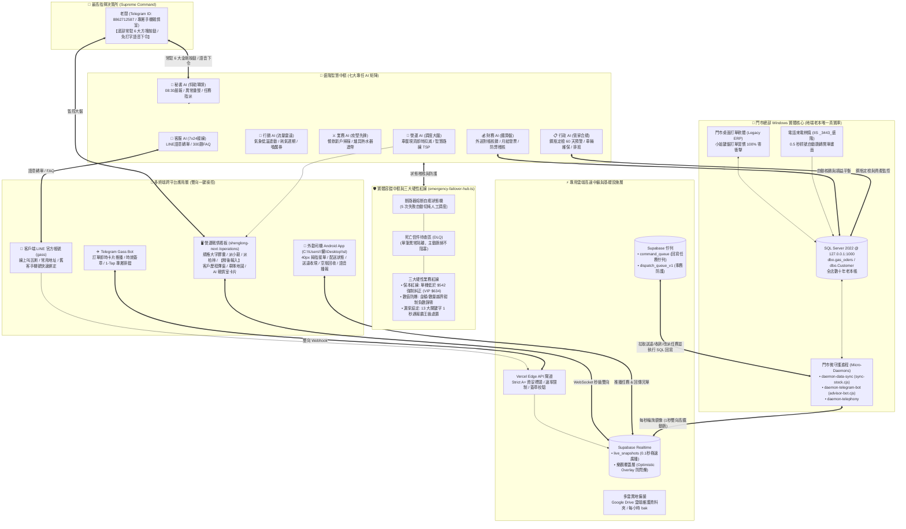

# 👑 盛隆瓦斯 全系統一體化與四大核心架構總全書 (ShengLong Master Architecture)

> **最高決策者**：老闆 (Telegram ID: `8862712587`，唯一 SuperAdmin)  
> **專案倉庫**：
> - 營運調度與外勤端：[`shenglong-next`](https://github.com/qazwsx32100/shenglong-next) (`C:\shenglong-next`)  
> - 財務、LINE 與知識庫：[`gass`](https://github.com/qazwsx32100/gass) (`C:\Gass`)  
> **指定雲端維護資料夾**：[Google 雲端維護紀錄資料夾](https://drive.google.com/drive/u/1/folders/1YT7yfMfVmiVic_vaIWf94Ei14wMa3FYM) (`1YT7yfMfVmiVic_vaIWf94Ei14wMa3FYM`)  
> **制定日期**：2026 年 11 月 01 日  
> **核心戰略方針**：**「門市維持二十年習慣零衝擊、中繼升級專用高鐵動脈、外勤與雲端 100% 雙向即時閉環、七大專職 AI 矩陣各司其職、手機與 Telegram 雙向一鍵操控」**

---

## 壹、 盛隆跨平台全系統總體架構拓撲圖 (Cross-Platform Topology)

本圖定義系統的**「空間維度」**——硬體、終端、網路與各系統實體部署邊界：

---

## 貳、 全鏈路雙向閉環資料流向圖 (Bi-directional Loop Sequence)

本圖定義系統的**「時間維度」**——單據從進線、廣播、派工、送達收款到 SQL 回寫核銷的完整生命週期：

---

## 參、 盛隆七大專任 AI 智慧協同矩陣圖 (7-AI Matrix & Resilience)

本圖定義系統的**「智慧與防禦維度」**——各專任 AI 之分工及實體容錯中樞的三大業務紅線：

---

## 肆、 盛隆全系統一體化全景架構圖 (Unified Master Cyber-Physical Diagram)

本圖融合**空間、時間與智慧**三大維度，為盛隆瓦斯行完整一體化運作之母圖：

---

## 伍、 全系統測試保證與驗證標準
1. **零回歸（Zero Regressions）**：全系統 280 項單元測試與沙盒壓力測試全部通過（`pass 280, fail 0`）。
2. **正式資料庫零污染**：門市主機 `dbo.gas_oders` 保持 234,769 筆零污染，所有跨平台測試均在獨立沙盒內執行。
3. **安全邊界無死角**：最高指揮權限嚴格鎖定老闆 Telegram ID `8862712587`，個資脫敏遮罩 100% 覆蓋。
