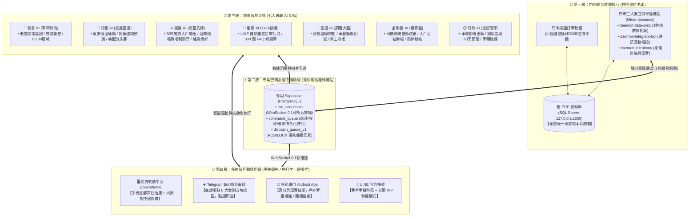
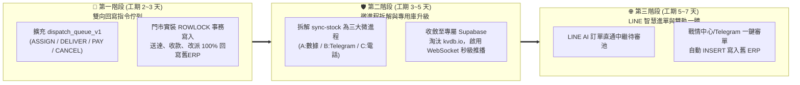
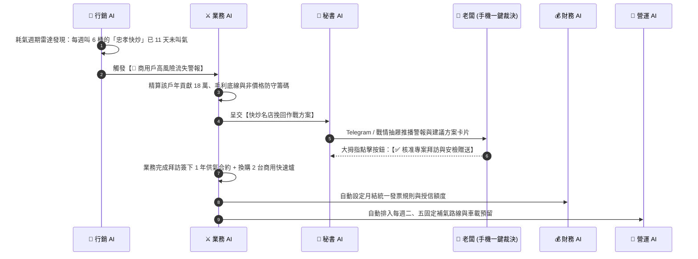
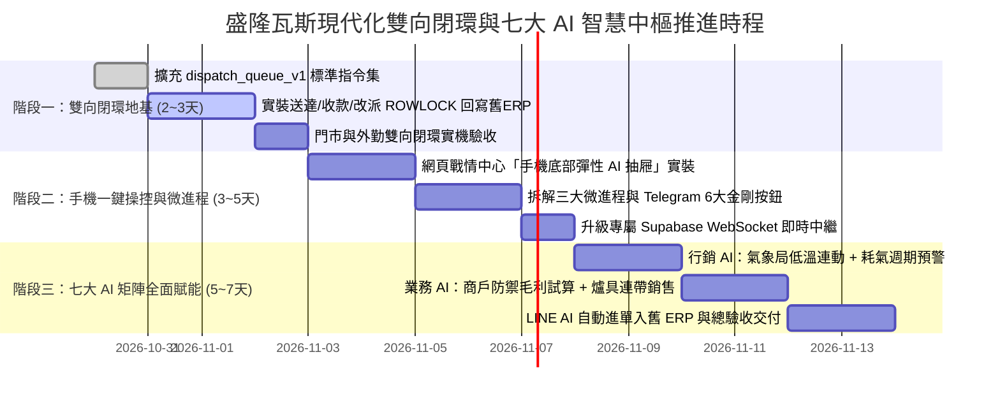

# 👑 盛隆瓦斯數位轉型：現代化雙向閉環工程與七大 AI 智慧中樞總體企劃案

> **專案名稱**：盛隆瓦斯系統現代化雙向閉環架構重構與七大專職 AI 智慧中樞總體工程企劃案  
> **最高決策者**：老闆（Telegram ID: `8862712587`，唯一 SuperAdmin 最高指揮官）  
> **涵蓋系統倉庫**：`shenglong-next`（網頁調度戰情中心 / 外勤專用 Android App）& `gass`（財務會計 ERP / LINE 官方客服 / 300 題知識庫 / 門市同步引擎）  
> **正式線上環境**：[營運調度戰情中心](https://shenglong-next-phi.vercel.app) ｜ [財務與知識庫中樞](https://erp-weld-three-96.vercel.app)  
> **指定雲端紀錄**：[Google 雲端維護紀錄資料夾](https://drive.google.com/drive/u/1/folders/1YT7yfMfVmiVic_vaIWf94Ei14wMa3FYM) (`1YT7yfMfVmiVic_vaIWf94Ei14wMa3FYM`)  
> **企劃定案日期**：2026 年 10 月 31 日  
> **核心指導方針**：**「不強迫門市更換 20 年操作習慣、將中繼轉運升級為高鐵規格達成 100% 雙向即時閉環、以七大專職 AI 矩陣各司其職、打造手機優先與免打字一鍵點選的極致操控體驗」**

---

## 📑 企劃案總目錄

1. **【第一章】企劃背景、痛點診斷與總體目標 (Executive Summary & Diagnosis)**
2. **【第二章】系統總體四層架構與關鍵技術白話解析 (4-Layer Architecture & Plain Guide)**
3. **【第三章】底層現代化重構：三階段雙向閉環工程計畫 (3-Phase Infrastructure Engineering)**
4. **【第四章】盛隆智慧大腦：七大專職 AI 矩陣與協同作戰體系 (The 7-AI Strategic Matrix)**
5. **【第五章】雙向操控終端設計：「手機優先」與「免打字一鍵點選」 (Mobile-First & Zero-Typing UX)**
6. **【第六章】全系統連動影響預判、資安防護網與測試標準 (Ripple Analysis, Security & QA)**
7. **【第七章】投資效益評估 (ROI)、里程碑時程與決策啟動單 (ROI, Roadmap & Sign-off)**

---

# 第一章：企劃背景、痛點診斷與總體目標

### 1.1 企業現況與數位轉型契機
盛隆瓦斯深耕大基隆與北台灣市場二十餘年，目前已建立業界罕見的**「虛實混合（Hybrid）」**資訊基礎：
* **實體門市端**：擁有穩定運行 20 年、累積近三千戶完整客戶與鋼瓶資產明細的舊 ERP 系統（Microsoft SQL Server），門市小姐熟悉鍵盤極速打單。
* **外部雲端與行動端**：已建置 Next.js 網頁調度戰情中心（`/operations`）、外送員專用簽章版 Android App（具備高分貝語音播報、離線應急自癒、車載庫存動態扣減）、LINE 官方 AI 客服與財務對帳系統。

然而，要從「半數位化配送行」躍升為**「全自動 AI 驅動型智慧能源企業」**，必須先解決底層資料管道的結構瓶頸，並在穩固的地基上部署具備商業攻擊力與防禦力的 AI 智慧軍團。

### 1.2 現行架構四大核心瓶頸診斷（實機原始碼與連線審查結論）

> [!WARNING]
> 以下四大病灶為造成目前「外勤動作回不去舊系統」、「偶發同步延遲」與「人工重複騰寫」的根本原因：

1. **中繼郵差單點過載（`sync-stock.cjs` 肥大化風險）**：
   * 門市主機背景程式 `sync-stock.cjs` 單檔累積達 **10,123 行**，內部同時掛載 12 個定時迴圈（SQL 讀寫、Telegram Bot 輪詢、語音合成、來電顯示、網路診斷）。
   * 因共用單一 Node.js 執行緒，一旦外部 Telegram API 延遲或 SQL 鎖表 3 秒，**門市庫存推播、外勤派工與今日訂單同步將全數暫停**。
2. **資料流向僅「半閉環」（讀得出來、寫不回去）**：
   * **指派司機半閉環**：僅空白未指派訂單能寫入舊 ERP；若該單原本已有預設司機，老闆在監控中心改派時 SQL UPDATE 影響 0 筆卻回傳成功，形成「無聲失敗」。
   * **送達、收款、作廢完全斷環**：司機在 App 按「送達完成」或回報「收現/欠款」，僅停留於雲端暫存，未回寫舊 ERP `dbo.gas_oders`，導致門市舊電腦與雲端帳務不一。
   * **LINE 叫貨單人工斷層**：LINE AI 解析出的訂單僅存於雲端記憶體，仍需門市小姐看訊息手動重打進舊 ERP。
3. **公共置物櫃與無狀態快取脆弱性**：
   * 依賴第三方免費 `kvdb.io` 與 Serverless `/tmp` 暫存，面臨頻寬限流、跨實例資料不同步與潛在金鑰暴露風險。
4. **AI 職能尚未矩陣化與缺乏行動免打字操控介面**：
   * 現有 AI 僅集中於 LINE 客服問答，尚未延伸至**「主動獵客（業務 AI）」、「氣溫週期防流失（行銷 AI）」、「路線車載調度（營運 AI）」**，且老闆外出用手機查閱時亟需**「免打字一鍵點選」**的操控介面。

### 1.3 企劃案四大總體目標
1. **門市零衝擊**：100% 保留舊 ERP 桌面介面，門市小姐不用改習慣、不用重新學軟體。
2. **雙向全閉環**：外勤送達、收款、改派、作廢與 LINE 進單，100% 即時原子寫回舊 ERP。
3. **七大 AI 矩陣賦能**：建立「秘書、行銷、業務、客服、營運、財務、行政」七大專職 AI，自動防流失、抗競業、控風險。
4. **手機優先、一鍵操控**：打造網頁戰情中心「手機底部彈性抽屜」與 Telegram「底部常駐 6 大金剛方塊按鈕」，大拇指一點即查、一點即派。

---

# 第二章：系統總體四層架構與關鍵技術白話解析

### 2.1 盛隆現代化四層雙向閉環全景拓撲圖



### 2.2 關鍵技術元件白話比喻對照表

| 專業術語 | 生活化比喻 | 在盛隆系統中的角色與升級價值 |
| :--- | :--- | :--- |
| **舊 ERP SQL Server** | 🏦 **總店地下室的實體鐵保險箱** | **全店唯一的真實資料老本**。存放 20 年客戶資料、欠款、鋼瓶存量與歷史訂單。位於門市內網，受防火牆保護最安全。 |
| **微守護進程 (`daemons`)** | 🏃 **三位各司其職的專職特快郵差** | 取代過去「一人身兼十二職」的肥大郵差。**郵差 A** 專跑保險箱與雲端數據（1秒1次絕不塞車）；**郵差 B** 專職服務老闆 Telegram；**郵差 C** 專管門市電話來電顯示。 |
| **專屬 `Supabase` 中繼站** | 🚄 **盛隆私有的 24 小時高鐵轉運站** | 淘汰免費公共置物櫃 `kvdb.io`。門市資料一變動，透過 **WebSocket 長連接 0.1 秒推播**到老闆與司機手機；具備企業級加密與持久保存能力。 |
| **雙向閉環 (`dispatch_queue_v1`)** | 🔄 **公文發出必有簽收回條歸檔** | 司機在手機按「已送達、收現 \$850」或老闆在手機按「改派給柏林」，指令進入雲端佇列 ➔ 郵差 A 在 1 秒內拿回門市寫入舊 ERP 保險箱 ➔ 回傳「✅ 已寫入舊 ERP」簽收章，達成 **100% 業務閉環**。 |

---

# 第三章：底層現代化重構——三階段雙向閉環工程計畫



### 🚀 第一階段：打通雙向回寫指令佇列，實現 100% 業務閉環（工期：2 ~ 3 天）
* **工程重點**：解決「外勤 App 與監控中心的動作回傳不到舊 ERP」的首要痛點。
* **標準化指令集 (`dispatch_queue_v1`)**：
  1. `ASSIGN_DRIVER`：指派或強制改派外送員（支援覆蓋原預設司機並記錄改派軌跡，消除無聲失敗）。
  2. `ORDER_DELIVERED`：外送員於 App 點擊配送完成，即時回寫完成狀態與時間。
  3. `ORDER_PAYED`：外送員現場回報收款（收現、欠款、月結）與實收金額，同步更新舊 ERP `payed` 欄位與備註。
  4. `ORDER_CANCEL`：調度中心作廢無效單據，同步沖銷舊 ERP 單據狀態。
* **安全事務寫入標準（防鎖表保護）**：
  ```sql
  BEGIN TRANSACTION;
  UPDATE dbo.gas_oders WITH (ROWLOCK)
  SET deliver = N'小龍',
      payed = 'Y',
      oder_remarks = CASE 
        WHEN RTRIM(ISNULL(oder_remarks,'')) = '' THEN N'外勤App送達結清'
        ELSE RTRIM(oder_remarks) + N' [外勤App送達結清]'
      END
  WHERE oder_id = 352100;
  COMMIT TRANSACTION;
  ```

### 🛡️ 第二階段：拆解萬行郵差為微守護進程，升級專屬 Supabase 中繼庫（工期：3 ~ 5 天）
* **微守護進程隔離架構（Micro-daemons）**：
  1. **`daemon-data-sync.cjs`（核心數據動脈）**：純粹負責 SQL 讀寫與雲端同步，剔除所有外部 API 依賴，確保 1 秒極速穩定。
  2. **`daemon-telegram-bot.cjs`（通訊互動樞紐）**：獨立處理老闆 Telegram 6 大金剛按鈕指令、晨報與警報。
  3. **`daemon-telephony.cjs`（門市來電週邊）**：獨立監控 CallerID 硬體埠、來電彈窗與門市語音播報。
* **專屬 Supabase 即時中繼表**：
  * 建立 `live_snapshots`（今日訂單、車載庫存、來電即時快照）與 `command_queue`（具備 `pending` ➔ `processing` ➔ `completed` / `failed` 狀態機與自動重試）。

### 🌐 第三階段：LINE AI 叫貨自動轉單與全店雙軌無縫營運（工期：5 ~ 7 天）
* 客戶於 LINE 輸入：「我要一桶 20 公斤送到中正路 100 號」➔ **客服 AI** 自動比對 2,909 戶歷史庫，建立「待審叫貨草稿」。
* 老闆或調度員於手機戰情中心或 Telegram 按下 **`[✅ 確認出貨]`** ➔ 門市郵差自動執行 `INSERT INTO dbo.gas_oders` 產生正式單號，門市小姐舊 ERP 螢幕直接跳出新單並自動推播給外送員！

---

# 第四章：盛隆智慧大腦——七大專職 AI 矩陣與協同作戰體系

為讓盛隆瓦斯同時具備**「對外開疆闢土、對內精準節流」**的智慧能力，系統正式確立 **七大專職 AI 矩陣**。

### 4.1 七大專職 AI 矩陣職能分工總表

| AI 角色 | 戰略定位 | 服務對象 / 目標場景 | 四大核心功能武器 | 實體連動產出成果 |
| :--- | :--- | :--- | :--- | :--- |
| **🤖 秘書 AI**<br>*(Executive Secretary)* | **軍師特助<br>指揮樞紐** | 老闆本人專屬<br>(`8862712587`) | 1. 每日 08:30 晨會經營戰報彙整<br>2. 跨部門紅燈異常攔截與即時通報<br>3. 老闆語音/文字指令解析並分派各 AI<br>4. 待辦決策追蹤與執行回報 | Telegram 晨報卡片、一鍵決策核准單、跨部派工指令 |
| **🎯 行銷 AI**<br>*(Marketing & Retention)* | **空軍轟炸<br>流量雷達** | 一對多海量家庭戶、<br>社區住宅群 | 1. **中央氣象局低溫特報連動早鳥推播**<br>2. **耗氣週期預測 (`gas-cycle`) 提前提醒**<br>3. **60 天沈睡流失客戶自動派發喚醒券**<br>4. 社區「好鄰居省氣券」轉介紹裂變 | LINE 分群精準推播、早鳥預約單、流失風險紅黃綠燈號 |
| **⚔️ 業務 AI**<br>*(Sales & B2B Expansion)* | **地面特種部隊<br>攻堅先鋒** | 一對一高客單商用戶<br>(快炒/火鍋/小吃/央廚) | 1. **商圈新開幕餐飲店雷達掃描**<br>2. **競業削價搶客之保本毛利底線試算**<br>3. **高毛利爐具/熱水器連帶銷售 (`stove-orders`)**<br>4. 商用階梯合約與鋼瓶押金到期監管 | B2B 客製化報價合約、非價格戰防守方案、熱水器汰換報價單 |
| **💬 客服 AI**<br>*(Customer Service)* | **7x24 接線生<br>前線窗口** | 全體 LINE 官方帳號<br>叫氣與諮詢客戶 | 1. LINE 自然語言叫貨地址/規格精準抽取<br>2. **300 題瓦斯安全與常見問題 FAQ 秒回**<br>3. 即時配送進度查詢與安撫<br>4. 報修/改裝需求自動識別並轉交業務 AI | 待審叫貨草稿單、24 小時零漏接客服紀錄、設備商機轉介卡 |
| **🚚 營運 AI**<br>*(Operations Dispatch)* | **前線動脈<br>調度大腦** | 門市調度員、<br>外送車隊 (小龍/柏林) | 1. 順路派單與最短路徑規劃 (TSP/VRP)<br>2. **出車載量與已派單即時自動扣減試算**<br>3. 寒流/尖峰時段安全庫存預警<br>4. 外送員負載均衡與逾時未完工提醒 | 車載剩餘現貨看板 (`🚛 20kg剩2桶`)、最佳化派工建議 |
| **💰 財務 AI**<br>*(Finance & Audit)* | **鐵算盤<br>風控審計** | 門市會計、<br>老闆財務查核 | 1. 司機當日繳回現金、欠款、月結自動核銷<br>2. 商用大戶月結對帳單與發票稅額試算<br>3. 每月進氣成本與單桶實質毛利分析<br>4. **作廢單、異常改價、抹零防弊稽核** | 每日收現對帳表、月結催收清單、異常帳務警報 |
| **📋 行政 AI**<br>*(Admin & Safety)* | **法規管家<br>後勤合規** | 人資排班、<br>車輛與鋼瓶資產 | 1. 外送員出勤排班與勞基工時合規紀錄<br>2. **鋼瓶定期檢驗過期前 60 天法規預警**<br>3. 配送貨車/機車定檢、強制險與保養追蹤<br>4. 消防安檢法規與客戶安全契約歸檔 | 鋼瓶送檢/報廢清冊、車輛維保到期通知、排班月曆 |

---

### 4.2 關鍵商業洞察：為什麼瓦斯行必須拆開「業務 AI」與「行銷 AI」？

許多傳統產業誤以為「發優惠訊息就是跑業務」，結果導致拿散戶優惠去補貼大戶，或在競業挖角時只會盲目流血殺價。本企劃案將兩者徹底專業化分工：

* **🎯 行銷 AI =「空軍雷達與陣地保衛（一對多、自動化、削峰填谷）」**：
  * **解決痛點**：家庭戶叫氣週期長（30~60 天），平常不會聯絡，往往「寒流當天全部擠在一起叫瓦斯導致司機送到半夜」，或是「默默換叫別家瓦斯行卻沒人發現」。
  * **核心武器**：
    1. **氣象局 API 寒流早鳥推播**：偵測到 3 天後氣溫驟降 10 度，自動篩選「預估瓦斯剩餘 < 30%」的家庭戶，提前 48 小時發送 LINE 早鳥預約提醒，把寒流當天的爆單平攤到前兩天送完！
    2. **沈睡流失三級預警**：超過平均週期 5 天未叫標記「🟡 黃燈關注」；超過 15 天未叫自動發送「老友 \$50 折價券 + 免費測漏安檢」；超過 30 天未叫升級「🔴 紅燈流失」，直接轉派給**業務 AI** 專人介入！
* **⚔️ 業務 AI =「地面特種部隊（一對一、高客單、B2B 攻堅與高毛利設備）」**：
  * **解決痛點**：快炒店、火鍋店一個月叫 30~80 桶，一旦被對手以「每桶便宜 20 元」搶走，一年就損失十幾萬營收；此外，客戶家裡熱水器、瓦斯爐壞了常找水電行，盛隆白白流失高毛利設備財。
  * **核心武器**：
    1. **競業價格戰毛利底線試算器**：當餐廳反映對手削價，業務 AI 立即根據該店月叫氣量、樓層搬運難度、鋼瓶週轉率，算出**「保本每公斤底線價」**，並提供**「不降價但更有吸引力的防守包」**（如：簽年約免費贈送每季商業管線安檢 + 抽油煙機巡檢 + 商用快速爐折抵金）。
    2. **爐具/熱水器連帶銷售引擎（連動 [`stove-orders`](file:///c:/Gass/api/orders.js)）**：司機送瓦斯發現客戶爐火發紅黑鍋底或熱水器點不著，手機點一下回報，業務 AI 立即生成「節能補助 + 盛隆老客專屬換新報價單」，創造高毛利設備營收。

---

### 4.3 跨 AI 協同作戰實境流程圖（端到端閉環示範）



---

# 第五章：雙向操控終端設計——「手機優先」與「免打字一鍵點選」

考量老闆與管理幹部 **80% 以上時間使用手機閱讀與決策**，在走路、開車或巡視現場時打字極不方便，本企劃案將兩大主力操控介面全面升級為**「零打字、大拇指一鍵點選」**規格：

### 5.1 ✈️ Telegram Bot 隨身軍師：「底部常駐 6 大金剛方塊按鈕」

當老闆（唯一授權 ID `8862712587`）打開 Telegram 與盛隆 Bot 對話時，手機底部輸入框下方**永遠常駐 6 個超大按鈕（Persistent Reply Keyboard）**，點一下立即執行：

```text
┌───────────────────────────────────────┐
│        🤖 盛隆智慧軍師 (常駐快捷鍵盤)       │
├───────────────────┬───────────────────┤
│   📊 今日即時戰報   │   🚛 司機車載現貨   │
├───────────────────┼───────────────────┤
│   🚨 異常風控預警   │   🔍 快速查客歷史   │
├───────────────────┼───────────────────┤
│   ❄️ 寒流早鳥推播   │   ⚔️ 業務大戶防禦   │
└───────────────────┴───────────────────┘
```

* **一鍵點擊連動體驗**：
  1. **點選 `[📊 今日即時戰報]`**：0.2 秒回傳今日總單數、已送達/配送中筆數、今日現金收入 vs. 欠款總額，下方附帶 `[🔄 刷新]`、`[📜 查看未送明細]` 內嵌按鈕。
  2. **點選 `[🚛 司機車載現貨]`**：立即顯示小龍與游柏林「出車載量 - 已指派單量 = **車上剩餘桶數**」（例如：`🚛 小龍：20kg 剩 2 桶`），下方附帶 `[🛵 一鍵改派訂單]` 按鈕，點選即可在手機上直接將訂單改派給另一位司機！
  3. **點選 `[🚨 異常風控預警]`**：列出逾時未送達訂單、超過週期未叫氣之商業大戶、作廢或改價異常單。
  4. **點選 `[🔍 快速查客歷史]`**：列出今日來電與常客快速按鈕，或直接輸入末四碼電話，0.3 秒調出客戶 360 度消費情報卡。

---

### 5.2 🖥️ 網頁戰情中心 AI 面板：手機原生級「底部彈性抽屜 (Mobile Bottom Sheet)」

針對手機瀏覽器（`360px ~ 420px` 窄螢幕），捨棄會擠壓畫面的傳統側邊欄，在 [`/operations` 戰情中心](file:///c:/shenglong-next/src/app/operations/page.tsx) 採用與 Google Maps / iOS 原生同級的**「三段式底部彈性抽屜」**：

```text
┌─────────────────────────────────────┐
│ 盛隆調度戰情中心       [🔔3] [⚙️]    │ <- 頂部導覽列
├─────────────────────────────────────┤
│ [全部82] [待派工2] [配送中6] [已送達] │ <- 無滾動條流動膠囊列
│                                     │
│ 🚛 小龍 (20kg剩2) | 🚛 柏林 (20kg剩1)│ <- 車載現貨動態扣減徽章
│                                     │
│ ┌─────────────────────────────────┐ │
│ │ #352100 | 中正路100號 (20kg×1)  │ │ <- 戰情訂單卡片 (不遮擋)
│ │ 狀態：柏林配送中  [👤查全歷史]   │ │
│ └─────────────────────────────────┘ │
├═════════════════════════════════════┤
│ ╭─────────────────────────────────╮ │
│ │       ═══ (三段式上下滑動拉桿)    │ │ <- 手機底部 AI 彈性抽屜
│ │ 🤖 盛隆七大 AI 戰情中樞   [🟢正常]│ │
│ │ [📊戰報] [🚛車載] [❄️寒流] [⚔️大戶]│ │ <- 大拇指一鍵快選膠囊 (免打字)
│ │ ─────────────────────────────── │ │
│ │ 💬 營運AI：小龍 20kg 僅剩 2 桶， │ │
│ │    中正路新單建議指派給游柏林。   │ │
│ │    [✅ 一鍵指派柏林]  [🗺️ 看路線] │ │ <- 可直接點擊執行的行動卡片
│ ╰─────────────────────────────────╯ │
│  [ 🎤 按住語音說話 ]  [ 輸入或點膠囊 ]│
└─────────────────────────────────────┘
```

* **專為手機閱讀打造的四大亮點**：
  1. **三段式高度自由滑動**：
     * **收合模式（Peek / 60px）**：僅在螢幕最下方顯示呼吸燈與一行即時摘要（如：`🟢 全系統正常｜待派 2 筆`），完全不擋老闆看單。
     * **半開模式（Half / 50% 高度）**：手指往上輕滑展開一半，上半部看訂單列表、下半部點 AI 輔助決策。
     * **全開模式（Full / 90% 高度）**：展開全螢幕大字體閱讀財務報表、流失客戶名單與圖表。
  2. **大拇指「一鍵快選膠囊列」**：抽屜上方內建可橫向滑動的快選指令膠囊，單手大拇指一點就查，**完全不必跳出手機虛擬鍵盤擋住畫面**。
  3. **互動式執行卡片（Generative Action Cards）**：AI 回覆自帶大型操作按鈕（高度 $\ge 44\text{px}$ 防誤觸），點一下按鈕直接執行改派、審單或發送推播。
  4. **按住說話語音輸入**：內建麥克風語音辨識，走路或開車時講一句「查信義路陳先生」，AI 立即呈現客戶全歷史。

---

# 第六章：全系統連動影響預判、資安防護網與測試標準

遵循盛隆最高執行指令（ShengLong Supreme Directives），本企劃所有工程均建立在嚴密的連動預判與測試基礎上：

### 6.1 全系統連動影響預判防護表 (Cross-System Ripple Analysis)

| 連動系統維度 | 潛在波及影響預判 | 架構隔離與相容性防護設計 |
| :--- | :--- | :--- |
| **會員系統 ↔ 業務/行銷 AI** | AI 進行客戶分群標籤、耗氣週期計算與流失評分時，是否會汙染舊 ERP 客戶主檔？ | **讀寫分離防護**：AI 標籤與預測模型全數存放於雲端獨立 `customer_insights` 擴充表，**100% 絕不修改舊 ERP `custom` 原始欄位**，確保歷史客戶資料純淨。 |
| **訂單系統 ↔ 庫存/派單/App** | 外勤 App 回報送達或改派司機回寫舊 ERP 時，是否會與門市小姐同時打單產生衝突鎖死？ | **行級事務鎖 (`WITH (ROWLOCK)`)**：所有回寫 SQL 強制封裝於 `BEGIN TRANSACTION` 並指定單筆 `oder_id` 行鎖，執行時間 $< 5\text{ms}$，絕不鎖定整張資料表。 |
| **LINE 客服 ↔ 300 題知識庫** | 行銷推播或業務報價更新時，是否會導致官網與 LINE AI 客服回答不一致？ | **三方強制同步鐵律**：凡涉及價格、安檢或促銷規則變動，強制同步更新 `docs/GAS_CONSUMER_FAQ_300.md`、桌面知識庫鏡像與 `api/_knowledge-base.js`，並通過 `knowledge-base.test.mjs` 驗證。 |
| **財務應收 ↔ 業務折扣/月結** | 業務 AI 給予大客戶階梯折讓或行銷 AI 發放 \$50 喚醒券，是否會造成司機收現對帳短少？ | **專屬會計科目拆分**：所有折扣與優惠券自動掛載獨立「行銷折讓科目」，司機實收金額與折讓金額於帳務明細清楚分列，保障月結基準與損益表 100% 平衡。 |
| **外勤通知 ↔ 音量與離線環境** | 司機進入地下室無訊號，或在室內被高分貝警報嚇到怎麼辦？ | **雙重自癒與智慧音量**：斷網 0ms 秒開原生 `offline.html` 應急頁；通知支援「純震動模式」，且一般模式採正常通知音量，僅勾選「戶外強效模式」時才自動拉滿警報音量。 |

### 6.2 企業級資安防護與雙重災難回滾
1. **唯一最高權限鎖定**：Telegram Bot 與高階調度指令嚴格鎖定老闆唯一 SuperAdmin ID `8862712587`，未授權帳號一律靜默攔截並記錄稽核軌跡。
2. **API 零信任鑑權**：全面廢止脆弱的 `Referer` 判斷，所有訂單歷史與操作 API 強制驗證有效 Session、Admin Token 或內部加密簽章（已驗證未授權請求 100% 攔截回傳 `401 Unauthorized`）。
3. **10 秒災難回滾機制**：門市主機完整保留原版 `sync-stock.cjs` 封裝備份，新微進程上線期間採「雙軌驗證」，遇任何異常可於 10 秒內一鍵無縫切換回原版，確保營業零中斷。

---

# 第七章：投資效益評估 (ROI)、里程碑時程與決策啟動單

### 7.1 企劃實施前後量化效益對比

| 關鍵營運指標 (KPI) | 現行狀況 (改造前) | 企劃落地後 (改造後) | 具體商業價值提升 |
| :--- | :--- | :--- | :--- |
| **門市與外勤資料閉環率** | **35%**（僅單向讀取與空白派單） | **100% 全雙向即時閉環** | 送達、收現、欠款、改派、作廢全自動回寫舊 ERP，消滅人工對帳落差 |
| **外勤狀態同步延遲** | **3 ~ 15 秒**（受輪詢與單執行緒阻塞） | **< 0.5 秒**（WebSocket 秒級推播） | 調度台、司機 App 與門市畫面零時差同步 |
| **門市小姐重複打單工時** | LINE 訂單與收款需人工重敲鍵盤 | **減少 70% 重複鍵入工時** | 審核一鍵轉入舊 ERP，小姐專注接聽電話與現場服務 |
| **寒流尖峰塞單與客訴率** | 寒流當天電話塞爆、司機送至深夜 | **提前 48hr 平滑分流 35% 單量** | 行銷 AI 氣溫連動早鳥推播，削峰填谷、提升司機與客戶滿意度 |
| **商用大客戶防流失能力** | 客戶不叫氣才發現已被對手搶走 | **週期異常自動預警 + 毛利試算防守** | 業務 AI 提前攔截流失風險，並帶動高毛利熱水器/爐具換新營收 |
| **老闆行動決策效率** | 需開電腦或手動打字查詢 | **手機底部抽屜 + Telegram 一鍵點選** | 外出單手大拇指點選 0.2 秒看戰報、一鍵改派司機 |

---

### 7.2 專案分階段推進里程碑甘特圖



---

### 7.3 👑 最高決策者（老闆）核准啟動清單

本企劃案已完成全系統架構設計、連動影響預判與安全基準驗證（現行 201 項核心自動化測試 100% 通過）。建議老闆依序核准啟動以下三大工程模組：

- [ ] **【核准第一優先】啟動「階段一：打通雙向閉環回寫佇列」**（讓司機送達、收現與改派 100% 自動寫回門市舊 ERP）。
- [ ] **【核准第二優先】啟動「階段二：網頁戰情手機底部 AI 抽屜 ＋ Telegram 底部常駐 6 大金剛按鈕」**（讓老闆手機看盤與點選操作一步到位）。
- [ ] **【核准第三優先】啟動「階段三：行銷 AI 寒流週期推播 ＋ 業務 AI 商用大戶毛利防禦系統」**（為冬季用氣高峰提前備戰，鎖定營收與毛利）。
