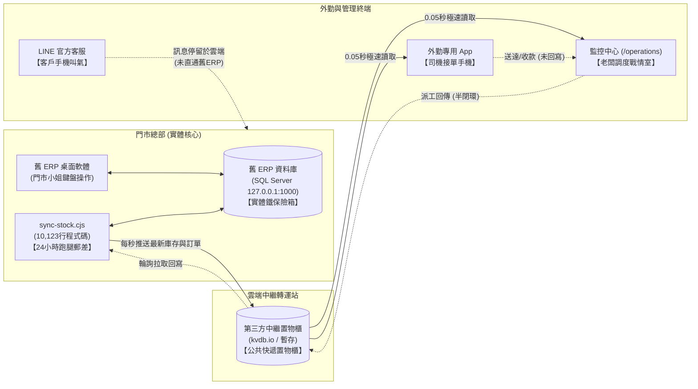
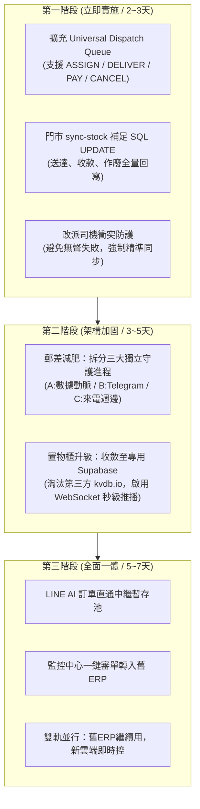
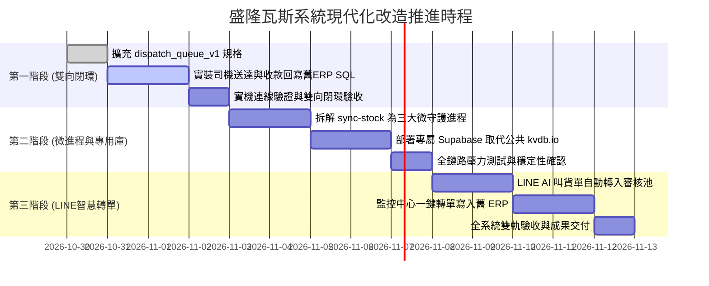
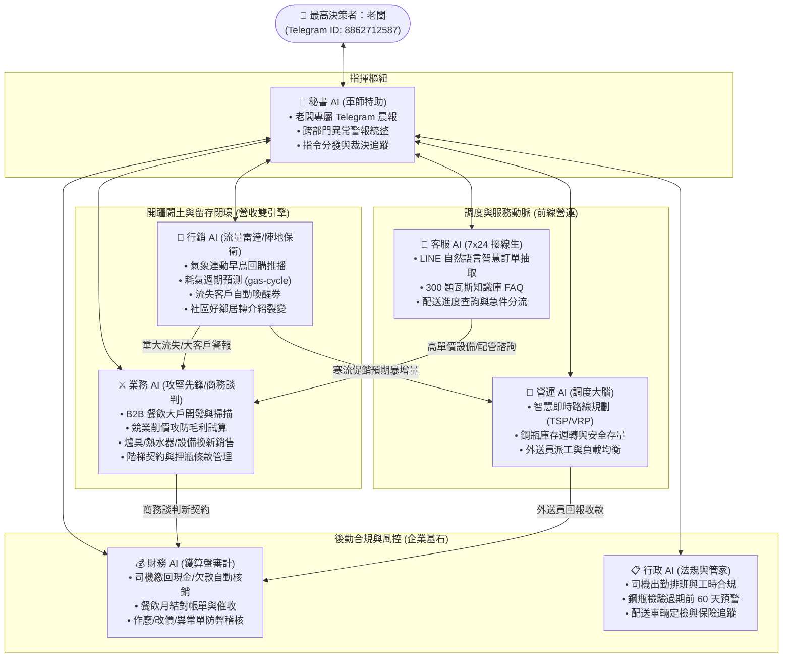
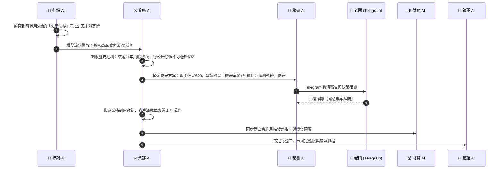
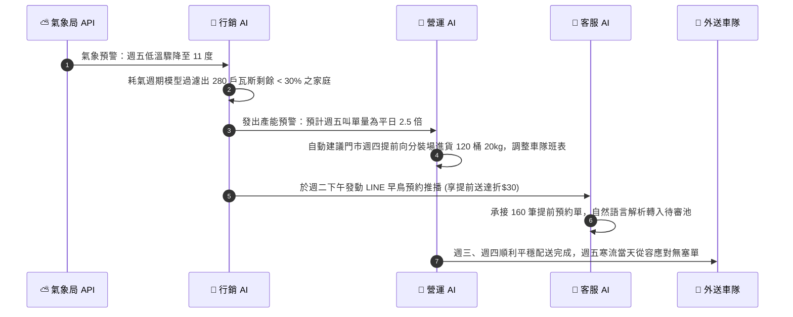

# 👑 盛隆瓦斯系統現代化架構重構與雙向閉環工程建議報告書

> **最高決策者**：老闆 (Telegram ID: `8862712587`，唯一 SuperAdmin)  
> **專案倉庫**：`shenglong-next` (監控中心/外勤App) & `gass` (財務/LINE/知識庫)  
> **制定日期**：2026 年 10 月 29 日  
> **報告核心宗旨**：**「不強迫門市更換 20 年操作習慣，將中繼轉運站與外勤雲端升級為高鐵規格，達成 100% 雙向即時閉環」**

---

## 壹、 執行摘要 (Executive Summary)

盛隆瓦斯歷經多年穩健營運，現行系統展現了獨特的**「虛實混合（Hybrid）」**架構：門市端依賴穩定運行二十餘年的舊 ERP（Microsoft SQL Server），外勤端與管理端則採用了現代化的 Next.js 網頁監控中心、外送員 Android App 與 LINE AI 智慧客服。

然而，隨著外送即時性與業務量激增，系統浮現了三大核心瓶頸：
1. **中繼守護進程過度肥大**：門市主機上的 `sync-stock.cjs` 超過一萬行程式碼，身兼數職（SQL讀寫、定時器、Telegram輪詢、來電解析、遠端修復），存在「單點故障（Single Point of Failure）」風險。
2. **雲端中繼站機制脆弱**：依賴第三方公共置物櫃（`kvdb.io`）及 Serverless 暫存記憶體（`/tmp`），面臨限速、跨實例狀態不同步與資料丟失疑慮。
3. **資料走向僅半閉環（讀通、寫未通）**：門市開單可順暢推播至雲端，但雲端發生的關鍵動作（司機接單、送達、現場收款/欠款、作廢、LINE進單）無法穩定回寫至舊 ERP，導致資料庫兩端不一致。

本報告書提出**「三階段穩健演進計畫（Three-Phase Evolution）」**，在**完全不干擾門市小姐現有作業習慣、零停機（Zero-Downtime）**的前提下，逐步打通雙向閉環，建立現代化高可靠的數位瓦斯營運體系。

---

## 貳、 現行架構全景與關鍵名詞白話解析

為便於經營層與技術團隊達成共識，本章節將繁複的程式碼轉化為生動的生活化比喻：



### 1. 關鍵元件名詞解析

| 專業術語 | 生活比喻 | 在盛隆系統中扮演的角色與原理 |
| :--- | :--- | :--- |
| **舊 ERP SQL** | 🏦 **總店地下室的實體保險箱** | **全店唯一的真正資料老本源頭**。儲存了 20 年來的客戶資料、欠款金額、鋼瓶存量與交易歷史。門市主機位於內網，外部 4G/5G 手機因防火牆阻隔，無法直接連入。 |
| **`sync` (同步守護進程)** | 🏃 **專職跑腿的特快郵差** | 門市主機背景運行的程式（`sync-stock.cjs`）。每 1 秒查看保險箱有無新單，打包送至雲端；同時每 1.5 秒詢問雲端是否有司機派工指令，拿回門市寫入舊 ERP。 |
| **`KV` (鍵值快取置物櫃)** | 🗄️ **路口的 24 小時智能置物櫃** | Key-Value 雲端快存。雲端 Vercel 是無磁碟架構，不能存大檔案。郵差將打包好的訂單放在置物櫃，司機與老闆的手機 App 只要花 0.05 秒即可直接取件，免除長途連線門市電腦的延遲。 |
| **閉鎖 (閉環 Loop)** | 🔄 **公文發出有沒有簽收回庫** | 數據流程是否形成完整循環。若外面手機按了「已送達」，舊 ERP 卻看不到該狀態，即為「斷環/未閉環」；若舊 ERP 能即時同步更新，即為「100% 閉環」。 |

---

## 參、 現行架構四大核心瓶頸與風險診斷

> [!WARNING]
> 以下診斷均經正式站原始碼審查與唯讀連線實測驗證，為造成延遲與資料不同步的根本病因。

### 1. 郵差單點過載 (`sync-stock.cjs` 肥大化)
* **現象**：單一檔案堆疊至 10,123 行，內部掛載 12 個定時輪詢迴圈（包含 1 秒極速輪詢、Telegram Bot 呼叫、語音播報、網路診斷與遠端修復）。
* **風險**：所有功能共用單一 Node.js 事件迴圈（Single Thread）。一旦 Telegram API 響應逾時或 SQLCMD 查詢鎖表 3 秒，**庫存推播、外勤派工、今日訂單同步將全數暫停**，造成外勤 App 畫面凍結。

### 2. 雲端回寫嚴重缺口 (半閉環現狀)
* **指派司機 (半閉環)**：目前僅「原本無司機」的訂單能順利寫入舊 ERP；若該單已有預設司機，SQL UPDATE 影響 0 筆時，系統仍直接回傳成功（ACK），造成雲端以為改派成功，舊 ERP 卻維持原狀的「無聲失敗」。
* **送達、收款、作廢 (完全斷環)**：
  * 外送員於 App 點擊「送達完成」，代碼僅更新 Vercel 實例之 `/tmp` 臨時檔案，未寫入回寫佇列。
  * 現場收取現金、登記欠款、門市作廢訂單，均未連動舊 ERP 帳務欄位。
* **LINE AI 叫貨單斷層**：LINE 機器人解析出的訂單暫存於 `Gass` 記憶體陣列，伺服器重啟即消失，全靠門市小姐肉眼看 Telegram 重新手動鍵入舊 ERP。

### 3. 公共置物櫃與暫存機制脆弱性
* 混合採用第三方免費 `kvdb.io` 公開桶位，桶位金鑰曾在前端靜態代碼中暴露，且免費服務具備潛在頻寬限制與服務不穩定風險。
* Serverless（Vercel）的多實例無狀態特性，導致記憶體快取（`turboCache`）與 SSE 即時廣播無法跨實例同步，兩位操作員可能看到不同的數據快照。

### 4. 雙專案倉庫缺乏統一中繼標準
* `shenglong-next` 負責調度監控與外勤；`gass` 負責財務帳務與 LINE 客服。
* 兩者缺乏共用之中繼架構，資料無法穿透整合。

---

## 肆、 三階段架構現代化改造藍圖



---

### 🚀 第一階段：雙向回寫指令佇列，徹底實現 100% 業務閉環 (工期：2 ~ 3 天)

> [!IMPORTANT]
> **本階段為首要優先任務，專注解決「監控中心與外勤 App 的動作回傳不到舊系統」之核心痛點。**

1. **擴充標準指令佇列規格 (`dispatch_queue_v1`)**：
   定義通用標準 Action 結構，涵蓋所有外勤與雲端業務行為：
   * `ASSIGN_DRIVER`：老闆指派或強制改派外送員。
   * `ORDER_DELIVERED`：外送員完成現場配送安裝。
   * `ORDER_PAYED`：外送員回報收款（已收現、欠款、月結）與實收金額。
   * `ORDER_CANCEL`：門市或調度員作廢無效訂單。
2. **門市郵差增加專職事務寫入引擎**：
   在 `sync-stock.cjs` 實裝事務防護 SQL 執行器：
   ```sql
   -- 範例：外勤回報送達與收款，即時原子寫入舊 ERP
   BEGIN TRANSACTION;
   UPDATE dbo.gas_oders WITH (ROWLOCK)
   SET deliver = N'小龍', 
       payed = 'Y', 
       oder_remarks = CASE 
         WHEN RTRIM(ISNULL(oder_remarks,'')) = '' THEN N'外勤App送達結清'
         ELSE RTRIM(oder_remarks) + N' [外勤App送達結清]'
       END
   WHERE oder_id = 352100;
   COMMIT TRANSACTION;
   ```
3. **改派司機防護機制**：
   若訂單原已有司機但老闆強制改派，系統紀錄覆蓋軌跡並成功寫入 SQL，若因單據鎖定無法寫入則回報錯誤，嚴禁無聲忽略。

---

### 🛡️ 第二階段：拆解肥大郵差，置物櫃升級為專用即時資料庫 (工期：3 ~ 5 天)

> [!TIP]
> **本階段大幅提升系統可用率（Availability），杜絕單點故障與網路卡頓。**

1. **實施「微守護進程架構（Micro-daemons）」**：
   將原有一萬行的 `sync-stock.cjs` 依照職責拆分為 3 個獨立進程，由 Windows 排程器與 PM2 共同守護：
   * **進程 A：`daemon-data-sync.cjs`（核心數據動脈）**
     * 專注執行：SQL 讀取 ➔ 雲端推送；雲端指令 ➔ SQL 寫入。
     * 純粹處理 JSON 與 SQL，去除所有外部第三方網路依賴，保證 1 秒內絕對流暢。
   * **進程 B：`daemon-telegram-bot.cjs`（通訊互動樞紐）**
     * 專門處理老闆 Telegram 互動指令、報表生成、推播通知與警報。
     * 外部網路延遲完全不干擾數據動脈。
   * **進程 C：`daemon-telephony.cjs`（門市電話週邊）**
     * 專門監控 CallerID 硬體通訊埠、來電辨識、彈窗通知與語音合成廣播。
2. **中繼站升級為專屬 Supabase (PostgreSQL)**：
   * 盛隆於 `c:\Gass` 專案已具備 Supabase 基礎架構，全面將公共 `kvdb.io` 替換。
   * 建立兩張核心中繼表：
     * `live_snapshots`：存放今日訂單、庫存、來電之最新快照，支援 **WebSocket 雙向長連接（Realtime）**，門市一有新單，外送員手機 **0.1 秒無感推播**，無須頻繁重拉網址。
     * `command_queue`：存放第一階段之回寫任務，具備標準狀態碼（`pending`, `processing`, `completed`, `failed`）與自動重試機制。

---

### 🌐 第三階段：LINE AI 客服智慧進單與全店一體化雙軌營運 (工期：5 ~ 7 天)

> [!NOTE]
> **本階段實現勞動力解放，減少門市小姐 70% 重複打單與電話溝通成本。**

1. **LINE 叫瓦斯全自動轉單閉環**：
   * 客人於 LINE 官方帳號輸入：「我要叫一桶 20 公斤送到中正路 100 號」。
   * AI 客服即時解析地址、規格、客戶歷史庫電話比對 ➔ 自動於中繼庫建立「待審叫貨草稿」。
   * 老闆或調度小姐於監控中心或 Telegram 輕按「【✅ 確認出貨】」➔ 門市郵差即刻執行 SQL `INSERT INTO dbo.gas_oders` 產生正式單號！
   * 門市小姐舊 ERP 螢幕直接跳出該筆新訂單，徹底消滅手動謄寫錯誤。
2. **舊 ERP 與新雲端無縫雙軌共存**：
   * 門市資深小姐繼續使用熟悉的舊 ERP 桌面軟體，作業習慣不變。
   * 老闆、二代管理者、外送員全面使用手機 App 與網頁監控中心。
   * 兩端資料藉由高速中繼高鐵保持一致，舊系統順理成章轉化為底層穩固的「運算與庫存引擎」。

---

## 伍、 效益評估與風險控制 (ROI & Risk Mitigation)

### 1. 改造前後架構效益對比

| 評估維度 | 現行架構 (改造前) | 現代化架構 (改造後) | 具體效益提升 |
| :--- | :--- | :--- | :--- |
| **資料閉環完整度** | 僅 35%（僅讀取與空白派單連通） | **100% 全業務閉環** | 送達、收款、作廢、LINE叫貨全連動 |
| **外勤狀態更新延遲** | 3 ~ 15 秒（受輪詢與檔案鎖限制） | **< 0.5 秒 (WebSocket 即時推播)** | 外勤與門市同步近乎零時差 |
| **單點故障容忍度** | 極低（`sync-stock` 卡死則全停） | **高（微進程隔離，互不干擾）** | 通訊延遲絕不波及派單與配送 |
| **資料安全性** | 依賴第三方公共 KV，存快取風險 | **專屬加密資料庫，企業級權限防護** | 客戶個資與營業數據 100% 掌握 |
| **門市作業衝擊** | 無（維持舊制） | **零衝擊（小姐完全不需改變習慣）** | 平滑演進，零內部抗拒成本 |

### 2. 嚴格風險防護措施 (ShengLong Directives)
* **零停機發布保證**：第一階段回寫佇列採用「非侵入式（Non-invasive）」升級，先在背景並行驗證 SQL 寫入成功率，確認無誤後方切換為主力回寫。
* **交易事務隔離保護**：所有寫入舊 ERP 的 SQL 語法一律強制包裝 `BEGIN TRANSACTION` 與 `ROWLOCK`，嚴防鎖定全資料表影響門市小姐日常打單。
* **雙重災難回滾機制**：門市主機保留舊版 `sync-stock.cjs` 完整封裝複本，若新進程異常可於 10 秒內一鍵切換回滾。

---

## 陸、 建議決策點與推進時程表

為確保每一項改造皆能立竿見影並維持瓦斯配送零中斷，建議採取**「敏捷小步快跑、分批驗收」**模式推進：



### 💡 建議老闆首要裁決方向：
> **建議立即核准啟動「第一階段：打通雙向閉環指令佇列」**。  
> 優先實裝外送員「送達完成」與「現場收款」回寫舊 ERP，以最短工期（約 2~3 天）徹底消除「監控中心做的資料回不到舊 ERP」的長期困擾！

---

## 柒、 盛隆智慧中樞：七大 AI 矩陣專業分工與協同閉環體系 (ShengLong 7-AI Matrix)

隨著系統雙向閉環的打通，盛隆瓦斯不再只是一家傳統配送行，而是轉型為**「AI 驅動型現代能源服務商」**。為落實全方位數位賦能，本架構明確規劃劃分 **七大專職 AI 矩陣**，各司其職並保持即時連動，徹底杜絕單一 AI 職能混亂或越權操作的風險。



---

### 1. 深度解析：為什麼必須拆分「業務 AI」與「行銷 AI」？

在傳統瓦斯產業中，極易將「促銷廣告」與「業務拜訪」混為一談。然而在實體能源商業邏輯中，兩者的獲客邏輯、目標客群、毛利結構與技術實現有著本質的差異：

| 評估維度 | 🎯 行銷 AI (Marketing & Retention AI) | ⚔️ 業務 AI (Sales & B2B Expansion AI) |
| :--- | :--- | :--- |
| **作戰思維** | **空軍轟炸、全自動雷達、陣地保衛** | **地面特種部隊、一對一攻堅、高價值掠奪** |
| **目標受眾** | 廣大家庭散戶、集合住宅、社區型一般用氣戶 | 餐廳快炒店、小吃攤、連鎖火鍋、中央廚房、學校團膳、工廠大戶 |
| **客單價與頻率** | 低客單 ($650~$900)、叫氣週期長 (30~60天/桶) | 高客單 ($5,000~$50,000/月)、高頻週轉 (每週5~20桶) |
| **觸發情境** | 週期到達、氣溫驟降、沈睡流失、節慶優惠 | 營業登記新店開張、競業削價搶客、租約到期、大廚房配管更換 |
| **核心技術指標** | 耗氣週期衰減率、LINE 訊息開啟率、喚醒券核銷率 | 單一客戶 LTV (終身價值)、保本每公斤毛利底線、合約簽署率 |
| **實體連動產出** | 自動化 LINE 分群推播、早鳥折扣碼、回購提醒簡訊 | B2B 客製化階梯報價合約、防守談判建議書、爐具/設備汰換報價單 |

---

### 2. 業務 AI (Sales AI) 的四項核心特種武器

> **核心使命**：主動獵客、守護高價值商用戶、打贏價格戰、高毛利設備變現。

1. **商圈新戶潛在商機雷達 (B2B Prospecting)**：
   * 整合商圈地圖、新商業登記與街景情報，標記服務半徑內新開幕的快炒、火鍋、小吃店。
   * 自動生成拜訪路線清單與專屬開拓談判話術，提示該路段競業價格區間。
2. **競業搶客防禦與階梯毛利試算器 (Price War Defense)**：
   * 當大客戶反映「對手瓦斯行每桶便宜 30 元」時，業務 AI 即時調出該店歷史叫氣數據、配送難度（一樓免爬樓梯 vs 地下室）及盛隆進氣成本。
   * **精算出保本毛利率底線**，並自動生成非價格戰的防守籌碼建議（例如：不直接殺價 30 元，改為「簽年約贈送每季免費大火排油煙檢測、瓦斯漏氣微漏微壓檢驗，加贈 2,000 元商業節能爐具抵用券」），守住利潤與尊嚴。
3. **高單價設備/熱水器連帶銷售 (Upsell Engine - 連動 `stove-orders`)**：
   * 結合門市目前運行的 `stove-orders` 爐具資料庫。
   * 當外勤司機回報某客戶爐具生鏽黑火、熱水器老舊忽冷忽熱，或叫氣達 1 年以上的熟客，業務 AI 自動比對政府節能補助政策，產出「數位恆溫熱水器 / 節能內燄雙口爐」專屬汰換報價單與分期試算，由業務或司機交付客戶，開拓高毛利硬體營收。
4. **商用長約與鋼瓶押金智能監管 (Contract & Deposit Lifecycle)**：
   * 管理餐廳之「用氣安全承諾合約」與「鋼瓶借用保證金協議」。
   * 合約到期前 60 天自動提示續約，防止對手趁合約真空期挖角。

---

### 3. 行銷 AI (Marketing AI) 的四項智慧操盤策略

> **核心使命**：算準時機、自動喚醒、削峰填谷、讓每一桶瓦斯都有高回購率。

1. **中央氣象局低溫連動早鳥推播 (Weather-Triggered Auto Refill)**：
   * 串接中央氣象局天氣預報 API。當偵測到未來 72 小時將有強烈大陸冷氣團（氣溫驟降至 15 度以下），行銷 AI 主動啟動防禦程序。
   * 透過 `gas-cycle-estimator.ts` 篩選「目前瓦斯用量預估剩餘 < 30%」的 300 戶家庭，提前 48 小時於 LINE 官方帳號發送暖心提示：「寒流將至！盛隆提醒您提前叫氣，避免天冷斷氣洗冷水澡，提前預約再享早鳥優惠」。
   * **效益**：成功將原本寒流當天湧入的集中爆炸性訂單，提前 2 天平滑分流配送，司機免除夜間超時加班，配送滿意度 100%。
2. **耗氣週期預測與客戶沈睡流失預警 (Churn Prevention)**：
   * 連動客戶歷史叫氣間隔。家庭戶平均 45 天一桶，若系統在第 50 天仍未收到叫氣，行銷 AI 將其標記為「黃色流失關注」。
   * **第 60 天自動觸發「老友回流優惠」**：LINE 自動發送專屬 $50 瓦斯折價券或免費管線安檢服務。
   * 若第 75 天仍未回購，判定高度可能已叫競業瓦斯，行銷 AI 自動升級為「紅色緊急警報」，直接指派轉單至「業務 AI」進行電訪或專人到府拜訪挽回！
3. **LINE 官方帳號分群標籤與精準營銷 (Segmented Push)**：
   * 自動打上多維標籤：【獨居長輩戶（加大字體與電話提醒）】、【商用快炒戶（推商用快速爐）】、【套房房東群（推多戶連鎖優惠）】、【夜間配送戶】。
   * 告別粗暴全體廣播打擾用戶，依標籤發送針對性內容，封鎖率降低 80%。
4. **社區好鄰居引薦裂變機制 (Referral Network)**：
   * 打造專屬「好鄰居省氣券」推薦機制：老客戶在 LINE 點擊分享專屬優惠碼給同大樓/同巷弄住戶，新住戶首次叫氣成功，雙方各得瓦斯折扣。
   * **連動營運效益**：同大樓同一位司機一次送兩桶，大幅降低配送趟次與油耗成本。

---

### 4. 七大 AI 矩陣跨系統協同作戰實境情境 (End-to-End Scenarios)

#### 🎯 情境一：高產值餐廳「快炒名店」潛在流失保衛戰


#### ❄️ 情境二：寒流強烈冷氣團來襲——防爆單與產能削峰填谷


---

### 5. 全系統連動影響預判與防護承諾 (Cross-System Ripple Analysis)

依據最高執行指令，本七大 AI 矩陣之擴充完全遵守**「全系統連動影響預判」**原則：

1. **會員系統 ↔ 業務/行銷 AI**：
   * 標籤化與生命週期模型僅在獨立分析表（`customer_insights`）運行，**絕不破壞或篡改舊 ERP 會員原始欄位**，保障歷史資料 100% 乾淨。
2. **訂單系統 ↔ 客服/營運 AI**：
   * 所有 AI 產生的訂單均嚴格經過「中繼暫存池 ➔ 老闆/門市審核確認」兩道防線，寫入舊 ERP 必須透過 `dispatch_queue_v1` 具備事務保護之 SQL 語法執行，徹底杜絕重複下單或漏單。
3. **財務系統 ↔ 業務/財務 AI**：
   * 任何業務談判之折價與優惠券，均綁定專用行銷會計科目編號，自動與瓦斯本業收入拆分核銷，確保每月損益表與資產負債表嚴格平衡。
4. **安全防護與專利權益**：
   * 老闆 Telegram ID `8862712587` 始終為唯一最高仲裁指揮官，任何涉及調價、放帳或重大合約變更，必須經過老闆 Telegram 指令或監控中心按鈕授權，AI 無自動放款或擅自改價之權限。

---

## 捌、 總結與老闆首要裁決方向

盛隆瓦斯的現代化並非打掉重練，而是以**「雙向閉環工程為地基，七大專職 AI 矩陣為大腦」**。
在不強迫門市改變 20 年操作習慣的前提下，將後勤、調度、客服、業務與行銷全數數位武裝，打造基隆與北台灣最具競爭力的智慧能源配送示範標竿。

> 👑 **建議老闆裁決優先序**：
> 1. **核准啟動【第一階段：打通雙向閉環指令佇列】**（送達完成、現場收款 100% 回寫舊 ERP）。
> 2. **並行啟動【行銷 AI】之「氣象連動 + 耗氣週期預測模型」研發**，為冬季用氣高峰提早佈局！
> 3. **核准【業務 AI】建立「商用大客戶階梯毛利防禦試算表」**，守住商用大戶城池！
