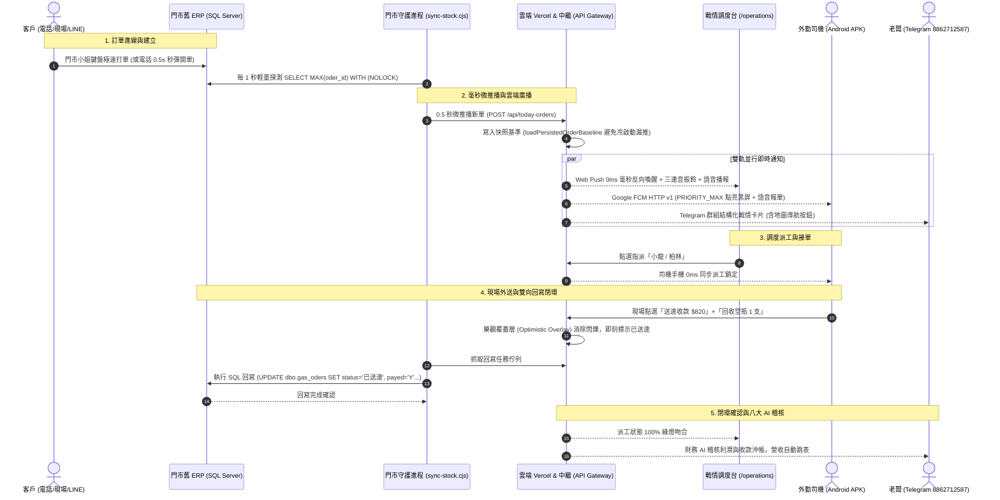
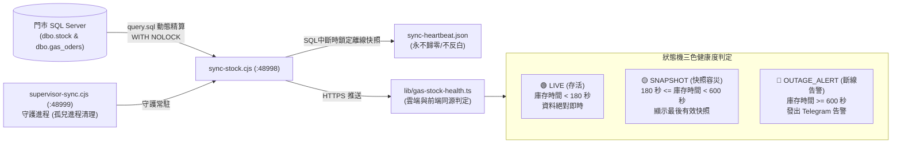

# 👑 盛隆瓦斯 全系統最新總體架構全覽與中樞拓撲全書

> **最高決策者**：老闆 (Telegram ID: `8862712587`，唯一 SuperAdmin)  
> **核心代碼倉庫**：
> - 營運調度中樞、監控中心、外勤司機端：[`shenglong-next`](https://github.com/qazwsx32100/shenglong-next) (`C:\shenglong-next`)  
> - 核心腳本、LINE 客服、題庫、輪調核心：[`gass`](https://github.com/qazwsx32100/gass) (`C:\Gass`)  
> **正式雲端生產環境**：`https://shenglong.vercel.app` (Vercel Production)  
> **Google 雲端維護資料夾**：[Google 雲端維護紀錄資料夾](https://drive.google.com/drive/u/1/folders/1YT7yfMfVmiVic_vaIWf94Ei14wMa3FYM) (`1YT7yfMfVmiVic_vaIWf94Ei14wMa3FYM`)  
> **整理基準日期**：2026 年 11 月 24 日  

---

## 壹、 盛隆核心戰略方針與四大不可逾越鐵律

整個盛隆系統現代化大架構建立在以下四項最高執行原則之上：

1. 🏛️ **舊 ERP 絕對零更動黑盒子鐵律 (Directive #4)**：
   - 門市運行 20 年之 Windows 打單介面、Microsoft SQL Server 資料庫結構 Schema（`dbo.gas_oders`, `dbo.customers`, `dbo.stock`）、欄位型別、Triggers 與預存程序**絕對嚴禁進行任何變更或增刪欄位**。
   - 所有查詢與同步強制使用 `WITH (NOLOCK)`，0 佔用表級鎖，門市小姐鍵盤極速打單習慣 100% 零干擾。現代化擴充屬性一律外掛於雲端。
2. 💻 **本機非門市營業主機最高隔離鐵律 (Directive #6)**：
   - 本機（`LAPTOP-FNKBAP5D`，工作區 `C:\Gass` 與 `C:\shenglong-next`）專屬於「開發、測試、編譯 APK、推 Git 與雲端發布」。
   - 門市現場營業主機（工作目錄多為 `D:\test`、連接實體 SQL Server 2008、常駐運行正式守護進程）才是唯一生產實體。絕不以本機狀態誤判門市營業當機。
3. 🛵 **外勤司機端 100% 零通知、零彈窗、靜默直接定位鐵律**：
   - 嚴禁前端定時輪詢 GPS 喚醒硬體晶片。全面採用雙通道靜默獲取：第一通道優先調用 Android 底層快取 `PASSIVE_PROVIDER`，0ms、0 額外耗電、0 狀態列橫幅通知；第二通道載入時強制長快取（180s），僅在手動點擊「📍定位」或按鈕時單次獲取。
4. 🚨 **做的任何事情都要上傳 GitHub 和雲端 (最高原則)**：
   - 任何改動必須通過全量測試，同次提交推送 GitHub 主幹（`origin/main`），同步部署至 Vercel Production 正式環境（`READY`），並即時登記維護紀錄。

---

## 貳、 盛隆全系統六大核心子系統全貌

```mermaid
flowchart TB
  subgraph STORE["🏢 1. 門市總部實體 Windows 核心 (生產唯一實體)"]
    direction TB
    SQL[("舊門市 SQL Server\n(dbo.gas_oders / dbo.customers / dbo.stock)\n234,769 筆老本真單")]
    DESK["門市打單軟體 UI\n(小姐鍵盤盲打習慣零衝擊)"]
    TEL["電話盒辨識系統 (IIS _3443_盛隆)\n(0.5s 抓號秒彈開單)"]
    DAEMONS["雙守護中繼進程\n• supervisor-sync.cjs (:48999)\n• sync-stock.cjs (:48998)\n(1s 輕量探測 / 0.5s 微推播)"]
    DESK <--> SQL
    TEL --> SQL
    DAEMONS <--> SQL
  end

  subgraph CLOUD["⚡ 2. 專用雲端高速中繼與 API 閘道層 (Vercel & Supabase)"]
    direction TB
    API_GATEWAY["Vercel Production Edge API\n(https://shenglong.vercel.app)\nNext.js Turbopack / Strict A+ 資安"]
    KV_RELAY[("雙軌容災持久化中繼\n• Supabase PostgREST (cloud_orders)\n• AES-256 加密快照 (KVDB)")]
    PUSH_ENGINE["雙軌即時推播引擎\n• Google FCM HTTP v1 (原生背景最高優先級)\n• Web Push (Service Worker v23 毫秒反向喚醒)"]
    API_GATEWAY <--> KV_RELAY
    API_GATEWAY --> PUSH_ENGINE
  end

  subgraph OPS["🖥️ 3. 戰情調度監控中心 (/operations)"]
    direction TB
    OPS_BOARD["現代化派單看板\n• 0ms 開屏秒顯快取\n• 訂單大字卡片 (門牌地址最大化)\n• 完單分流 (欠款O/月結M精準歸入已送達)\n• 置中防遮蔽音效震動設定"]
    CALL_MODAL["0ms 即時來電開單視窗\n(45s 新鮮度門檻 / 24h 去重 / 同電話多客號自動銷案)"]
    FULL_HISTORY["19年全歷史客戶訂單 (237,416筆)\n(Gzip 索引 2.93MB / 三方資料源毫秒展開)"]
    OPS_BOARD --- CALL_MODAL
    OPS_BOARD --- FULL_HISTORY
  end

  subgraph DRIVER["🛵 4. 外勤司機專用端 (小龍、柏林)"]
    direction TB
    APK["Android 原生 APK (C:\\Users\\懶\\Desktop\\sl)\n• 專屬 Operations / Driver 雙 APK 隔離\n• 100% 靜默零通知直接定位\n• 個人專屬網址直達 (/driver?token=...)\n• 方式 B：直接顯示未內扣前總金額 + 運費$70"]
  end

  subgraph AI_CORE["🤖 5. 盛隆八大 AI 部門矩陣 & Telegram 指揮所"]
    direction TB
    TG_BOT["✈️ Telegram Gass Bot (@shenglong_gas_bot)\n唯一 SuperAdmin: 老闆 (8862712587)\n• 08:30 晨間綜合戰報\n• L3 審批一鍵按鈕 (Approve / Reject)\n• 即時新單雙軌戰情卡片"]
    AI_EIGHT["盛隆八大專任 AI 專家\n(秘書 / 營運 / 工程 / 財務 / 客服 / 業務 / 行銷 / 行政)\n三級安全護欄 (L1唯讀 / L2草稿 / L3高危)"]
    TG_BOT <--> AI_EIGHT
  end

  subgraph ROTATOR["⚡ 6. Gemini 多帳號輪調與即時監控中心 (AI 寫程式代理)"]
    direction TB
    ROTATOR_CORE["OpenAI 相容協定代理 (:3333/v1 & /api/ai-status)\n• 4 大帳號池 (3 組 Gemini 4500次/日 + 1 組 OpenAI 兜底)\n• 輪詢 Round-Robin / 主備 Failover\n• 429 觸發 60 秒冷卻自動繞道\n• 專供 Cline / Cursor / Roo Code / Aider"]
  end

  %% 連線關聯
  DAEMONS <== "1秒探測 / 0.5秒新單事件微推播" ==> API_GATEWAY
  API_GATEWAY <== "SSE 脈衝 / Web Push 喚醒 / 15s 校正" ==> OPS
  PUSH_ENGINE ==> "FCM PRIORITY_MAX + 語音播報" ==> DRIVER
  DRIVER <== "回傳接單 / 送達收現 / 空瓶回收" ==> API_GATEWAY
  API_GATEWAY <== "Webhook 雙向互動 / 審批流" ==> TG_BOT
  API_GATEWAY <--> ROTATOR
```

---

## 參、 全鏈路雙向閉環資料時序流 (Data Flow Loop)



---

## 肆、 盛隆八大 AI 專任部門矩陣與三級防護

依據權威規範 [`docs/AI_EIGHT_DEPARTMENTS_ARCHITECTURE_AND_PLAYBOOK.md`](file:///c:/Gass/docs/AI_EIGHT_DEPARTMENTS_ARCHITECTURE_AND_PLAYBOOK.md)，全系統由八大 AI 專家協同運作：

| AI 部門職能 | 角色代號 | 核心職責與監控範圍 | 跨部門自動化連動 |
| :--- | :--- | :--- | :--- |
| **執行秘書** | `executive_secretary` | 跨部門指揮調度、08:30 晨間綜合戰報、待辦彙整、意圖分派 | 總攬七大部門日報與突發通報 |
| **營運總監** | `operations_director` | 即時庫存平衡、司機派單調度、夜間瓦斯荒警報、同路段 200m 順路併單建議 | 庫存急缺與夜間斷氣主動預警閉環 |
| **系統工程師** | `system_engineer` | 全系統健康巡檢、4 大速度與推播哨兵、雙向同步守護、離職 APK 自毀防線 | 4 大專屬推播與開屏哨兵 |
| **財務主管** | `finance_officer` | 毛利成本精算（進價 $22.63/kg、運費 $70/$140）、外送收款自動沖帳、倒賠稽核 | 門市訂單保本底線主動防禦閉環 |
| **客服主管** | `customer_service` | LINE AI 客服品質稽核、300 題 FAQ 知識庫維護、問答盲區提煉 FAQ 反哺 | 客服自學習題庫反哺草稿 |
| **業務主管** | `sales_manager` | 餐飲大戶用量斷崖異常預警、商用 VIP 毛利防守、合約到期預警 | 大戶用量斷崖偵測與拜訪排程 |
| **行銷總監** | `marketing_director` | 52 天用氣週期預測、沈睡戶召回（60天/90天）、氣象低溫連動 | 90 天呆瓶壓瓶精準召回閉環 |
| **行政主管** | `admin_manager` | 鋼瓶 30 年 8 檢到期預警（30天內告警/逾期嚴禁出貨）、客戶座標與門牌審計 | 座標品質審計與車輛定檢 |

### 🛡️ 三級安全護欄（Guardrails）
- **L1 唯讀分析（Read-Only）**：日常巡檢、日報彙整、數據診斷，自動放行。
- **L2 建議與草稿（Draft/Suggestion）**：促銷文案、客戶召回名單、併單建議，需人工確認後發布。
- **L3 敏感高危變更（High-Risk Mutation）**：價格調整、破盤倒賠單放行、退款扣款、系統權限變更，**強制由老闆 Telegram ID `8862712587` 唯一 SuperAdmin 一鍵按鈕審批授權**。

---

## 伍、 即時庫存計算與同源健康狀態機 (Directive #5)

全系統即時庫存計算與故障排除完全依照 [`docs/REALTIME_STOCK_ARCHITECTURE_AND_TROUBLESHOOTING.md`](file:///c:/Gass/docs/REALTIME_STOCK_ARCHITECTURE_AND_TROUBLESHOOTING.md)：



---

## 陸、 盛隆官方標準成本、定價與保本底線 (Directive #3)

全系統 AI 部門、報價引擎與財務分析，必須絕對嚴格遵守此數據：

| 規格 | 瓦斯進氣成本 ($22.63/kg) | 外送運費 | 購入成本 | 單支年持有成本 | 門市外送定價 | 每桶淨毛利 | 實質毛利/kg | 實質保本底線 |
| :--- | :--- | :--- | :--- | :--- | :--- | :--- | :--- | :--- |
| **4kg** | $90.5 元 | $70 元 | $1,080 元 | $132.00 / 年 | $400 元 | **$239.5 元** | $59.87 / kg | $193 元 |
| **10kg** | $226.3 元 | $70 元 | $1,480 元 | $145.33 / 年 | $530 元 | **$233.7 元** | $23.37 / kg | $330 元 |
| **16kg** | $362.1 元 | $70 元 | $1,480 元 | $145.33 / 年 | $680 元 | **$247.9 元** | $15.49 / kg | $466 元 |
| **20kg (住家)** | $452.6 元 | $70 元 | $1,550 元 | $147.67 / 年 | $750 元 | **$227.4 元** | $11.37 / kg | **$556 元** |
| **20kg (生意攤)**| $452.6 元 | $70 元 | $1,550 元 | $147.67 / 年 | $620 元 | **$97.4 元** | $4.87 / kg | **$529 元** |
| **50kg (大戶)** | $1,131.5 元 | $140 元 | $3,400 元 | 約 $290 / 年 | $1,600 元 | **$328.5 元** | $6.57 / kg | $1,290 元 |

> [!IMPORTANT]
> **住家 20kg 保本底線為 $556 元**（含鋼瓶分攤 $33 + 運費 $70 + 進氣 $453）。  
> **生意攤 20kg 保本底線為 $529 元**（含鋼瓶分攤 $6 + 運費 $70 + 進氣 $453）。  
> 任何訂單低於此底線，財務 AI 立即攔截並升級為老闆 L3 審批。

---

## 柒、 全系統即時端點、網址與連接埠速查表

| 子系統 / 模組名稱 | 環境 / 協定 | 存取網址或本機位置 | 核心用途與規格說明 |
| :--- | :--- | :--- | :--- |
| **戰情調度監控中心** | 雲端 Production | `https://shenglong.vercel.app/operations` | 0ms 開屏秒顯、門牌最大化卡片、Web Push 雙軌喚醒 |
| **AI 輪調與監控中心** | 雲端 Production | `https://shenglong.vercel.app/system-status?tab=ai` | Gemini x3 + OpenAI x1 負載均衡與 429 容錯 |
| **AI 輪調 本機代理端點** | 本機 Node.js | `http://localhost:3333/v1` | OpenAI 相容代理，供 Cline / Cursor / Roo Code / Aider 串接 |
| **外勤司機端 (Web/PWA)** | 雲端 Production | `https://shenglong.vercel.app/driver?token=...` | 個人專屬免登入網址直達、方式 B 未內扣總金額 |
| **外勤司機端 (Android APK)**| Android Native | `C:\Users\懶\Desktop\sl\盛隆外送員_小龍.apk` | 100% 靜默定位、FCM PRIORITY_MAX 背景強制叫單 |
| **調度中樞 (Android APK)** | Android Native | `C:\Users\懶\Desktop\sl\盛隆新ERP_戰情調度中樞.apk` | 專屬 OperationsMainActivity 物理隔離，絕不誤跳司機端 |
| **Telegram 老闆指揮所** | Telegram Bot | `@shenglong_gas_bot` (ID: `8862712587`) | 08:30 晨報、新單即時推播卡片、L3 一鍵審批 |
| **門市主機雙守護進程** | 門市 Windows | Port 48999 (supervisor) & Port 48998 (sync) | 1s 輕量探測、0.5s 微推播、SQL 斷線快照自癒保護 |
| **Google Drive 雲端資料夾**| 雲端儲存庫 | 資料夾 ID: `1YT7yfMfVmiVic_vaIWf94Ei14wMa3FYM` | 存放 2007~2026 全歷史 237k 訂單、每日打烊 bak 封存備份 |
