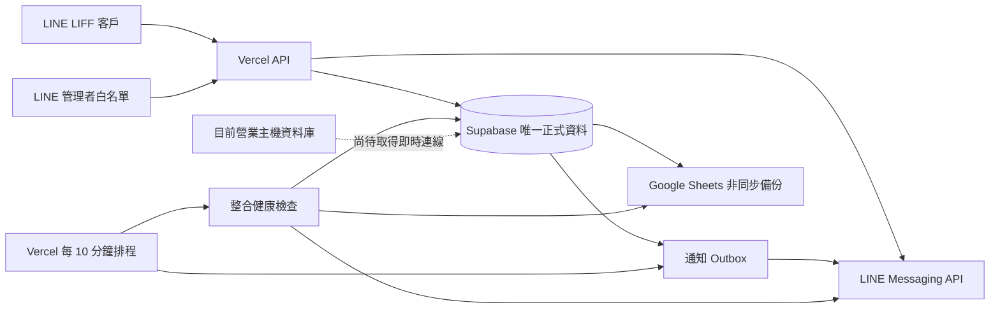

# 盛隆 LINE 會員系統：資安與 API 串接改善報告

檢查與改善日期：2026-10-04  
最後更新：2026-10-05  
正式站：`https://shenglong-line-liff.vercel.app`  
正式資料來源：Supabase  
備份資料來源：Google Sheets「盛隆 LINE 會員資料庫」  
最新正式部署：`dpl_F5db51vYpGt95U5nKt5PCoRDnAFs`

## 管理結論

本輪已完成會員查找、通知可靠性、登入撤銷、管理者身分、防濫用、通知重試、整合監控及多項低風險資安收斂。正式站目前可正常連線，公開健康檢查回傳 HTTP 200；自動測試 59/59 通過，正式相依套件掃描為 0 個已知漏洞。2026-10-04 14:20 的正式排程實測確認 Supabase、LINE Messaging API 與 Google Sheets 三項連線全部健康。

Supabase 是 LINE 網站唯一正式即時資料來源。Google Sheets 只做非同步備份，不在 Supabase 故障時提供可能過期的會員或價格資料。這可確保所有使用者看到一致資料，並避免兩套主資料互相覆蓋。

主機舊系統尚未具備即時同步條件。本機 SQL Server Express 原先只有系統資料庫；找到並驗證的 `ShengLong_hour (1).bak` 是 2026-08-23 備份，含 3,903 名客戶，數量與既有匯入一致，但不是今天仍在更新的正式來源。已用獨立名稱 `ShengLong_Inspection` 還原供欄位對照，沒有將舊備份寫回 Supabase。要啟用主機增量同步，仍需取得目前實際營業系統正在寫入的 SQL Server 位址與資料庫。

## 已完成項目

### 1. 首次電話查找改為即時 Supabase

- 首次綁定不再讀部署時產生的 Google Sheets 電話索引。
- 電話修改後不用重新部署即可查到。
- 同一客戶有多個電話來源時會去重。
- 回傳只含遮罩候選提示，不回傳姓名、完整地址、價格或客戶編號。
- Supabase 無法使用時回傳 503，不用舊資料完成錯誤綁定。

### 2. 訂單狀態通知改為可重試工作

- `sl_update_order_status` 在同一交易內更新訂單、狀態事件、通知工作、備份與稽核。
- 通知以 `order_id + status_event_id` 去重，避免同一狀態重複推播。
- 後台更新後立即嘗試發送。
- 失敗從 5 分鐘開始採指數退避，最多 8 次。
- Vercel 正式排程由每日一次改為每 10 分鐘補送。

### 3. 會員登入可單獨撤銷

- Cookie 已加入資料庫 `session_version`。
- 私人 API 會核對會員狀態、客戶狀態及版本。
- 營運後台可依會員電話強制登出該會員所有裝置。
- 強制登出會留下稽核紀錄，不影響其他會員。
- 舊版 Cookie 會失效；會員重新由 LINE 開啟即可繼續使用。

### 4. 管理後台綁定個別 LINE 管理者

- 管理登入必須同時通過 LINE 使用者白名單與管理登入碼。
- 後台稽核會記錄實際 LINE 管理者 ID，不再使用共用管理者名稱。
- 管理碼由舊 SHA-256 自動升級為帶隨機鹽的 scrypt 慢雜湊。
- `sl_admin_credentials` 啟用 RLS，匿名與一般登入角色無權限。
- 既有管理者第一次成功登入後自動完成慢雜湊升級，不需重設登入碼。

### 5. 所有敏感 API 使用 Supabase 持久限流

涵蓋管理登入、後台讀寫、會員首頁、訂單歷史、註冊、電話查找、地址操作與下單。限流計數由 Supabase 共用，Vercel 多實例與冷啟動不能重置或繞過計數。

本輪另修正 `sl_consume_rate_limit` 的時間變數名稱碰到 SQL `CURRENT_TIME` 關鍵字所造成的型別錯誤，正式交易測試已確認第三次請求可按設定拒絕。

### 6. 管理者整合健康檢查

- 後台分別顯示 Supabase、LINE Messaging API、Google Sheets 是否正常。
- 記錄檢查時間、最近成功時間、延遲與不含秘密的錯誤代碼。
- 每 10 分鐘的通知排程會一起執行整合檢查。
- `sl_integration_checks` 已啟用 RLS；`anon` 與 `authenticated` 無讀取及函式執行權，只有 `service_role` 可寫入。
- 後台也顯示備份待處理、備份失敗、逾期租約、LINE 通知待處理及會員／地址待核對數量。
- 已核實 Messaging API 使用「SL瓦斯行」頻道（Channel ID `2011282454`）的長效權杖；Vercel 正式環境更新後，原本的 `LINE_HTTP_401` 已於下一輪正式排程消失。

### 7. 公開資訊與前端防護收斂

- 公開 `/api/health` 只回傳 `{"ok":true}` 或 `{"ok":false}`。
- 不再公開 Vercel 區域、資料來源、索引時間或產品數量。
- CSP 已移除 `style-src 'unsafe-inline'`；首頁、價格後台、營運後台均實測 HTTP 200。
- 正式登入一定使用獨立 `SESSION_SECRET`，不再從 Google 服務帳號 JSON 推導。
- Supabase 欄位、約束與原始錯誤文字只留在伺服器端，前端只取得固定商業錯誤訊息。

### 8. 會員綁定與地址寫入原子化

- 首次綁定申請、管理者核准／拒絕、地址新增申請、地址改名／預設／停用，均改為單一 Supabase RPC 交易。
- 核准會員時，客戶建立、LINE 綁定、電話、地址、申請狀態、稽核及備份工作會一起成功或一起回復，避免只完成一半。
- 同時送出兩筆相同申請會重用既有待處理申請；LINE 或客戶已有其他有效綁定時會拒絕。
- 地址操作會鎖定該客戶的有效地址，避免同時操作產生兩個預設地址；最後一筆地址仍不可停用。
- 四個函式均已撤銷 `anon` 與 `authenticated` 執行權，只有伺服器端 `service_role` 可執行。

### 9. 價格與工作佇列原子化

- 價格版本、價格明細、備份工作與稽核紀錄在同一交易內建立；重複版本會直接拒絕。
- LINE 通知與 Google Sheets 備份以資料庫鎖定及租約領取，避免兩個 Vercel 執行個體重複處理同一筆工作。
- 通知完成時會核對工作代次，舊執行個體不能覆蓋後來重新領取的結果。
- 通知與備份的失敗退避、成功完成及管理狀態彙總均改為指定用途 RPC。
- 八個新增函式均已撤銷 anon 與 authenticated 執行權，只有 service_role 可執行。

## 正式資料流

## 公開與後台資料界線

### 客戶可取得

- 自己的會員狀態與 LINE 顯示名稱。
- 自己的啟用配送地址。
- 自己適用的商品價格、配送費與優惠。
- 自己的訂單與配送進度。
- 首次電話核對時只取得遮罩後的候選提示。

### 只有管理後台可取得

- 完整客戶電話、地址與客戶編號。
- 待核對的會員與搬家／地址申請。
- 全客戶與生意攤價格設定及生效時間。
- 配送、鋼瓶、合作店家、瓦斯金、提醒及營運分析。
- 備份／通知佇列與三項整合健康狀態。
- 會員強制登出功能與管理稽核紀錄。

### 只有伺服器可取得

- Supabase service role key。
- LINE Channel Access Token。
- Google 服務帳號 JSON。
- Cookie `SESSION_SECRET`、Cron Secret、管理碼雜湊。
- 原始資料庫錯誤與內部欄位名稱。

## 已核實的正式防護

- Supabase 營運資料表均啟用 RLS。
- 匿名與一般登入角色沒有正式資料表或敏感 RPC 權限。
- Vercel 敏感環境變數均以 sensitive 類型保存，查詢不回傳明文；權杖內容未寫入程式、日誌或本報告，本機轉交用暫存檔已全部清除。
- Google Sheets 備份檔未公開，僅擁有者與指定服務帳號可存取。
- 未登入讀取管理後台與會員私人 API 回傳 401。
- 跨來源寫入會被拒絕。
- `/.env` 與伺服器端會員索引無法公開下載。
- 管理登入錯誤碼正式測試為 401；公開健康檢查為 200。
- 三個正式頁面的 CSP 均不含 `unsafe-inline`。

## 最新驗證

- 自動測試：59/59 通過。
- npm production audit：0 個 info、low、moderate、high、critical 漏洞。
- 最新正式部署狀態：READY。
- 首頁、價格管理、營運管理：HTTP 200。
- 公開健康檢查：HTTP 200，內容只有 `{"ok":true}`。
- 管理登入錯誤碼：HTTP 401。
- 整合健康資料表：RLS=true；anon/authenticated select=false；service_role select=true。
- 整合健康 RPC：anon/authenticated execute=false；service_role execute=true。
- 2026-10-04 14:20 正式整合檢查：Supabase 健康（20 ms）、LINE 健康（111 ms）、Google Sheets 健康（855 ms），三項錯誤代碼皆為空。
- 會員寫入 RPC 權限：四項函式的 anon/authenticated execute=false；service_role execute=true。
- 正式交易測試已回滾；測試客戶、綁定申請與稽核紀錄均為 0 筆殘留。
- 最新部署的公開健康檢查為 200；未登入會員與管理操作均為 401；Vercel error/fatal runtime log 為 0 筆。
- 價格／通知／備份 RPC 正式權限：八項函式的 anon/authenticated execute=false；service_role execute=true。
- 價格、通知、備份與稽核回滾測試後均為 0 筆殘留。
- 2026-10-05 08:20 新版正式排程成功：Supabase 健康（43 ms）、LINE 健康（112 ms）、Google Sheets 健康（511 ms），部署 error/fatal 日誌為 0 筆。

## 尚待處理

### A. 目前營業主機到 Supabase 的增量同步

狀態：等待取得真正即時來源，不能用 2026-08-23 備份冒充正式資料。

啟用前需要核實：

1. 目前營業軟體實際連到哪一台 SQL Server、哪個資料庫。
2. 是否仍使用 `dbo.customers`、`dbo.gas_oders` 與相同欄位。
3. 客戶 `update_time` 的格式與可靠度；若不可靠，要用 SQL Change Tracking 或獨立變更表。
4. 地址異動要區分新增地址、本人搬家及新住戶接手舊址，不能只覆寫字串。
5. 同步方向採主機到 Supabase 單向；LINE 綁定、session、地址申請與通知紀錄留在 Supabase，不回寫舊系統。

### B. 繼續縮小 service role 使用範圍

目前瀏覽器拿不到 service role，RLS 也已阻擋匿名存取。會員首頁、下單、地址、會員核准、價格寫入、通知工作及備份佇列已改用窄範圍 RPC；尚待把營運後台寫入及部分價格／會員讀取逐步改為指定用途的 RPC。

### C. 主動告警

整合健康狀態已每 10 分鐘記錄，但尚未設定對外告警收件者。可在 LINE、Sheets、Supabase 連續失敗或通知佇列超過門檻時，傳給指定管理者；啟用前要指定接收告警的管理 LINE 帳號。

## 建議後續順序

1. 在實際營業主機確認即時 SQL Server 連線，建立唯讀同步帳號。
2. 先執行只比對不寫入的增量同步，產生新增、修改、停用與地址衝突報表。
3. 核對報表後啟用客戶、電話、類型與歷史單價的單向同步。
4. 地址衝突留給後台核准，不自動搬移客戶。
5. 逐步把 Vercel 直接查表改為窄範圍 RPC。
6. 指定告警接收者並啟用連續失敗通知。

## 重要限制

目前 Supabase 正式資料中沒有可安全使用的正式 LINE 會員與訂單測試對象，因此本輪沒有發送假推播、建立假正式訂單或修改正式客戶。交易性資料庫測試均使用可回復交易，完成後未留下測試資料。

## 2026-10-05 LINE／舊系統整合更新

### 已完成

- 後台人員、派車、路線預覽、鋼瓶、鋼瓶異動、合作店家及提醒設定改用指定用途 RPC；資料異動、稽核及備份工作在同一交易內完成。
- 會員、session、地址、商品價格來源、訂單歷史、待核准會員／地址及價格管理讀取改用指定用途 RPC。
- `api/_operations.js` 與 `api/_database-primary.js` 已無直接 `select`、`insert`、`update` 營運資料呼叫。
- 建立 LINE／舊系統訂單橋接：HMAC 驗證、五分鐘時效、Nonce 防重播、唯一工作鍵、防重複、租約、退避重試、衝突狀態及雙方訂單編號對照。
- LINE 新訂單會在 Supabase 交易內建立「待寫入舊系統」工作；舊系統訂單可透過專用匯入 RPC 寫回 Supabase，不會再次送回舊系統形成迴圈。
- 舊系統 50、18、新 4 公斤規格已建立非上架商品對照，確保歷史訂單明細可保留，LINE 商品頁仍只顯示正式上架商品。
- 正式橋接入口 `/api/legacy-sync` 已部署，但 `LEGACY_SYNC_ENABLED` 保持關閉；目前回應 503，沒有正式同步或舊系統寫入。
- 正式 Supabase 新表均啟用 RLS；anon/authenticated 沒有表格讀取權，也不能執行新 RPC；service_role 才能使用。
- 正式交易回滾測試涵蓋 LINE 訂單、派車、鋼瓶、合作店家、提醒與同步工作，所有測試資料殘留均為 0。
- 自動測試 60/60；production dependency audit 為 0 個已知漏洞。
- 最終正式部署 `dpl_J9fM9Y78zNCbWxtVr6hE9hXe155b` 為 READY；首頁、營運頁與健康檢查為 200，未登入後台為 401，關閉中的舊系統橋接為 503；新版部署 error/fatal 日誌為 0。

### 2026-10-05 16:37 正式重部署驗證

- 最新工作區已重新部署到正式網址 `https://shenglong-line-liff.vercel.app`。
- 首頁 200、營運頁 200、公開健康檢查 200。
- 未登入管理 API 401，證明後台仍受登入保護。
- 舊系統橋接 503，證明在真正營業主機完成核對前仍維持安全關閉。
- 部署範圍內 error／fatal runtime log 為 0。

### Supabase Advisor

- 安全 Advisor 只回報「RLS 已啟用但沒有 policy」資訊。這是本系統刻意的伺服器專用模式：anon/authenticated 的表格權限已撤銷，瀏覽器不能直接查詢。
- 效能 Advisor 曾指出同步工作缺少 `order_id` 外鍵索引，已新增 `sl_legacy_sync_jobs_order_idx`。
- 重新執行效能 Advisor 後，缺少外鍵索引的警示已消失，只剩新功能尚無正式流量造成的 unused index 資訊。
- 其他 unused index 是新功能尚無正式流量的資訊，不在資料量不足時提前刪除必要索引。

### 補充驗證

- 舊系統 50 公斤、18 公斤、新 4 公斤三種非上架商品已通過正式資料庫匯入斷言；三筆明細與總數量均正確。
- 該測試在交易內完成後回滾，測試客戶、訂單、明細及舊系統對照均為 0 筆殘留。
- SQL Express 具名執行個體與固定連接埠已分開設定，避免驅動程式同時收到 `instanceName` 與 `port`。
- 未核對營業主機的訂單狀態欄位前，狀態同步預設為 `review` 並明確失敗，不會把未寫入的狀態誤報為同步成功。

### 還不能在本機完成

1. 這台電腦不是每天操作舊系統的營業主機，因此無法核實即時 SQL Server，也不能啟用正式雙向同步。
2. 到真正營業主機後要依序執行 `inspect`、`dry-run`、人工核對，再個別開啟網站橋接與營業主機寫入開關。
3. 每日 Google Sheets 備份新版流程仍要等下一次正式排程後核對實際執行紀錄。
4. 完整 LINE 真實會員 E2E 測試仍需要指定安全測試帳號，避免建立假正式訂單或誤發訊息。
5. 主動 LINE 故障告警仍需要指定管理者接收帳號。

更新後架構圖：`reports/LINE與舊系統整合架構_2026-10-05.png`。

營業主機啟用說明：`reports/舊系統同步啟用步驟_2026-10-05.md`。
