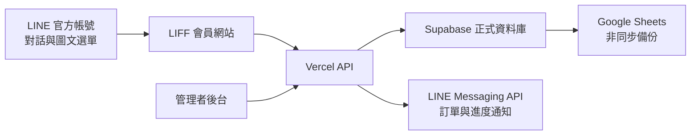

# 盛隆 LINE 官方帳號系統六層功能架構

整理日期：2026-09-24

目前 LINE 官方帳號系統可以分成 6 層：

## 1. LINE 官方帳號入口

官方帳號主要負責：

- 從圖文選單進入「立即叫瓦斯」LIFF 網站。
- 接收客戶傳給客服的訂單詢問。
- 發送訂單成立通知。
- 發送訂單進度更新。
- 通知內可以直接開啟 LIFF 的訂單紀錄。

目前程式確認使用的 LIFF ID 是 `2011207944-VaQEXeyi`。

但「圖文選單目前實際有哪些按鈕、歡迎訊息與自動回覆」屬於 LINE Official Account Manager 的外部設定，尚未從管理平台重新核實，因此不能把實際按鈕配置視為已確認。

## 2. LIFF 客戶會員網站

客戶從 LINE 開啟後，系統會辨識 LINE 身分。

第一次使用時：

1. 客戶輸入電話。
2. 系統只顯示遮罩後的可能資料。
3. 即使電話相同，也不會直接取得舊客戶姓名、完整地址或價格。
4. 建立待核准的會員綁定申請。
5. 管理者核對姓名、電話及地址後核准。
6. 核准後才將 LINE 帳號綁定既有客戶資料。

已核准會員可以使用：

- 立即叫瓦斯。
- 查看自己的商品售價、配送費及優惠。
- 選擇自己的配送地址。
- 申請新增地址。
- 申請本人搬家。
- 申請接手前住戶地址。
- 管理地址名稱、預設地址及停用地址。
- 查看最近 20 筆訂單。
- 查看五階段配送進度。
- 再次下單。
- 從訂單頁聯絡客服。
- 查看瓦斯安全資訊。
- 保持登入 60 天，不必每次重新登入 LINE。

## 3. 地址與搬家架構

客戶、地址、訂單使用不同的資料識別碼，因此：

- 一位客戶可以保留多個地址。
- 搬家後，新地址可以設成預設地址。
- 舊地址及舊訂單仍保留在原客戶名下。
- 新住戶接手舊地址時，只承接地址使用權。
- 前住戶的訂單、價格及會員資料不會轉移給新住戶。
- 樓、戶、門牌不同會視為不同地址。
- 新增、搬家與接手申請都需要管理者核准後才能下單。

## 4. 管理者後台

目前後台分為兩部分。

### 會員與價格管理

- 核准或拒絕 LINE 會員綁定。
- 比對舊客戶資料。
- 核准新增地址、搬家及地址接手。
- 設定全體客戶價格。
- 設定營業客戶價格。
- 設定生效時間。
- 保留歷史價格版本。
- 查看待備份、通知失敗及待審數量。
- 保存管理操作稽核紀錄。

### 營運管理

已經具備以下頁面與資料結構：

- 訂單與配送狀態。
- 配送人員及建議路線。
- 鋼瓶與檢驗期限。
- 合作店家。
- 瓦斯金流水。
- 預計叫瓦斯提醒。
- 最近 31 天營運分析。

這些營運模組目前沒有正式會員及訂單資料，所以屬於「功能已建置、等待真人營運驗收」。

## 5. 訂單及 LINE 通知

客戶下單時，伺服器會重新確認：

- 會員是否已啟用。
- 地址是否屬於該會員。
- 地址是否仍有效。
- 商品是否存在。
- 該客戶實際適用的價格。
- 商品數量是否符合限制。
- 是否為重複送出的訂單。

訂單成立後：

1. 寫入 Supabase。
2. 建立訂單明細。
3. 發送 LINE 訂單確認訊息。
4. 通知失敗時放入重試佇列。
5. 後台變更訂單狀態後，可以發送進度通知。
6. 同一個訂單識別碼不會重複成立訂單。

## 6. 資料來源

目前資料分工如下：

| 系統 | 用途 |
|---|---|
| Supabase | 唯一正式即時資料來源 |
| Vercel | 官網、LIFF、API 及排程 |
| LINE Login／LIFF | 驗證客戶 LINE 身分 |
| LINE Messaging API | 發送訂單及進度通知 |
| Google Sheets | 非同步報表與備份 |
| Apps Script | 舊入口導向正式 Vercel 網站 |

Supabase 故障時，會員、價格及訂單功能會停止並回傳錯誤，不會改讀可能過期的 Google Sheets。

## 目前正式資料狀態

截至最近一次檢驗：

- 舊客戶：3,904 筆。
- 有效地址：3,903 筆。
- 商品：4 項。
- 已綁定 LINE 會員：0 位。
- 正式訂單：0 筆。
- 待審會員及地址：0 筆。

## 尚待完成的正式驗收

整套架構已經部署，但還缺少第一個受控 LINE 帳號完成以下真人流程：

1. LINE 登入。
2. 會員資料綁定。
3. 管理者後台核准。
4. 重新開啟後保持登入。
5. 新增地址或搬家。
6. 建立正式測試訂單。
7. 收到 LINE 訂單通知。
8. 後台更新訂單狀態。
9. 收到 LINE 進度通知。
10. 確認 Google Sheets 備份寫入。

完整的 API、權限、資安與測試證據，另見桌面檔案「盛隆_LINE_系統檢驗報告_2026-09-15.md」。

