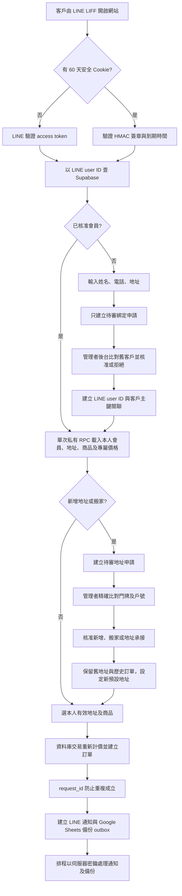

# 盛隆 LINE 會員／官網全系統流程、API 與資安檢驗報告

檢驗日期：2026-09-15（Asia/Taipei）  
正式網站：https://shenglong-line-liff.vercel.app  
正式部署：`dpl_8qaDzYNNY9PQQQDFRuPgaK7ce8oS`（Vercel Production / READY / hnd1）

## 1. 結論

- 修正後最終重跑 **400,000 次**隨機與負載情境，全部通過；錯綁客戶、跨客戶價格、地址碰撞、會員越權、訂單越權、隱私洩漏與接受無效輸入均為 **0**。
- 另有 **52 / 52** 項單元與整合測試通過，`npm audit --omit=dev` 為 **0 個已知套件弱點**。
- 正式環境的未登入會員 API、管理 API、排程與同步端點均回應 `401`；跨網站寫入回應 `403`；環境檔、資料庫結構與私人會員索引均為 `404`。
- Supabase 的 29 張 `sl_%` 營運資料表全部啟用 RLS；`anon`、`authenticated` 對營運資料表及敏感函式的直接授權均為 0。
- 本次找到並修正一項低風險憑證格式問題：舊版會忽略合法簽章後多出的第三段字串。現在會員、管理者及快速查詢只接受嚴格的「內容.簽章」兩段格式，修正已部署正式環境。
- 未發現已證實的重大或高風險資料外洩。仍有會員憑證撤銷、跨 Vercel 執行個體限流、公開健康資訊與 CSP 內嵌樣式四項改善建議。
- 正式資料庫目前有 0 位 LINE 會員、0 筆訂單，所以本次無法證明真人 LINE 登入、管理者實際核准、正式下單與 LINE 推播的完整端到端流程。這些流程已由合成測試覆蓋，但仍需一筆受控驗收資料才能完成正式營運驗收。

## 2. 正式系統資料流

### 主要業務規則

1. 電話相同只代表「可能是既有客戶」，不會自動讓 LINE 帳號取得該客戶資料。
2. 綁定前由管理者確認；前台只顯示遮罩候選，不回傳舊客戶姓名、完整電話、真實地址或價格。
3. 同一位客戶可以有多個有效地址；訂單必須使用本人名下且有效的地址。
4. 搬家不會把舊住址的歷史訂單轉給新住戶。地址承接以精確地址與戶號比對，客戶、地址、歷史訂單分別用不同主鍵保存。
5. 商品售價、配送費與優惠由伺服器按客戶重新計算，瀏覽器送來的價格不作為成交依據。
6. 訂單由資料庫交易建立，重送同一個 `request_id` 只會得到原訂單，不會重複成立。
7. Supabase 是唯一正式即時資料來源；Google Sheets 只接收 outbox 備份，不參與會員即時讀取。

## 3. 400,000 次最終測試結果

這 400,000 次是在本機使用正式程式邏輯與隨機資料執行，沒有向正式網站連續發送 400,000 個請求，因此不會污染會員、訂單、LINE 通知、限流紀錄或 Google Sheets。

| 測試組 | 次數 | 內容 | 結果 |
|---|---:|---|---|
| 全系統流程與資安 | 100,000 | 狀態轉換、數值邊界、日期、輸入清理、管理者與會員憑證、公開查詢隱私、價格隔離、地址識別、訂單範圍 | 通過；權限失敗 0、隱私洩漏 0、客戶混淆 0、接受無效輸入 0 |
| LINE 會員綁定流程 | 100,000 | 新客戶、首次使用、多地址舊客戶、舊客戶叫瓦斯、共用電話、特殊與錯誤輸入 | 通過；錯誤配對 0、資料洩漏 0 |
| 會員極端情境 | 100,000 | 回收門號、家庭共用電話、樓層戶號、搬家、個別價格、無價格、竄改／過期憑證、重試、數量上限 | 通過；電話誤認 0、地址碰撞 0、價格洩漏 0、憑證洩漏 0、訂單洩漏 0 |
| 客戶電話索引容量 | 100,000 | 對 3,903 筆索引做精確電話查詢 | 通過；220 ms，約 454,110 次查詢／秒 |

最終一輪耗時：全系統 22.827 秒、會員綁定 49.762 秒、極端情境 18.013 秒、容量測試 0.220 秒。這些速度是本機邏輯及記憶體索引效能，不能直接當成使用者的網路延遲。

### 測試涵蓋的錯誤與奇怪要求

- 空白、過長、含控制字元、HTML／腳本字串、錯誤電話、錯誤日期、負數、無限大與超量數量。
- 同一電話對應多人、門號轉讓、格式不同但相同電話、相同道路但不同號／樓／戶。
- 搬家後舊地址保留、新住戶承接地址、停用地址不得下單。
- 客戶專屬價、一般價、商業價、歷史成交價與無法確認價格的安全處理。
- Cookie 簽章竄改、過期、增加第三段、管理憑證與會員憑證混用。
- 重複送單、未知商品、跨會員地址、跨會員訂單與不合法狀態跳轉。

## 4. 正式 API 外部驗證

| 端點／資源 | 未登入結果 | 判定 |
|---|---:|---|
| `/` | 200 | 公開官網正常 |
| `/admin` | 200 | 只有靜態後台外殼公開，資料另由受保護 API 載入 |
| `/operations` | 200 | 只有靜態營運外殼公開，資料另由受保護 API 載入 |
| `/api/health` | 200 | 公開健康檢查；不回傳客戶資料或密鑰 |
| `/api?action=fast-bootstrap` | 401 | 會員資料受保護 |
| `/api?action=orders` | 401 | 訂單資料受保護 |
| `/api?action=admin-bootstrap` | 401 | 管理資料受保護 |
| `/api/retry-notifications` | 401 | LINE 重送排程受 `CRON_SECRET` 保護 |
| `/api/sync-sheets` | 401 | Sheets 備份排程受 `CRON_SECRET` 保護 |
| `/api/customer-lookup` | 401 | 即使同源，沒有 LINE／會員憑證仍不能查詢 |
| 跨來源 `/api?action=register` | 403 | 跨網站寫入已拒絕 |
| `/api/member-index.generated.json` | 404 | 私人客戶索引不可下載 |
| `/.env` | 404 | 環境檔不可下載 |
| `/database/schema.sql` | 404 | 資料庫結構不可下載 |

所有敏感 API 回應均為 `Cache-Control: no-store`。Vercel 最近一小時沒有 error 等級的正式執行紀錄。部署後連續 10 次健康檢查全部為 200；第一次冷啟動 1.659 秒，其後 9 次為 0.213–0.248 秒，整體中位數 0.221 秒。

## 5. 哪些資料公開、哪些只給會員或後台

| 等級 | 可見資料 | 不包含 |
|---|---|---|
| 公開 | 官網品牌文字、服務說明、瓦斯安全資訊、CSS／JavaScript／圖片、LIFF 公開識別碼、靜態管理頁外殼、健康檢查的區域／資料來源名稱／商品數／是否正常 | 客戶姓名、電話、地址、客戶價格、訂單、後台清單、密鑰 |
| 已驗證會員本人 | 本人的 LINE 顯示名稱、聯絡姓名、電話、會員編號、客戶類型／狀態、本人有效地址、本人商品價格／配送費／優惠來源、本人待審申請、本人最近 20 筆訂單及進度 | 其他客戶資料、全客戶價目、管理者資料、伺服器密鑰 |
| 管理者後台 | 待審會員綁定、待審地址與搬家候選、舊客戶比對資料、全部價格版本、備份與通知狀態、訂單調度、司機、鋼瓶、合作店家、瓦斯金、提醒及營運統計 | Vercel／Supabase／Google／LINE 的秘密金鑰原文 |
| 只在伺服器 | Supabase service-role key、會員簽章密鑰、管理登入碼雜湊、排程密鑰、LINE channel token、Google service account 私鑰、試算表 ID、客戶查詢密鑰、完整客戶索引、稽核紀錄、outbox payload、限流桶 | 不會被打包到 `public` 目錄或 API 回應 |

補充：管理頁網址可被知道不等於後台資料公開。實際資料請求未登入回 `401`。若希望連管理頁外觀也不公開，可以另加路由層驗證，但不能取代 API 本身的權限檢查。

公開目錄共有 15 個檔案；以密鑰名稱、service-role、private key、管理密碼雜湊等敏感模式掃描，命中 0 個檔案。瀏覽器端動態資料寫入 HTML 前有做字元轉義；未使用 `eval` 或 `new Function`。舊的 localStorage／IndexedDB 會員快照會被刪除，會員資料主要依靠 HttpOnly Cookie 從伺服器即時載入。

## 6. 資安控制檢驗

- 會員憑證：HMAC-SHA256、到期檢查、固定時間簽章比較、HttpOnly、Secure、SameSite=Lax、最長 60 天。
- 管理者憑證：獨立簽章密鑰、HttpOnly、Secure、SameSite=Strict、12 小時到期。
- 管理登入碼：正式環境只保存雜湊，不保存前台明碼；登入失敗採 Supabase 共用限流。
- LINE 身分：首次驗證使用 LINE access token；成功後建立伺服器簽章 Cookie。
- 寫入保護：POST 必須同源；請求大小有限制；欄位有長度、格式、日期與數量驗證。
- 資料庫：29 / 29 張營運表啟用 RLS；anon／authenticated 直接資料表授權 0、敏感函式授權 0；兩個檢視表均為 `security_invoker=true`。
- 秘密管理：16 個正式環境變數都由 Vercel 以 Encrypted 保存，檢驗過程沒有輸出變數值。
- 網頁標頭：HSTS 兩年、`nosniff`、嚴格 referrer policy、停用相機／麥克風／定位、CORP same-site、CSP 限定本站與 LINE 網域。
- 訂單完整性：資料庫重新計價、地址歸屬檢查、單一交易、`request_id` 冪等、防止跳躍式狀態變更。
- 資料來源：正式敏感流程只讀 Supabase；連線失效時回 503，不會退回可能過期的 Sheets。
- 備份與通知：以 outbox 保存待辦，排程端點需要伺服器密鑰，失敗可重試。

Supabase Security Advisor 只有 29 筆 INFO 等級的「RLS 已開啟但沒有 policy」。這是目前刻意的全封鎖、server-only 設計，不能為了消除提示而新增公開 policy。參考：[Supabase linter 0008](https://supabase.com/docs/guides/database/database-linter?lint=0008_rls_enabled_no_policy)。

Performance Advisor 有 35 個 INFO 等級未使用索引。正式會員與訂單目前都是 0，資料尚未產生足夠流量統計；現在刪除索引會降低未來查詢與外鍵操作效能，因此本次不移除。累積正式流量後再依查詢計畫複查。參考：[Supabase linter 0005](https://supabase.com/docs/guides/database/database-linter?lint=0005_unused_index)。

## 7. 本次找到並已修正

### 低風險：憑證接受多餘第三段

舊版把 token 分割後只讀前兩段，所以持有一張原本就合法的 token 者，在後方加入 `.extra` 仍會被視為同一張合法 token。這不能偽造簽章、不能換成其他會員或升級成管理者，但格式驗證不夠嚴格。

處理結果：會員憑證、管理者憑證與快速電話查詢共用驗證器全部改成只接受剛好兩段；新增單元測試與 10,000 次會員、10,000 次管理者憑證隨機測試，已部署正式環境。

## 8. 尚可改善的項目

### P1：會員憑證需要可立即撤銷

目前 60 天 Cookie 可以讓正常客戶免重複登入，但 `sl_line_members.session_version` 尚未參與 Cookie 驗證。若手機遺失或 Cookie 被取得，只能等待到期或更換整體簽章密鑰；停用會員會阻止下單，但 bootstrap 仍可能回傳該帳號原本可看的會員資料。

建議：把 `session_version` 放入簽章內容，在每次私有 bootstrap／orders／寫入前與 Supabase 會員版本比對；後台增加「登出此會員所有裝置」，只遞增該會員版本。保留 60 天免登入體驗，同時提供立即撤銷能力。

### P1：所有敏感動作改用跨執行個體限流

管理登入、會員申請與地址申請已使用 Supabase 共用限流；部分訂單、管理讀寫及電話快速查詢仍使用 Vercel 單一執行個體記憶體限流。攻擊者若命中多個 serverless 執行個體，實際總上限可能高於設定值。

建議：把下單、電話查詢、管理資料載入與管理修改全部切到 `sl_rate_limits`／資料庫 RPC；鍵值包含動作、LINE user ID、管理者 ID 與經雜湊的來源 IP。訂單冪等仍保留，兩層控制不同風險。

### P2：縮減公開健康檢查資訊

`/api/health` 目前公開 Vercel region、索引產生時間、主要資料來源名稱、商品數及資料庫可用狀態。這些不是客戶個資，也沒有密鑰，但會提供少量系統指紋。

建議：公開只回 `{ ok: true }`；詳細 region、資料來源、產品數與資料庫狀態移到管理 API 或需要監控密鑰的端點。

### P3：移除 CSP 的 `style-src 'unsafe-inline'`

目前 CSP 已限制 script，但樣式仍允許 inline style。這不等於已存在 XSS，公開程式也有轉義，但可以再收緊。

建議：將所有 inline style 移至版本化 CSS，或改用 nonce／hash，之後拿掉 `'unsafe-inline'`。

### 營運驗收：建立一筆受控真人 LINE 測試

正式現況：客戶 3,904、有效地址 3,903、LINE 會員 0、訂單 0、待審會員 0、待審地址 0、可重送通知 0、待備份 0。

建議以指定測試 LINE 帳號完成：首次登入 → 電話候選 → 管理者核准 → 重新開啟免登入 → 新增第二地址 → 搬家／地址承接 → 建立一筆測試訂單 → 收到 LINE 通知 → 後台更新狀態 → Sheets outbox 同步。完成後刪除或標記測試資料，並保留稽核紀錄。這是目前唯一尚未被正式資料證明的完整鏈路。

## 9. 驗收判定

| 項目 | 判定 |
|---|---|
| 400,000 次合成流程與容量測試 | 通過 |
| 52 項單元／整合測試 | 通過 |
| 套件已知弱點 | 通過，0 個 |
| 正式部署與健康檢查 | 通過 |
| 公開／會員／管理／伺服器資料隔離 | 通過 |
| Supabase RLS 與直接權限 | 通過 |
| 未登入與跨來源 API 阻擋 | 通過 |
| 敏感檔案與前端秘密掃描 | 通過 |
| 真人 LINE 登入、核准、下單、推播、Sheets 備份端到端 | 待受控驗收資料 |

目前系統可以繼續進入受控真人驗收；在擴大正式使用前，優先完成「會員單人憑證撤銷」及「跨 Vercel 執行個體共用限流」。
