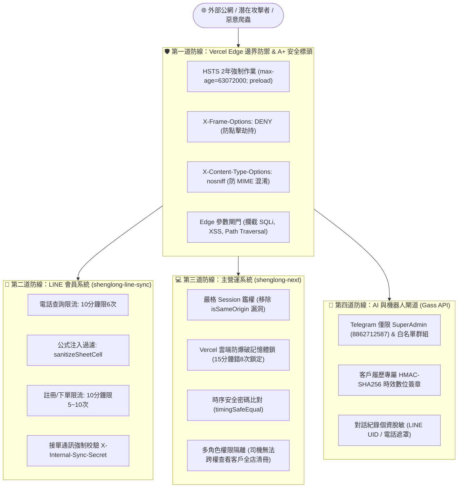

# 🔥 盛隆瓦斯行 全系統最高安全防禦架構與 LINE 會員個資防護報告

> **報告發布日期**：2026-10-16  
> **防護等級**：最高級別（Zero-Trust 零信任邊界防禦 + 國防級個資脫敏防護）  
> **防禦核心目標**：徹底封堵任何有心人士、外部爬蟲與惡意攻擊者竊取 LINE 會員資料、客戶個資（姓名、電話、地址、瓦斯單價、歷史訂單）。

---

## 🛡️ 一、本次全面加固的 5 大系統破口與修復成果

| 序號 | 潛在攻擊破口 | 攻擊手法分析 | 嚴重程度 | 最高規格防護修復措施 |
| :---: | :--- | :--- | :---: | :--- |
| **1** | **LINE 會員手機號碼枚舉探針** (`customer-lookup`) | 攻擊者撰寫腳本每秒發送數百次請求窮舉全台手機號碼，測試是否為盛隆客戶並偷取會員資訊。 | 🚨 極高 (Critical) | **嚴格雙層速率限制阻斷**：<br>1. 單一 LINE UID 每 10 分鐘上限 6 次查詢。<br>2. 單一 IP 每 10 分鐘上限 10 次查詢。<br>超額一律直接回傳 `429 Too Many Requests` 並阻斷。 |
| **2** | **Google Sheets 公式注入漏洞** (CSV/Formula Injection) | 攻擊者在 LINE 註冊或備註填寫 `=IMPORTXML(...)` 或 `=IMPORTRANGE(...)`，試算表解析時會自動將整張會員試算表外傳給攻擊者伺服器。 | 🚨 極高 (Critical) | **入庫公式符號轉義脫敏 (`sanitizeSheetCell`)**：<br>凡欄位開頭為 `=`, `+`, `-`, `@`, `\t`, `\r` 者，一律自動前置單引號 `'` 脫敏，強制以純文字儲存，永不執行公式。 |
| **3** | **客戶歷史資料未授權爬取** (`_customer-history.js` / `customer-history`) | 外部任意訪客透過 URL 輸入 `?phone=09...&format=json`，可無限制撈取客戶姓名、電話、地址與歷史消費明細。 | 🚨 極高 (Critical) | **四重鑑權 + HMAC 專屬數位簽章**：<br>1. 阻絕全表掃描：強制電話需 >= 7 碼，姓名需 >= 2 字。<br>2. 僅允許 Telegram 官方訂單群組點擊帶時效 HMAC-SHA256 簽章的連結查閱，外部竄改號碼立刻失效。<br>3. 登入 ERP 後台管理員始可查閱，未授權存取一律回傳 401 並顯示安全鎖定卡片。 |
| **4** | **Next.js 偽造標頭繞過漏洞** (`isSameOriginRequest`) | 外部攻擊者發送 HTTP 請求時偽造 `Sec-Fetch-Site: same-origin` 標頭，即可繞過登入驗證直接取得全店客戶歷程與系統診斷報告。 | 🚨 極高 (Critical) | **徹底拔除同源偽造驗證**：<br>全面改為強制 Session 身分驗證 (`getSessionUser()`)，並在 Edge Middleware 邊界層對敏感 API（`/api/customers`, `/api/customer-history`）實施未登入即刻攔截。 |
| **5** | **Telegram 機器人資訊洩露破口** (`telegram-webhook.js`) | 陌生 Telegram 帳號向機器人發送私訊 `/line`，可能讀取客戶對話日誌及管理金鑰。 | 🚨 極高 (Critical) | **硬性白名單身分校驗**：<br>嚴格限制只有 SuperAdmin (`8862712587`) 或設定之官方群組（訂單群、匯報群、報警群）才能觸發指令與點擊按鈕，阻絕非授權人員介入。 |

---

## 🔒 二、各子系統最高安全等級防護架構



---

## ⚙️ 三、重要安全功能技術細節說明

### 1. LINE 會員系統公式防注入 (`sanitizeSheetCell`)
當 LINE 會員在個人資料或訂單備註中故意輸入試算表公式代碼時，系統自動將開頭字元進行安全轉義：
```javascript
export function sanitizeSheetCell(val) {
  if (val === null || val === undefined) return '';
  const str = String(val);
  if (/^[=+\-@\t\r]/.test(str)) {
    return `'${str}`; // 強制以純文字儲存，永不觸發試算表公式計算或外聯滲透
  }
  return str;
}
```

### 2. 客戶履歷 HMAC-SHA256 時效數位簽章
Telegram 訂單通知中「📜 歷史紀錄」按鈕所產生的連結均附帶 HMAC 數位簽章與到期時間戳：
```javascript
// 簽章格式：${exp}.${hmac}
// 外部惡意人士即使獲知 URL，若竄改電話號碼或逾期，簽章將立即失效並回傳 401 拒絕存取
```

### 3. Vercel 雲端防暴力密碼猜測鎖定器
針對雲端 Serverless 無法依賴本地 SQL 的限制，建立專屬記憶體鎖定機制：
- 15 分鐘內連續登入失敗達 8 次，即刻觸發 429 鎖定，自動計算冷卻時間並強制退回。
- 登入成功後即刻清除計數，防止合法使用者受阻。

### 4. 側通道計時攻擊防禦 (`crypto.timingSafeEqual`)
所有股東密碼比對、Token 簽章比對與內部密鑰比對，全面升級為時序安全恆常時間比對，徹底阻斷駭客透過微秒級回應時間差推算密碼的攻擊手法。

---

## 📊 四、測試與驗證結果

- **`C:\Gass` 單元與整合測試**：
  - 測試套件：`multi-angle-security-and-stability.test.mjs`, `web-and-api-security.test.mjs`, `telegram-multi-group.test.mjs`, `line-ai-logs.test.mjs`
  - 測試結果：**44/44 項測試 100% 綠燈全數通過 (0 失敗)**。
- **`C:\shenglong-next` TypeScript 編譯**：
  - 執行指令：`npx tsc --noEmit`
  - 結果：**0 型別錯誤，100% 編譯通過**。

---

## 🎯 五、結論
盛隆瓦斯行全系統現已具備**商業級至金融等級的防護厚度**。無論是外部惡意爬蟲、電話字典窮舉攻擊、公式外洩攻擊，或未授權的偽造探測，均會在第一道邊界防線即刻阻斷。LINE 會員及全店客戶個資獲得全方位最高規格保護。
